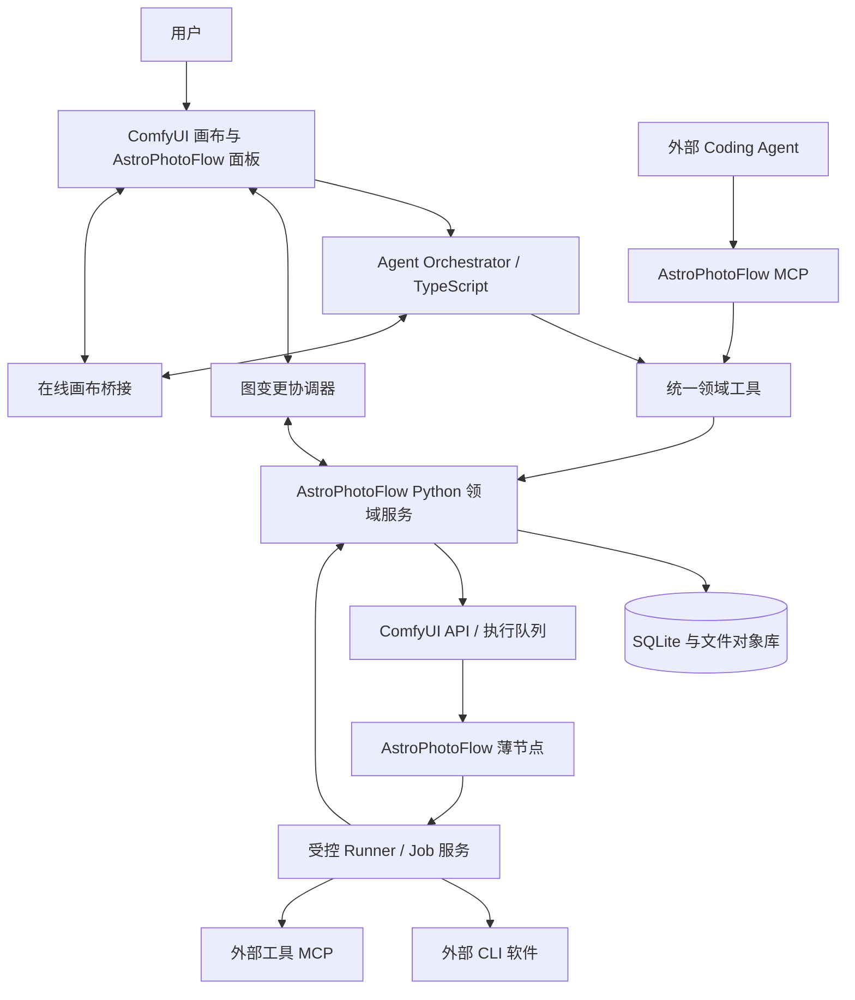

# 04｜技术架构与运行边界

## 1. 架构决策

采用 Extension 集成，不全面 Fork ComfyUI Desktop；保留 ComfyUI Frontend 和 Server 作为宿主。官方区分 Python 节点扩展和 JavaScript 前端扩展，可作为该结构的基础。[S13](08_调研来源与核验记录.md#s13)

一个产品可以包含多个进程，但只保留一个项目业务权威和一个图执行引擎。



图中的 Agent 到画布桥接只执行经过协调器授权的命令；不得成为绕过项目版本的旁路。

## 2. 模块职责与技术选择

| 模块 | 建议实现 | 边界 |
|---|---|---|
| 前端领域面板 | TypeScript；新增复杂界面可用 Vue 3 + Vite | 保留原生画布；既有 Agent JS 桥接不先整体重写 |
| Agent 编排 | 基于 artokun 的 Node.js／TypeScript 模块裁剪 | 负责模型会话和消息，不另建项目事实数据库 |
| 领域服务 | Python + FastAPI + Pydantic | 项目、版本、权限、任务、能力目录与记忆 |
| 持久化 | SQLite + 迁移机制 + 文件对象库 | 单进程控制业务写入；大文件不放进数据库 |
| ComfyUI 薄节点 | 官方 Custom Node API，版本化兼容层 | 接收引用与参数，调用 runner；不内嵌完整业务系统 |
| Runner | Python 任务管理 + 独立工具进程／MCP client | 唯一实际调用外部软件的受控路径 |
| 前端事件 | 带序号的 WebSocket／事件通道 | 断线能重放或重新拉取状态，不能仅靠短暂广播 |
| 测试 | Python 单元／契约测试、TS 单元测试、浏览器 E2E | 用真实宿主和真实工具验证，不只测 mock |

这是选型建议，不是上游强制要求。`comfyui-mcp` 的 TypeScript 构建及后端抽象可从源码核实。[S01](08_调研来源与核验记录.md#s01)

## 3. 进程与启动

首版在同一 WSL 环境中运行 ComfyUI、领域服务、Agent 编排和工具 runner；Windows 浏览器仅承担前端访问，避免第一阶段同时支持跨系统工具调用和路径转换。

由独立启动器管理启动顺序、健康检查、端口、认证令牌和关闭流程。浏览器关闭不自动终止正在运行的任务；显式“退出所有服务”时先提示未完成任务。服务重启后先核对残留进程和运行状态。

参考面板当前 Python 入口提供前端资源和发现／代理能力，不应继续沿用“Custom Node 导入时随意启动 npm 进程”的假设。[S02](08_调研来源与核验记录.md#s02)

所有服务默认仅本机绑定，验证 Origin 和会话身份，凭据不写入工作流或日志。localhost 不等于无需鉴权。WSL 网络可达性作为安装诊断项，不以开放到所有网卡作为默认修复。

## 4. 队列与执行链路

执行顺序固定为：

```text
确认工作流版本
→ 权限与依赖预检
→ 固定素材集合和输入版本
→ 生成编辑图与 API 图快照
→ 创建 run_id 和提交意图
→ POST /prompt
→ 保存 prompt_id 关联
→ 薄节点按 job 调用 runner
→ 采集实际日志和产物
→ 验证、登记、更新运行状态
```

ComfyUI 提供 `/prompt`、`/object_info`、`/queue`、`/history`、`/interrupt` 和 WebSocket 接口；这些是引擎接口，不是完整项目数据库。[S14](08_调研来源与核验记录.md#s14)

ComfyUI 队列负责图调度；领域服务记录任务并调度外部 job，不再实现第二套图调度器。首版默认同一 ComfyUI 实例串行处理受控运行，避免全局中断影响其他项目。

不能在持有数据库事务锁时等待整条 ComfyUI 工作流完成，否则节点回调领域服务时可能互相等待。提交、节点执行、结果登记都采用短事务和可恢复状态机。

### 原生按钮与其他提交入口

托管工作流的原生运行按钮、快捷键、Agent 执行和 MCP 执行都必须导向同一运行服务。无法拦截或验证的路径明确标为“非托管执行”，不能承诺完整追溯。

节点层同时校验服务签发的运行上下文。缺少有效运行授权的天文执行节点拒绝启动外部工具，不能仅依靠 UI 按钮隐藏来防旁路。

## 5. 原生缓存与输出节点：首版必须处理

ComfyUI 原生会缓存节点输出，并从输出节点反向判断所需执行节点。官方文档提供 `OUTPUT_NODE` 和 `IS_CHANGED` 等机制；因此“不开发额外缓存”不意味着每次都实际运行了工具。[S15](08_调研来源与核验记录.md#s15)

本项目首版采用以下策略：

- 科学处理操作默认不做跨 run 结果复用。编译执行图时为每个外部操作注入系统生成、参与缓存键的 `run_nonce`／运行上下文；它不混入用户科学参数。
- 节点生成层按锁定的节点 API 实现失效策略，不能只把 nonce 放在不参与缓存判断的元数据里。
- 显式结果登记／导出节点作为执行终点。没有可达输出的图在预检时阻断，避免“节点摆上画布但从未被执行”。
- 预览和元数据解析允许按素材内容散列及算法版本缓存；界面明确“复用已有结果”，不能登记成新的科学处理。
- 第三方节点的缓存行为未验证时，不纳入受托管科学主链路。

验收必须连续运行两次完全相同参数，证明策略与记录一致；也要测试文件内容改变但路径不变时不会读到旧结果。这里只确定语义，具体缓存钩子在 D0 原型中验证。

## 6. 取消、重试与崩溃恢复

运行状态建议：

```text
planned → awaiting_approval → queued → running
                                  ├→ succeeded
                                  ├→ failed
                                  ├→ cancel_requested → cancelled / cancellation_unconfirmed
                                  └→ reconcile_required
```

必须区分队列中删除、当前引擎中断、runner 终止进程组、工具内部取消。调用 `/interrupt` 之前验证当前任务属于目标 run；无法做到精确中断时拒绝误伤其他任务。[S14](08_调研来源与核验记录.md#s14)

提交给引擎后连接断开，可能出现“请求已经接受但尚未拿到 prompt_id”。先用提交意图、运行标识和引擎状态核对；不能盲目重试，不能承诺跨进程的严格 exactly-once。

重试保存 attempt，并按照操作的副作用和幂等声明决定是否需要用户确认。已生成但未登记的文件优先核对并补登记，而不是直接重新处理。

## 7. 安装与 Registry 边界

安装器与日常节点执行分开。节点执行期间不得临时下载并运行未知依赖；缺失依赖返回可理解错误，由环境管理入口处理。

官方 Registry 当前明确禁止节点运行期通过 subprocess 安装包，以及 `eval/exec` 和代码混淆。不能扩大解读成“所有外部 CLI 调用一律被禁止”，也不能通过改写 import 名称绕过扫描。若计划上架，按真实行为提交审核；独立 runner 不能自动保证通过。[S20](08_调研来源与核验记录.md#s20)

本地 Git 安装是首版交付方式之一；Registry 上架不是科学处理闭环的前置条件。

## 8. 仓库与上游管理

维持两个产品仓库：

| 仓库 | 起点 | 保存内容 |
|---|---|---|
| `AstroPhotoFlow-Extension` | 官方 Extension 模板生成自己的项目 | 前端、薄节点、领域服务、Agent 集成、适配 SDK、文档与测试 |
| `AstroPhotoFlow-Test` | 新建轻量测试仓库，不必 Fork ComfyUI | 版本锁、宿主初始化、测试工作流、素材清单、E2E 和诊断脚本 |

官方模板提供前端类型选项；用模板生成项目，而不是把模板仓库原样当产品 Fork。[S18](08_调研来源与核验记录.md#s18)

artokun 两个项目按固定提交维护上游镜像／Fork 或补丁来源，保留来源记录。它们是被管理的上游，不要求把所有参考仓库都变成运行依赖。需要修改 Agent 的业务写路径时维护清晰的补丁边界，不能依赖未验证的动态注入。

建议主仓库逻辑目录：

```text
AstroPhotoFlow-Extension/
  comfy_extension/        # 薄节点与 WEB_DIRECTORY 入口
  frontend/               # 领域面板、graph bridge 适配
  agent_bridge/           # TypeScript 编排集成与领域工具
  service/                # 项目业务与运行协调
  adapter_sdk/            # 能力清单、验证、runner 契约
  adapters/               # 首批适配器
  schemas/                # 跨语言接口定义
  tests/                  # 单元、契约、集成、E2E
  upstream/               # 来源锁、补丁说明，不放未授权代码
  docs/
```

这是建议布局。正式安装应将明确的 ComfyUI 扩展入口放入 `custom_nodes`，不能假定上述整个多进程仓库直接复制进去便能正确启动。

## 9. 兼容性边界

发行锁记录 ComfyUI、Frontend、Extension、Agent 上游、Python／Node、适配器、外部工具及星库版本。协议采用独立版本号；不把“最新版本”作为兼容性承诺。

只有扩展 API 无法满足已经验证的产品交互时，才提出局部 Frontend 补丁；记录原因、替代方案、维护成本和回退路径。独立 Desktop 包装以后单独评估，不改变本地业务服务的核心边界。
