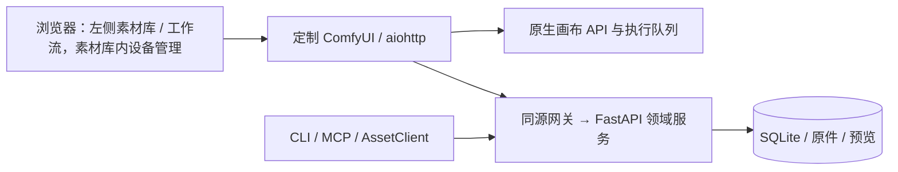

# 模块与数据流

AstroPhotoFlow 是基于 ComfyUI 源码定制的本地网页软件。产品采用原生前端与内部领域服务，网页入口统一，两个服务由工作台管理。

| 模块 | 职责 |
|---|---|
| `engine/ComfyUI` | 固定 ComfyUI 0.42.0 源码，核心启动直接注册业务网关 |
| `frontend` | 固定前端 1.57.1 的完整 Vue workspace、原生产品外壳和画布 |
| `src/astrophotoflow/frontend` | 已有素材与设置业务组件，由原生应用直接编译，共用 Vue/Pinia |
| `config` | 配置定位、TOML 解析、workspace 路径 |
| `backend` | FastAPI、SQLAlchemy/SQLite、导入、资产、组、设备、校准、预览、回收站与迁移 |
| `comfyui/proxy` | 原生网页服务的受限同源业务网关，不启动领域服务 |
| `client` / `client_domains` | HTTP 传输、错误与类型化领域操作 |
| `cli` / `agent_tools` / `mcp_server` | 工作台命令、结构化 CLI 和 58 个 stdio MCP 工具 |
| `workbench` / `vendor` | 固定源码与 CPU 环境、完整网页资源、进程生命周期 |

原生 hash 路由为 `#/library`、`#/workflows`，设备管理使用 `#/equipment`。默认素材库；画布首次访问初始化，随后保持挂载，切页保留图、草稿和视口。设置和素材表单沿用未保存保护。

网页经 `/astrophotoflow/api/v1` 网关访问内部 `/api/v1`。网关在服务端添加令牌，浏览器不持有领域服务令牌。CLI/MCP 使用同一 API，不直接写 SQLite。

产品不再安装 AstroPhotoFlow custom node，不再由扩展导入启动服务。引擎使用 `--front-end-root` 加载 workspace/web，并默认禁用外部 Custom Nodes 和 API 节点；图执行仍由 ComfyUI 完成。

原生 CPU runtime 使用独立的 native-web-0.1.0 目录。workspace 的数据库、原件、预览、ComfyUI 用户文件与网页资源分开管理；不会清理已有素材或改写固定版本。

导入与预览线程池由领域服务 lifespan 创建并排空。显式停止通过内部认证关闭入口请求领域服务退出，等待任务排空后清除进程记录；浏览器关闭不停止服务。

前端构建先于发行构建。构建脚本从受版本管理的引擎源码生成确定性归档，wheel/sdist 携带完整网页产物，安装不依赖源码目录和 Node。
