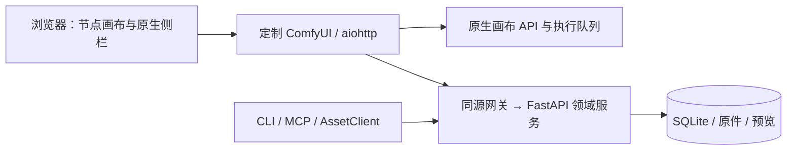

# 模块与数据流

AstroPhotoFlow 是基于 ComfyUI 源码定制的本地网页软件。产品采用原生前端与内部领域服务，网页入口统一，两个服务由工作台管理。

| 模块 | 职责 |
|---|---|
| `engine/ComfyUI` | 固定引擎源码，负责图调度与节点执行 |
| `frontend` | 完整原生 Vue workspace，共用一份前端锁文件 |
| `frontend/packages/astrophotoflow-ui` | 按模块组织的私有源码组件包，目前包含数据界面 |
| `frontend/src/platform/astrophotoflow` | 原生外壳、素材侧栏和公开挂载桥接 |
| `core` | 配置、进程、认证、数据库基础及迁移 |
| `modules/data` | 资产、集合、设备资料、导入、预览、校准引用及回收站 |
| `contracts` | 标准库与 Pydantic 构成的公共模型和纯校验器 |
| `interfaces` | HTTP 装配、CLI、客户端领域操作、58 个 MCP 工具 |
| `client.py` / `cli.py` | 保留公开客户端和命令模块入口 |
| `comfyui/proxy` / `vendor` | 固定同源网关与随包运行资源 |

完整落点、依赖和目标模块状态见[七模块导航](module-map.md)与[文件架构](repository-layout.md)。其余五个业务模块已有文档位置，不表示新增业务功能已经实现。

原生工作台使用 `#/workflows`，启动时打开素材库侧栏。左栏顺序为节点库、素材库、工作流；后两者作为原生 Vue 侧栏注册，和节点库共用分栏、宽度调整与收起行为。设备管理在素材库侧栏内打开，表单保留未保存保护。画布始终挂载。

网页经 `/astrophotoflow/api/v1` 网关访问内部 `/api/v1`。网关在服务端添加令牌，浏览器不持有领域服务令牌。CLI/MCP 使用同一 API，不直接写 SQLite。

产品不再安装 AstroPhotoFlow custom node，不再由扩展导入启动服务。引擎使用 `--front-end-root` 加载 workspace/web，并默认禁用外部 Custom Nodes 和 API 节点；图执行仍由 ComfyUI 完成。

原生 CPU runtime 使用独立的 native-web-0.1.0 目录。workspace 的数据库、原件、预览、ComfyUI 用户文件与网页资源分开管理；不会清理已有素材或改写固定版本。

导入与预览线程池由领域服务 lifespan 创建并排空。显式停止通过内部认证关闭入口请求领域服务退出，等待任务排空后清除进程记录；浏览器关闭不停止服务。

前端构建先于发行构建。构建脚本从受版本管理的引擎源码生成确定性归档，wheel/sdist 携带完整网页产物，安装不依赖源码目录和 Node。
