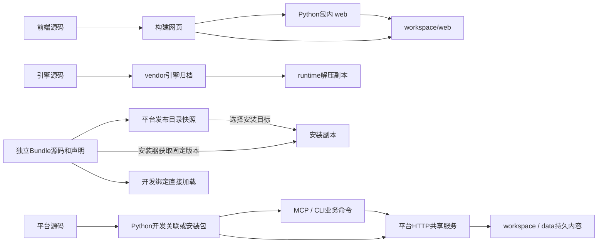

# 文件归属与读写关系

本页记录当前源码实际采用的文件来源、生成、复制、加载与缓存关系；模块职责见[架构](overview.md)，功能入口见[源码导航](module-map.md)，操作命令见[开发流程](../development/README.md)。生成文件不一律是缓存，`.artifacts`下的内容也不一律可删除。本文包含当前Feature的Siril归属清理待审候选，不表示这些改动已经进入dev、main或现有安装。

## 路径的含义

| 记号 | 实际含义与确定方式 |
|---|---|
| `R` | 当前平台源码仓库／Worktree根目录；下文未加其他前缀的路径均相对R |
| `P` | 当前Python进程导入的`astrophotoflow`包目录。editable开发安装指向`R/src/astrophotoflow`；普通wheel安装位于所选Python环境的`site-packages/astrophotoflow` |
| `W` | 用户workspace，等于选中平台`config.toml`的父目录；不等于Git Worktree。开发入口限定在`R/.artifacts/workspaces/<名称>` |
| `D` | 平台配置中的`storage.data_dir`；相对路径按W解析，默认模板为`W/data`，也可以是其他绝对目录 |
| `T` | `ASTROPHOTOFLOW_RUNTIME`指定的目录；未指定时Windows为`%LOCALAPPDATA%/AstroPhotoFlow/runtime/native-web-0.1.0`，其他系统为`~/.local/share/astrophotoflow/runtime/native-web-0.1.0` |
| `B` | 独立Bundle源码checkout，可位于`R/.artifacts/bundles/AstroPhotoFlow-Siril`，但由自己的Git仓库管理，不属于平台源码 |
| `C` | 开发包缓存根目录，开发入口按`--cache-dir`、`ASTROPHOTOFLOW_DEV_CACHE`、`R/.artifacts/cache`选择 |

开发入口默认把runtime放在`R/.artifacts/local-app-data/AstroPhotoFlow/runtime/native-web-0.1.0`，显式`--runtime-dir`可以选择本Worktree的另一个`.artifacts`子目录。因此不能只看到“runtime”字样就判断实际位置。路径规则来自[开发准备](../../scripts/dev_prepare.py)、[平台路径](../../src/astrophotoflow/core/workbench/paths.py)和[配置解析](../../src/astrophotoflow/core/config.py)。

## 源码、随包资源和受跟踪生成文件

这些内容归源码仓库。平台dev与main保留相同类别，分别记录开发与选定发布版本；Git分支不负责存储用户安装副本和缓存。

| 内容 | 归属／维护输入 | 谁写入、谁读取 |
|---|---|---|
| `src/astrophotoflow/core`、`contracts`、`modules`、`interfaces`及公开入口 | 平台Python源码，包含HTTP、MCP、CLI、通用Bundle SDK | 开发者修改；构建打包，所选Python环境从P加载。业务入口通过共享服务合作 |
| `frontend/packages/astrophotoflow-ui` | 平台私有业务UI源码，不单独安装或发布为应用 | 开发者修改；原生前端通过包导出消费，Vite一起编译 |
| `frontend/src/platform/astrophotoflow` | 平台与原生Store、画布及事件的桥接源码 | 开发者修改；原生前端编译、浏览器执行 |
| `frontend`其余上游workspace及`frontend/build` | 保留的原生前端与构建辅助源码 | 前端构建／开发服务器读取；`frontend/build`不是可清理的网页产物 |
| `engine/ComfyUI` | 固定上游引擎源码及平台集成修改 | `scripts/build_engine.py`读取；正常受管启动执行T中的解压副本，不直接执行此目录 |
| `pyproject.toml`、`setup.py`、`MANIFEST.in`、`uv.lock` | Python依赖、安装与打包输入 | uv／setuptools读取。`setup.py`也影响开发依赖指纹 |
| 根`package.json`、workspace配置；`frontend/package.json`、`frontend/pnpm-lock.yaml`及子包声明、patches | 根为任务入口，前端为实际依赖workspace及唯一前端锁文件 | pnpm读取；依赖安装位于frontend，不在根安装第二套前端依赖 |
| `tests`、前端测试、`scripts`、`.github`、文档、配置模板、`.agents/skills` | 源码仓库维护的验证／开发输入与说明 | 相应工具和Agent读取；不是用户运行数据。Skill安装到外部客户端后属于另一副本，仓库修改不会自动同步该副本 |
| `docs/api/openapi.json`、`vendor/http-routes.json` | 平台HTTP／contracts派生的受跟踪快照；vendor前缀相对P | `scripts/export_openapi.py`写入；前者供SDK生成／查询，后者由同源代理读取作为公开路由白名单 |
| `frontend/packages/astrophotoflow-ui/src/generated/api` | OpenAPI及同包`openapi-ts.config.ts`、`openapi-input.ts`派生的前端契约 | Hey API生成器写入；前端源码消费，不直接手改生成类型 |
| `src/astrophotoflow/interfaces/cli/generated.py`、`docs/api/mcp-tools.json` | 完整离线MCP工具目录派生的受跟踪生成物 | `scripts/generate_cli.py`同时生成；CLI运行读取前者，Agent／开发查询后者。生成不连接业务workspace |
| `src/astrophotoflow/core/database/alembic/versions/0001_baseline.py` | 数据模块ORM元数据派生的数据库基线 | `scripts/generate_database_baseline.py`用内存数据库生成；初始化数据库时读取，不是workspace数据库副本 |
| `docs/development/source-inventory.json` | 源码审计派生的清单 | `scripts/export_source_inventory.py`写入；仅供开发核对，产品运行不读取 |
| `P/vendor/comfyui-0.42.0.zip`、`comfyui-source.json`、`comfyui-frontend-LICENSE` | 引擎归档、来源清单、前端许可证，随Python包分发 | `scripts/build_engine.py`先在`.artifacts/build/engine`生成，再更新仓库vendor；runtime准备／校验读取。根`pnpm build`会执行该脚本，可能改动受跟踪资源 |
| `P/vendor/comfyui-0.42.0-windows-py312.lock` | 维护的固定引擎依赖清单 | runtime准备读取；不是安装环境，也不由普通runtime启动回写 |
| `P/vendor/bundle-catalog.json` | 从独立Bundle导出的固定发布目录快照，含声明、显示资料和参考文件 | `scripts/export_bundle_catalog.py`读取干净且HEAD与指定tag一致的B后写入；平台用于未安装能力展示和固定安装目标，不含Siril实际程序／适配器源码 |
| `B/adapter`、`tools`、`reference`、`locales/source.zh.json`、测试／文档／examples | Siril Bundle维护的实现、资料与专属验证 | Bundle开发者维护；本Bundle的生成器／适配器读取。平台不再单独维护三个旧`siril-1.4.4-*.json` |
| `B/operations`、`nodes`、`locales/en.json`、`locales/zh.json`、`bundle.json`及部分`reference`记录 | Bundle内受跟踪声明和资料；部分由生成器更新，不是平台缓存 | `python -m tools.build_catalog`读取recipes、资料、显示配置，写入这些目录，并更新`reference/coverage.json`、`assessments.json`；平台加载和导出目录时读取 |
| `B/app`、`licenses` | 独立Bundle携带的实际Siril程序／许可证 | Bundle仓库维护；安装或开发绑定后执行。声明生成不会重新构建Siril二进制 |

生成顺序由代码确定：HTTP契约→OpenAPI→前端SDK；MCP完整目录→生成CLI及工具快照；Bundle源码／资料→Bundle声明→明确导出的平台发布快照。Bundle开发生成不会自动更新平台vendor。生成器、schema和读写实现分别见[API入口](../api/README.md)、[引擎构建](../../scripts/build_engine.py)、[Bundle导出](../../scripts/export_bundle_catalog.py)和Bundle自身`tools/build_catalog.py`。

## 构建产物、安装副本与执行来源

| 位置／类别 | 谁生成或复制 | 谁读取／执行；如何重建 |
|---|---|---|
| `R/.artifacts/build/frontend` | 前端Vite生产构建，包含`index.html`、assets和`build-manifest.json` | workspace网页安装及Python打包读取；由前端源码重新构建。直接改这里不会改源码 |
| `R/.artifacts/build/engine` | 引擎构建脚本的归档暂存 | 构建脚本读取后写vendor；可从引擎源码重建 |
| `R/.artifacts/build/python` | setuptools构建暂存，包括`astrophotoflow/web` | Python打包读取；web来自上面的前端产物，可重新构建 |
| `R/.artifacts/dist` | Python打包产生wheel／sdist | pip／uv安装或外部交付读取；不提交Git，不是运行数据 |
| Python环境中的`site-packages`、`dist-info`、`Scripts/apf.exe`／`bin/apf`等 | pip／uv安装wheel，或uv开发安装 | 启动包装器选择该环境的Python和P。普通安装是源码及资源副本；editable只建立指向R/src的关联，不复制一份可编辑平台源码。依赖环境不是下载缓存 |
| `W/web` | `apf init`默认从`P/web`复制；开发准备通过显式前端产物目录复制 | ComfyUI的`--front-end-root`读取。安装函数复制文件并删除目标中源目录已不存在的文件；更新构建产物不会自动更新已复制的W/web |
| Vite开发页面 | `scripts/dev_frontend.py`明确选择W后，以前端源码启动Vite，并把后端地址指向该W的ComfyUI | 浏览器读取开发服务器输出；相关请求转发到所选ComfyUI，再进入平台接口。不写回W/web，也不替换打包网页 |
| `T/ComfyUI` | runtime准备校验P/vendor归档后解压，记录`.apf-native-build` | 受管启动执行这里的`main.py`；重新准备可能整体替换此副本，不能在这里维护引擎修改 |
| `T/comfyui-env`、`.apf-runtime.json` | runtime准备按固定清单安装CPU引擎依赖并写指纹回执 | ComfyUI使用独立Python；平台启动同时通过PYTHONPATH指定P的父目录以加载平台接入代码。环境可按锁重新准备，不能把runtime当素材目录 |
| `W/software/<id>/bundle` | 软件安装器clone并校验指定Bundle；经同目录`.bundle-install-*`暂存及`previous-bundle`回滚交换 | 未开发绑定时，从这里读程序、适配器、操作／节点／语言和参考文件；它是安装副本，不是开发源码。重装依赖原仓库／版本仍可取得 |
| 被开发绑定选中的B | `W/run/bundle-sources.json`记录根目录及生成所用Python，平台调用B的`development.json`指定模块 | **直接在B中生成并直接从B加载**，不先复制到安装目录。绑定存在但尚未就绪时报告未就绪，不静默采用安装副本 |

Python分发边界由[pyproject.toml](../../pyproject.toml)、[MANIFEST.in](../../MANIFEST.in)、[setup.py](../../setup.py)控制：wheel包含平台包、声明的资源及复制进去的构建网页；当前sdist另外携带前端源码、固定引擎源码、脚本／文档等，并携带构建网页以支持无Node的wheel重建。源码仓库内容、sdist内容、wheel内容不是同一集合；普通`python -m build`消费已有前端产物，显式完整构建入口才先重建前端。

## Workspace持久内容与运行记录

这些是用户／实例内容，不进平台Git，不因“可由程序写出”就算缓存。

| 位置 | 谁写、谁读 | 归属与删除边界 |
|---|---|---|
| `W/config.toml`；`~/.config/astrophotoflow/config.toml` | core配置及控制入口写入；服务、客户端读取。后者只记录默认workspace指针 | 平台实例配置与用户默认选择，均不是Codex的config.toml；不能按缓存清理 |
| `D/astrophotoflow.sqlite3`及SQLite伴随文件 | 平台数据服务通过共享服务和ORM读写；迁移工具维护schema | 用户元数据、固定版本和关系；MCP／CLI／网页不直接写SQLite。不可从源码重建 |
| `D/service.token`、数据库锁文件 | core创建／读取令牌，相关进程维护锁 | 服务访问凭据与并发状态，不是源码；在用时不得删除，令牌不出现在梳理报告中 |
| D中的受管原件及外部导入根目录 | data按storage_mode／storage_location解析；reference模式读取外部原件，managed模式读取D内副本 | 外部原件和受管原件都不是预览缓存。根目录由配置约束，不能因清理Feature而删除外部引用素材 |
| `D/upload-staging`、`D/exports` | 上传／导出服务写入并维护任务状态，导入／下载过程读取 | 任务暂存和待交付文件；不能在进行中的任务里当作包管理缓存删除 |
| `W/nodes/<definition_id>.json` | nodes公开能力保存自定义定义；Bundle原生目录装配会同步包声明 | 包含用户定义及Bundle节点的workspace副本；来源以definition.source区分。用户定义不是可丢弃缓存，包定义也不应手改来代替B的声明 |
| `W/comfyui-user/default/workflows`、`subgraphs`、`comfy.templates.json`等 | ComfyUI及原生前端保存／加载 | 原生图、模板和设置属于用户内容；平台不另外维护完整图副本库 |
| `W/comfyui-data`、`input`、`output`、`runs` | ComfyUI和平台按明确传入的路径写；软件调用写`runs/<prompt>/work/<call>`，调用记录在`calls`，已检查结果记录在`results`等目录 | 实例数据、执行输出与调用记录；可能有尚未另行保存的结果，不能统称临时缓存。`output/apf-siril`是现存输出路径名，归平台调用装配，不是Bundle源码 |
| `W/software/<id>/state.json`、`bundle-lock.json`、`native-load*.json` | software安装／维护写状态和固定版本，原生加载器写实际加载观察 | 安装状态及加载回执；开发加载观察和安装加载观察分开记录，不代替Bundle源文件 |
| `W/run/processes.json`、`control.json`、`bundle-sources.json`、`bundle-development/<id>.json` | core及Bundle开发入口／监听器写入；控制、配置客户端及原生加载读取 | 进程与采用配置、控制状态、开发绑定及生成回执；不是可任意删除的缓存。Bundle生成日志在W/logs |
| 浏览器原生草稿、客户端状态 | 原生前端通过localStorage等浏览器存储写／读 | 不位于R或W/web中；未保存草稿可能只有这一份。清浏览器存储会影响草稿，不能等同于删除可重建JS缓存 |

写入侧证据见[workspace准备](../../src/astrophotoflow/core/workbench/workspaces.py)、[服务启动](../../src/astrophotoflow/core/workbench/control.py)、[节点存储](../../src/astrophotoflow/modules/nodes/storage.py)、[Bundle安装](../../src/astrophotoflow/modules/software/packages/install.py)、[调用记录](../../src/astrophotoflow/modules/software/execution/records.py)和[原生草稿](../../frontend/src/platform/workflow/persistence/stores/workflowDraftStoreV2.ts)。

`W/context`等目录会在workspace准备时创建；目录存在本身不代表已有产品读写能力或可清理缓存。控制记录还包括重启回执和锁文件，统一由core控制入口管理。

## 缓存、工具环境与审计文件

| 位置／类别 | 写入者→读取者 | 能否重建／注意事项 |
|---|---|---|
| `C/uv`、`pnpm`、`pnpm-metadata`、`npm`、`toolchains` | uv／pnpm／bootstrap下载或存储→后续安装复用；pnpm-metadata由显式缓存配置时采用，其他默认缓存仍由工具管理 | 下载／包缓存，可重新获取；离线重建依赖现存缓存，不等于已安装环境 |
| `R/frontend/node_modules`及子workspace链接 | pnpm根据前端锁安装→前端工具／构建读取 | 已安装依赖和链接，不是源码，也不是全局包缓存；由固定安装入口重建，不跨Feature复用整套目录 |
| `R/.artifacts/venvs/dev`、`toolchains`、`managed-python`、`python-bin` | bootstrap／uv安装工具和开发依赖→开发命令执行 | 可准备重建的本地工具／环境；删除在用的Python或Node会中断本Feature，不是简单清下载缓存 |
| `T/uv-cache`、`T/python-bin`及uv管理的Python | runtime准备调用uv→依赖／Python安装复用；UV_CACHE_DIR存在时覆盖T/uv-cache默认位置 | runtime缓存与Python链接；受开发环境变量影响的安装根不能只按T推断 |
| `W/software/.release-cache/<id>/<仓库hash>` | Bundle版本发现／解析写`listing.json`、`repository.git`、`<commit>/header.json`、`metadata`、`snapshot.json`→选择安装目标时读取 | 远端声明／Git对象缓存，**不是已安装Bundle**；可重新获取，清除会失去上次离线目录与错误后的旧列表 |
| `W/software/.tools` | 缺少系统Git时平台安装固定MinGit→Bundle获取过程使用 | 下载来的运行工具，不是Siril源码；重建依赖网络与校验资源 |
| `D/previews`，尤其`<version>/media/<key>`及进程内MediaCache | data与预览装配写样本、瓦片、PNG等→显示读取；持有期间受保护，磁盘预算管理可淘汰非活动内容 | 派生显示缓存，可在原件可读时重建；不作为科学输入。数据库的预览记录与文件由对应服务维护，不手动删除活动文件 |
| `__pycache__`、`.ruff_cache`、pytest／Vite等工具缓存 | Python／检查器／构建器维护 | 可重建；Bundle适配器加载另以源码指纹管理进程内模块，不把旧字节码当源码事实 |
| 浏览器HTTP资源缓存、前端查询的内存缓存 | 浏览器／前端查询库存储服务返回的资源和查询结果→页面复用 | 派生数据，可重新请求；区别于上表中可能尚未保存的原生草稿。没有平台仓库内可统一指定的浏览器缓存路径 |
| `R/.artifacts/dev-dependencies.json`、`dev-prepare.json`及`logs/dev-prepare/<run_id>` | 开发准备入口写指纹、最新阶段回执及日志→后续准备／交接读取 | 环境判定及审计资料，不是产品源码；删回执不等于停止服务，也不等于清理安装环境 |
| `.artifacts/reports`、`verification`、各工具日志及W/logs | 检查／运行工具写→人和审计工具读取 | 一般不是产品输入，但属于验证和故障证据；不能用一份旧成功日志证明新安装或进程状态 |

`.artifacts`同时包含可重建产物、独立Bundle源码checkout、真实workspace和runtime；不能整体视为缓存。删除边界必须按具体子目录及归属判断，本页不授权清理任何现存内容。

## 四条实际读写链与配置选择

1. **平台／引擎**：所选Python环境决定P；受管启动的领域服务使用该Python，ComfyUI使用T/comfyui-env和T/ComfyUI，并通过PYTHONPATH读取同一P的接入代码。P源码、vendor归档、T解压副本是三个不同对象，不相互自动回写。editable源码可以被新导入读取，但既有进程的已导入代码不会因文件变化自动全部重载。
2. **前端**：生产路径是源码→构建目录→P/web或显式资源目录→W/web→浏览器；Vite路径是源码→开发服务器→浏览器，接口仍指向指定W。修改W/web、构建目录或浏览器缓存不会回写Vue源码。常规start要求W/web存在，但不自动从最新构建重新复制。
3. **MCP／CLI**：`apf mcp`启动P中的FastMCP；业务CLI通过同一Python的stdio MCP子进程→共享AssetClient→平台HTTP→所属服务读写数据。本机init／start／stop／runtime等CLI命令另走core控制入口，不经过业务MCP。MCP没有另一套平台源码、数据库或独立安装资源目录；外部客户端启动命令选择的是Python／apf安装位置，ASTROPHOTOFLOW_CONFIG选择的是数据workspace，两者可以不同，不能由其中一个推断另一个。
4. **Bundle**：平台固定目录来自P/vendor，开发覆盖目录可由ASTROPHOTOFLOW_BUNDLE_CATALOG显式指定；实际执行根目录按W的开发绑定优先，其次安装副本。开发生成器会写B，平台同时写W的生成回执／日志；实际加载器按源码指纹失效进程内模块。Bundle原生节点声明还会同步到W/nodes，这是另一份有明确写入者的workspace副本。

平台配置选择顺序是明确传入的配置路径→ASTROPHOTOFLOW_CONFIG→用户默认workspace指针。运行中的客户端优先读取W/run/processes.json中的采用配置，再读取令牌；MCP会话内共享的HTTP客户端在会话创建时建立，不因之后修改配置文件自动改换目标。实现见[客户端传输](../../src/astrophotoflow/interfaces/client/transport.py)、[MCP生命周期](../../src/astrophotoflow/interfaces/mcp/lifespan.py)、[本机CLI](../../src/astrophotoflow/interfaces/cli/local.py)、[网页安装](../../src/astrophotoflow/core/workbench/runtime.py)、[开发绑定](../../src/astrophotoflow/modules/software/development/bindings.py)、[开发生成](../../src/astrophotoflow/modules/software/development/builder.py)及[原生Bundle同步](../../src/astrophotoflow/interfaces/native/bundles/catalog.py)。

外部客户端的MCP注册配置（例如Codex的config.toml）由该客户端管理；平台的`apf mcp-config`只输出注册命令，不写全局注册。它与W/config.toml及用户默认workspace指针是三种不同配置文件。

本次核对的当前平台根为`C:/Users/Administrator/.codex/worktrees/693d/AstroPhotoFlow`；开发Python从该目录的`.artifacts/venvs/dev`启动，editable关联实际指向该目录的`src`。已有准备回执指向私有workspace`equipment-management-final`；回执只是准备记录，不据此宣称当前服务或外部MCP连接已经加载最新源码。独立Siril修改仍位于该根目录下的`.artifacts/bundles/AstroPhotoFlow-Siril`，没有复制进现有安装或写入固定发布tag。
