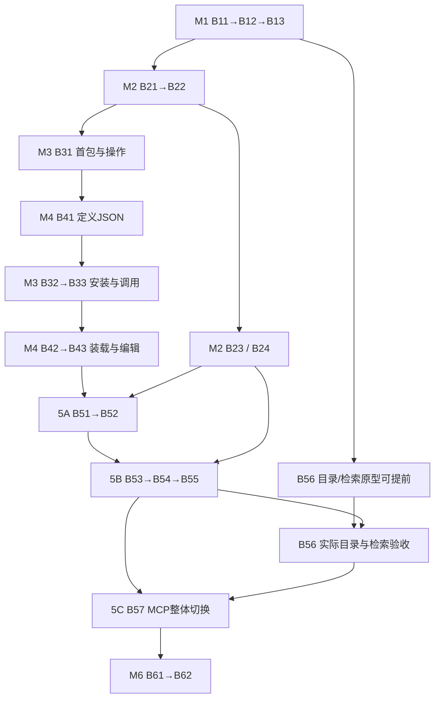

> 历史设计参考（2026-10-29退出现行计划）。签名、状态和任务顺序可能过时；不能直接据此实施。当前任务见 [当前计划](../../../development/implementation-plan.md)。

# 第⑤阶段近期实施计划

## 2026-10-29 Siril Bundle 实施增量

从 dev `366a3112` 在 `codex/siril-bundle` 实施四步：独立 Auto Stretch Bundle → 固定 Git 安装/通用节点加载 → 节点目录与授权画布编辑 → 隔离联调。此增量覆盖 B31/B32/B42/B52 的窄范围，不将 B43、B55、全量 B57 或整个 M3/M4/M5 标为完成。

首版 Bundle 已独立发布；主项目实现、编译和隔离联调结果分别维护在当前上下文与验证矩阵。端口、参数和执行绑定变化仍须完整影响确认，当前安装入口拒绝覆盖这些不同内容；仅名称/说明更正可在安装计划中确认更新；不宣称任意节点升级/端口重映射已验收。首版保持现有 Auto Stretch 定义身份、端口和参数。下一发布版修改定义须接续 B55，而非绕过此检查。

2026-10-29 最新 M3 状态覆盖：B31 首操作已锁定 Auto Stretch；B31／B32／B33 均有本轮实现候选，尚未执行新增测试或获 M3 用户批准。软件页精简为安装／卸载与红绿点，保留真实计划确认；仅移除程序的卸载提前到本轮。首个 Siril V3 节点为用户明确要求的窄接入，B42 通用加载、B43 编辑器及 M5 仍未整体交付。具体实现、边界及证据以[最新 M3 任务记录](batches/03-software.md)为准。


2026-10-28 用户追加素材入画布窄增量：在codex/m2-ui-acceptance实现单件／固定组按钮、拖放及已授权活动画布MCP／CLI加数据；复用②固定版本及原生节点／撤销／草稿，不实施整套B51／B52／B53，也不将这些整卡标完成。测试仅编写，编译及隔离预览资源更新证据见当前上下文与验证矩阵library-canvas，用户验收仍待完成。

状态：2026-10-28用户已确认M1通过测试并授权整体合入dev，已实施B11／B12／B13，依次位于`codex/workbench-config`、`codex/workbench-lifecycle`、`codex/workbench-settings-ui`；设计基线`9d4c729`已同步dev。当前在本地`demo`推进：B31原型、版本绑定命令目录及前端浏览候选进行中；B32计划／页面确认候选进行中；B41唯一节点JSON定义本地候选通过；B62有独立发行资源包装预检，但B62正式卡等待B61前置。B33、B42、B43及B51～B61共11个Batch尚未开工。M1的开发／自动验收和用户批准分别记录，最终候选及结果见[验证矩阵](../../../development/test-matrix.md#m1-foundation)。用户已选择“完成各模块近期范围”，保留22个Batch／分支，在复杂任务卡内按依赖拆小步、整卡完成后集成；M3／M4交叉实现，同轮分别人工批准。已有①②及原生能力复用，缺口按本计划补齐。具体结果见[验证矩阵](../../../development/test-matrix.md#b11-implementation)，不代表首个真实闭环已通过。

产品规则以[现行需求](../../../requirements/README.md)为准；接口、字段、公开签名和文件职责以[接口与文件级详细设计](../api/platform-contracts.md)为准。本文及任务卡只映射实施责任、顺序和验证，签名摘录不是第二套契约；发生不一致时停止受影响任务，修正契约后再继续，不让执行Agent自行猜协议。当前接口仍见[接口说明](../../../api/README.md)。

### 执行入口与状态

先读本页的依赖、验收门和环境约束，再只读取所属任务卡、卡内精确契约与指定源码；不要求每次通读所有设计。卡内N／M／R分别表示拟新增／修改已有／复用已有，均以本轮静态核对为基线，开工时重新核对。

| 任务卡 | Batch／建议分支数 | 当前可交付边界 |
|---|---|---|
| [M1 公共基础](batches/01-foundation.md) | B11～B13／3 | 配置、生命周期、配置界面 |
| [M2 数据](batches/02-data.md) | B21～B24／4 | 现有管理、科学输入、内容接纳和输出交接 |
| [M3 软件](batches/03-software.md) | B31～B33／3 | B31原型／查询／前端命令目录、B32计划确认链进行中；Siril 1.4.4 CLI |
| [M4 节点](batches/04-nodes.md) | B41～B43／3 | B41本地候选通过；真实装载和编辑器未开始 |
| [M5 工作流／执行／Agent](batches/05-workflows.md) | B51～B57／7 | 项目图、在线编辑、受控运行、结果、更新和精简MCP |
| [M6 集成与交付](batches/06-integration.md) | B61～B62／2 | B62目录/定义包装预检部分完成；正式B61→B62仍未开始 |

**M1三卡及验收修复已交付dev并获用户批准。** M2 B21～B24已在`38edd952`快进合入dev；自动验证、UI风格审计及独立功能验收通过，M2用户Milestone批准仍待完成。B31进行中、B32计划／页面确认候选进行中、B41本地候选通过；M6发行资源预检不改变B62对B61的前置，B33、B42、B43及B51～B61共11卡尚未开工。Batch集成与Milestone用户批准是两个独立状态。其余卡的Ready仍按各卡前置核对。开工Ready条件是：用户已确认总计划、具体前置Batch已集成、列明的用户选择已锁定、原型和测试环境可用，且本卡不存在尚待执行Agent决定的关键接口问题。需要先做原型的卡，先按卡内原型小步工作，原型未过不得开放其后业务入口。规则见[验收门](#acceptance-gates)。

## 1. 六个阶段及完成范围

M1～M6 是本计划的模块交付里程碑，区别于模块①～⑤和既有路线 S0～S6。M6 是近期集成验收，不是路线 S6 的完整产品交付。

| 阶段 | 集中交付 | 本阶段完成后 | 留到后续的明确交接 | 对应路线 |
|---|---|---|---|---|
| M1 公共基础 | workspace 配置、实际地址、启停重启、配置界面和维护准入 | ①近期公共入口可独立使用，①②现有繁忙事实接入 | ③软件与⑤运行出现后补真实繁忙参与者；精简 MCP 对外注册在 B57 | S1 |
| M2 数据与资产 | 现有素材管理成套核对、必要设备表单、科学输入、内容变化确认、结果检查登记和移除保护能力 | **②近期自身能力完成**，网页现有数据操作与新增内容确认可用；科学交接和结果登记可用真实文件验证 | 画布引用、实际运行来源、移除影响及运行中清理保护由 B51／B53／B54 联调；不提前宣称这些场景通过 | S2，S3／S4 的②侧 |
| M3 软件接入 | 首个固定包、网页确认安装、准备与许可、状态、准确操作、真实调用和停止观察 | ③能安装并调用首个真实软件；明确当前版本、位置、可用原因及取消能力 | 配套定义加载由B42；需真实图影响的更新／卸载公开链由B55；Agent入口由B57 | S2，S3／S4 的③侧 |
| M4 节点构建 | JSON 节点库、制作界面、端口参数、准确操作绑定、白名单实际加载、更新差异 | ④能保存定义并让原生节点库实际加载，跨项目复用；测试不是使用门槛 | 测试走 B53 同次运行；已有图实例的更新由 B55；在途保护在⑤运行落位后验收 | S3 的④侧 |
| M5 工作流／执行／Agent | 先完成项目图和在线编辑，再完成手动运行及结果，最后完成精简 MCP 和真实 Agent | 五模块形成同一业务链，M2～M4 的跨模块验收在本阶段关闭 | 完整产品远期能力继续留在 S6 | S3～S5 |
| M6 综合验收 | 独立隔离环境中的双入口、故障及既有功能回归，必要发行资源核对 | 首个真实闭环有候选、实际证据及明确限制 | 不代签跨软件、完整比较、记忆、Python／复合、Linux／WSL 等目标 | S1～S5 综合 |

每个模块同时交付其必要前端、后端、公开入口和相关测试。已有功能执行相称回归；新增功能才增加实现与必要测试。跨模块项保留在同一清单，不用单元替身或未接通的按钮提前销项。

## 2. 分支、接口及合入规则

- 建议共 **22 个分支**，均使用 `codex/` 前缀，目标分支为 `dev`。分支按可验收能力划分，包含必要的前后端、测试及文档，不再按 DTO／路由／组件拆出空壳分支。
- 实施起点必须是已包含本轮确认设计的可识别 `dev` 提交。当前未提交内容先保留；实际开工前核对基线及提交授权，本轮不提交、不推送、不切分支，也不操作 `main`。
- 表中依赖是**真实能力前置**。依赖合入最新 `dev` 后再开下游分支；独立分支可以并行。共享文件冲突按正常合并处理，不强推，不预设长期堆叠分支。
- `contracts`、应用装配、代理白名单和 UI 包公开导出随首次真实消费者一起修改。① `core` 不导入业务，业务通过 `public.py` 调用，接入层负责显式组合；不创建占位 API、通用容器、第二图副本或队列。
- 新 HTTP 行为落位时同步请求模型、具名客户端、同源代理、UI Zod、实际生成的 OpenAPI 和相关测试。②同进程科学解析不额外公开路径型 API；③软件调用不变成任意执行工具。
- 各分支验收范围在下文编号。V01～V18 和 E／P 测试标识均引用[既定验证设计](../api/platform-contracts.md#verification-design)；P 文件目前不存在，落位前不当作已可运行命令。
- 当前 58 个数据 MCP 工具持续工作到 B57 整体切换；期间可开发内部目录／客户端，但不发布旧新两套注册入口。B57 同步 Skill、操作参考、协议测试及客户端刷新要求。
- 一项验收的记录至少包含分支候选、预期／观察、测试或真实操作、结果及限制。模块自身通过与跨模块通过分开；原型失败保持阻塞，不静默换软件、输入保证、权限或执行范围。

<a id="m1"></a>

## 3. M1：公共基础设施

接口范围：[①行为](../api/platform-contracts.md#foundation)、[①签名与文件](../api/platform-contracts.md#foundation-design)。既有配置、认证、数据库和两个服务保留。

| 分支 | 实施与对接范围 | 前置 | 验收与测试 |
|---|---|---|---|
| B11 `codex/workbench-config` | `core/config.py`、`contracts/workbench.py`：默认定位、`get/save_configuration`、`load_running_settings`、保存值／有效值及实际端口交接。接现有配置解析，不建配置历史 | 设计基线 | A11-1～3；V01／02，E-FND |
| B12 `codex/workbench-lifecycle` | `core/workbench.py`、CLI、应用维护组合：结构化 `start/status/stop/restart`，最新进程／控制文件，端口自动选择与就绪后回写；② `data_busy` 接入既有导入／预览。新模块按实现补参与者 | B11 | A12-1～3；V01／02，E-FND／E-TRANSPORT |
| B13 `codex/workbench-settings-ui` | `GET/PATCH /settings/workbench`、具名客户端、`WorkbenchSettings.vue` 及宿主挂载：显示保存／有效配置、实际地址和需重启状态 | B11、B12 | A13-1～3；V02，P-BROWSER／E-BOUNDARY |

验收标准：

- **A11-1**：显式配置、环境和 `config.toml` 默认定位按契约解析；`Settings.workspace` 来自选定配置，非 `data_dir` 猜测；定向操作不改默认目标。
- **A11-2**：修改并发等启动配置后，保存值变化、运行有效值保持；下次成功重启才采用。旧配置校验值冲突不覆盖新保存；改默认位置不要求重启当前实例。
- **A11-3**：就绪后只回写实际端口／Origin，不覆盖同期修改的其他参数；写回失败报告真实在线和未保存原因，不二次启动。
- **A12-1**：W1 端口被测试程序占用、W2 在线时，W1 找到可用的两个端口且健康核对后返回实际地址；再次启动复用 W1，W2 不受影响。
- **A12-2**：导入／预览繁忙或无法确认空闲时拒绝重启并列原因；空闲检查到维护期间不接纳冲突任务；不安排稍后自动重启。③⑤接入后的补验由 B54／B55／B61 负责。
- **A12-3**：停止沿原排空，实际退出后释放端口和进程关联；启停断连先查询当前／最近结果。服务离线时本机 CLI 控制仍可用，不依赖在线 HTTP；MCP 同一能力在 B57 补真实协议验收。
- **A13-1**：网页读取当前 workspace 的配置，显示正在使用与待应用值；保存不自动重启、不换掉当前连接。
- **A13-2**：配置冲突、部分在线和未知原因可见；网页显示地址与实际服务一致，不把 PID 存在显示为就绪。
- **A13-3**：沿现有同源代理和认证；错误 `code/fields/request_id` 保留，组件不导入原生 Store，不创建第三个服务。

<a id="m2"></a>

## 4. M2：数据与资产管理

接口范围：[②行为](../api/platform-contracts.md#data)、[②签名与文件](../api/platform-contracts.md#data-design)。保留现有 16 个模型及 schema0009 的历史；本阶段不重写导入、版本、快照或回收站。

当前状态：B21～B24实现已由`38edd952`集成dev；M2用户Milestone批准尚待完成。依赖⑤的真实运行输入保护、工作流移除影响与结果选择在B51／B53／B54／B57联调。

| 分支 | 实施与对接范围 | 前置 | 验收与测试 |
|---|---|---|---|
| B21 `codex/data-library-completion` | 核对并贯通现有上传／授权目录、任务、项目、固定引用、集合、设备校准、预览及回收站；按已确认设计精简设备输入。实际观察缺口定点修复，不重建已有界面或重复测试 | B12；配置界面联调使用 B13 | A21-1～3；V03／04，E-DATA／E-PROTECT／E-BROWSER |
| B22 `codex/data-scientific-inputs` | `contracts/inputs.py`、`data/science_inputs.py` 与 `public.py`：`get_project`、`resolve_inputs`、`observe_reference_inputs`，固定科学引用、HDU、顺序、当前资料和两类保证 | B21 | A22-1～3；V04／13，P-DATA／E-DATA |
| B23 `codex/data-content-acceptance` | `observe/accept_asset_content`、`POST .../content-observation` 与 `/content-accept`、客户端及素材页确认；同一 Asset 新内部内容记录 | B22、B13（共用HTTP首次落位） | A23-1～3；V04，P-DATA／E-PROTECT |
| B24 `codex/data-output-and-protection` | `check_output`、`render_output_preview`、`register_output/get_output_registration`；②移除范围只读查询。沿既有任务登记，不提前复制移除写逻辑，不增加来源表或保护框架 | B22 | A24-1～4；V16／17，P-DATA／E-PROTECT；B53首次接活动输入保护，B54接结果保存，B57一次切换普通移除公开链 |

验收标准：

- **A21-1**：按钮单个／批量上传与授权根目录导入可用；成功、跳过、失败分开，同批重复跳过、独立导入新身份；中断恢复与失败重试沿现有任务／资产／快照规则。现有 HTTP／CLI／MCP 行为保持。
- **A21-2**：项目固定组 dv1 的成员和顺序不随 dv2 追加而变化；资料 revision、校准继承／null／覆盖、设备接收快照及历史删除保护保持。仅明确更新项目选择才采用新组。
- **A21-3**：相机单像元尺寸输入按设计写入现有 x/y 字段，未编辑则不改旧值；不要求原生位深、赤道仪和配件；望远镜含已约定光学信息，滤镜名称及可选带宽。现有设备类型和历史字段保留。
- **A22-1**：用真实合成 FITS 验单图、至少两成员固定组及明确 HDU，交接的是完整科学文件及原始成员顺序；错项目、缺失或不支持选择明确拒绝，不使用 JPEG 补位。
- **A22-2**：默认可复现模式实际固定所需字节，已有托管内容不重复复制；空间不足／内容准备失败不降为引用。显式仅引用记录前后观察和较弱保证，不虚称整个期间字节恒定。
- **A22-3**：解析采用当前纠正资料、revision 及该固定组有效校准，接收快照独立；返回成本和实际值供⑤保存。②不读取⑤ ORM、不向 MCP 泄漏内部路径；⑤排队后不重读资料的联调由 B53 验证。
- **A23-1**：外部替换文件先返回实际观察，确认后同 Asset 新建内容记录并增加 revision；旧版本、固定组、其他引用及旧运行不被修改，不承诺恢复被覆盖旧字节。
- **A23-2**：重复旧确认或资料并发返回契约冲突；观察后字节再变拒绝。保留人工资料，非人工文件观察按既有刷新规则处理；断连先读取核对。
- **A23-3**：网页可查看并确认变化；接受新内容不隐式改画布。用户选中节点的 `set_data` 和组显式更新在 B52 联调，不能只更新当前指针就声称全部引用已更新。
- **A24-1**：真实完整输出经 `check_output` 核对，预览只生成独立文件、不建资产；格式不支持或缩图失败给真实原因，科学原件散列保持。
- **A24-2**：明确选择的完整文件才能进入托管素材，名称可省略采用默认名；固定同一 `task_id` 后可查询已登记阶段，重复续查不新建资产。⑤输出定位和并发保存由 B54 验证。
- **A24-3**：移除交接明确素材／集合及版本范围，回收站既有活动任务、校准和共享路径保护保持；实际清理前继续复核。没有⑤真实影响消费者时不发布声称已支持工作流保护的新移除入口。
- **A24-4**：M2 用真实文件和②任务验证自身能力；活动输入同事务清理保护在 B53 首次受理运行时接线，工作流影响和图中缺失提示由 B51／B54 联调，不注入生产空回调来绕过依赖。

M2 完成后，②近期数据管理可以独立使用；偏好记忆、完整科学查看／比较、标签及完整文件治理不前移。运行预览属于⑤，素材显示预览仍属于②。

<a id="m3"></a>

## 5. M3：外部软件接入与环境

接口范围：[③行为](../api/platform-contracts.md#software)、[③定义与公开面](../api/platform-contracts.md#software-design)、[原生确认交接](../api/platform-contracts.md#native-design)。先由用户确定首软件／准确版本／真实操作及素材，不默认某个候选已经支持。

| 分支 | 实施与对接范围 | 前置 | 验收与测试 |
|---|---|---|---|
| B31 `codex/software-first-package` | 锁定维护清单、实际来源／版本和首操作，验证专用副本及受支持输入；实现 `list/get_package`、`get_operation/get_bundled_definitions`、当前状态文件和必要读取接口 | B12、B22；首包用户决策 | A31-1～3；V05／13，P-SOFTWARE |
| B32 `codex/software-install-confirmation` | 安装／准备、SoftwarePanel、具名客户端、当前pending动作；首次接通原生连接的confirm_software定向回包及真实按钮来源。安装组合使用④JSON保存能力，确认不需要活动图或Agent控制；卸载公开链等B55真实影响生产者 | B13、B31、B41 | A32-1～4；V05／06前置，P-SOFTWARE／P-HOST／P-BROWSER |
| B33 `codex/software-invocation` | `invoke_operation`、`inspect_operation`、`cancel_operation`、当前占用及维护互斥；用真实科学输入验证操作、实际日志／产物／退出／停止能力 | B22、B32 | A33-1～4；V13／15，P-SOFTWARE／P-INTEGRATION |

验收标准：

- **A31-1**：记录首包准确来源、版本、准备方式及实际操作；至少一份真实可读输入得到可检查产物。替身包只验证安装逻辑，不能作为首软件通过证据。
- **A31-2**：软件名称、当前版本、位置、状态及未就绪原因可查；清单外版本／任意下载 URL／安装脚本不进入接口；仅查询不安装、不登录或启动处理。
- **A31-3**：锁定操作输入输出、参数、单文件／有序集合、HDU 与实际取消能力；至少两成员证明集合是一次有序交接，不能误变成引擎逐成员隐式执行。未支持格式明确保留限制。
- **A32-1**：安装请求返回202和当前网页计划；确认前软件、定义和图均无变更。SoftwarePanel显示同一准确计划，真实确认才执行；Agent自填confirmed、打开链接或GET均无确认效力。卸载沿同一确认链，在B55具备真实影响后开放。
- **A32-2**：原生同连接可定向回包；按钮来源与连接能核对，旧动作／包状态变化拒绝。无活动图可安装；不为此授予画布写权、不新增确认 HTTP 或连接服务。B52 扩展该薄桥接，不再另建通道。
- **A32-3**：安装进度／最终状态来自实际操作，关页不取消已受理安装；失败保留实际安装及加载事实。不因软件已装把配套节点标为已加载；需要重启时先结束安装动作，再走①显式控制。
- **A32-4**：登录、验证码和许可由用户在软件或平台直接输入，Agent只获步骤及未就绪原因；卸载保留原件、自建定义和历史的规则由B55实际执行验收。B32不注入空图影响或提前发布半成品卸载路由。
- **A33-1**：在隔离目录经③公开入口真实调用，采用准确环境和完整科学文件，原件只读，只在指定运行工作目录写输出；不新增面向 MCP 的直接软件执行入口。
- **A33-2**：实际启动、阶段、退出和产物可观察；百分比无依据时为未知并给阶段／日志。非零退出、部分产物和断连不能报成功，状态查询不重跑操作。
- **A33-3**：定向取消返回请求事实与实际停止观察；不支持就说明，不误杀软件或其他任务。失联后核对 `active`，无法证明空闲时保持未知占用。
- **A33-4**：包维护与新调用互斥，繁忙拒绝且不自动排程；③当前句柄与⑤持久运行的综合占用在 B54／B55 接入后补验，不以空内存推断历史任务已停。

软件更新的准确影响预览、参数重置和已保存图写入在 B55 完成；M3 不使用空工作流列表伪装完整更新已经实现。安装后配套节点可用的产品出口，需要 B42 的真实加载共同通过。

<a id="m4"></a>

## 6. M4：节点构建与原生加载

接口范围：[④行为](../api/platform-contracts.md#nodes)、[④签名与文件](../api/platform-contracts.md#nodes-design)、[真实原生装载](../api/platform-contracts.md#native-design)。只实现标准软件操作节点；Python、复合及节点分发保持后续范围。

| 分支 | 实施与对接范围 | 前置 | 验收与测试 |
|---|---|---|---|
| B41 `codex/node-definitions` | `contracts/nodes.py`、JSON 定义读写／绑定检查及六个④公开函数；端口参数和执行映射内嵌。首次 HTTP／具名客户端随 B42 的真实 NodeDetails 生产者开放，不用假加载状态补位 | B31、B22 | A41-1～3；V07／08，P-NODES |
| B42 `codex/node-native-loading` | 一个白名单平台节点包、固定科学引用节点、由定义生成原生类及实际 registry 观察；③配套定义导入组合、`get_node_details`、首次节点 HTTP／具名客户端，返回真实加载就绪 | B41、B32、B33 | A42-1～3；V07／13，P-NODES／E-NATIVE／P-HOST |
| B43 `codex/node-editor` | 节点库／编辑器、常用与高级参数、绑定可读信息、保存和加载错误；更新差异及端口规则的纯计算。实例实际更新与测试入口由 B55／B53 接通 | B41、B42 | A43-1～3；V07／08，P-NODES／P-HOST／P-BROWSER |

验收标准：

- **A41-1**：workspace 节点定义按 JSON 保存并可读取，无项目草稿库、发布审批或旧版本仓库；输入名称各自唯一、输出名称各自唯一，绑定准确③操作，不硬编码测试素材或凭据。
- **A41-2**：保存成功与加载／就绪分别表达；测试不作为保存使用门槛。尚未接入⑤测试时不伪造最近测试／运行链接，也不发布空实现测试路由。
- **A41-3**：端口类型、参数默认值及省略／null／0 沿实际定义，未支持 Python／复合内容明确拒绝，不猜转换或另建代码执行环境。
- **A42-1**：冷启动仅加载平台白名单包，真实原生 registry 含当前类；registry 缺类、旧内容标记或查询失联分别为未加载／不匹配／未知，不能拿 JSON 文件校验值冒充实际加载事实。
- **A42-2**：③安装的配套节点和自定义软件操作节点可在原生节点库出现，缺软件／许可时可见且给未就绪原因；注册和添加实例不启动软件处理。
- **A42-3**：记录保存后刷新、重建或显式重启的实际条件。未证明热加载则采用明确流程；加载成功尚不等于受控科学调用成功，后者由 B53 验收。
- **A43-1**：前端能创建、查看、编辑并保存标准定义，常用／高级参数及固定值／映射可查，跨项目可使用同一定义；错误保留实际原因。
- **A43-2**：更新差异能判定自制节点参数全部用新默认；同方向同名同类型端口含重排保线，改名／改类型／删除断对应线，增加不自连；③配套节点仅变化参数重置，规则不混用。
- **A43-3**：旧内容的测试不能标为新内容通过；真实 `latest_node_test` 和在线测试动作在 B53 接入。B55 验已有图实例变化和在途保护，M4 不靠静态差异表提前关闭这些验收。

<a id="m5"></a>

## 7. M5：工作流、执行与 Agent 交互

分为三批：**5A 项目图与在线编辑（B51／B52）→ 5B 手动运行与跨模块闭环（B53～B55）→ 5C 能力发现与 Agent（B56／B57）**。B56 可较早准备目录／检索原型，B57 在真实业务可用后整体切换。

接口范围：[⑤行为](../api/platform-contracts.md#workflows)、[⑤文件与签名](../api/platform-contracts.md#workflows-design)、[原生交接](../api/platform-contracts.md#native-design)、[精简 MCP](../api/platform-contracts.md#mcp-design)。

| 分支 | 实施与对接范围 | 前置 | 验收与测试 |
|---|---|---|---|
| B51 `codex/workflow-native-files` | ⑤模型及既定0010迁移装配、项目图列表／读取、首次保存关联；原生 userdata 保存／改名／另存／删除钩子，最终文件 guard；唯一当前图仍为原生 JSON | B13、B21、B42；复用 B32 薄桥接 | A51-1～4；V09，P-WORKFLOWS／P-HOST／P-BROWSER |
| B52 `codex/workflow-online-editing` | 活动页面、`agent-context`、局部 `edits/save/replace`、素材拖入与 `set_data`、手改接管／明确交回、同序撤销、同 socket 定向命令。先用共享 HTTP／宿主验，不另注册临时 MCP 工具 | B23、B43、B51 | A52-1～4；V04／10／11，P-WORKFLOWS／P-HOST／P-BROWSER |
| B53 `codex/workflow-controlled-runs` | `submit_run/test_node`、RunDetail／查询／CLI 观察、固定快照和准备 Task、原生单次转换保存／最终入队范围检查、白名单执行桥接、③真实调用、目标范围和科学缓存；首次运行即接①忙闲及②活动输入清理保护 | B24、B33、B42、B52 | A53-1～5；V02／07／12／13／14／17，P-RUNS／P-HOST／P-DATA／P-INTEGRATION |
| B54 `codex/workflow-results-and-cancel` | 后端原生事件、get_run/cancel、实际停止、多轮预览、完整结果保存／反查；素材影响只读查询／内部测试、①完整busy及B53保护回归。普通移除公开切换归B57 | B24、B53 | A54-1～6；V02／14／15／16／17，P-RUNS／P-DATA／P-INTEGRATION／P-BROWSER；A54-5在B57关闭 |
| B55 `codex/workflow-package-node-updates` | 首次开放③更新／卸载及④自建节点更新的真实影响／确认组合，⑤find_definition_usage/preview_workflow_change/apply_workflow_change；含未打开图、草稿和部分失败，沿原生同一最终文件guard | B32、B43、B51、B54 | A55-1～4；V06／08，P-SOFTWARE／P-NODES／P-WORKFLOWS／P-HOST |
| B56 `codex/capability-catalog-search` | 由真实公开能力、节点定义和软件操作派生目录，按需完整定义，本地固定 embedding＋关键词 Top10 和显式降级；模型资源沿①固定资源机制 | B12 可起原型；完整目录验收依赖 B43、B52、B54 | A56-1～3；V18，P-WORKFLOWS／E-TRANSPORT |
| B57 `codex/mcp-three-entry-migration` | 三个顶层工具、原58项及新增固定映射；普通移除preview／DELETE新正文／Python及UI客户端／Skill同次切换，接①离线控制与⑤操作，验证真实外部客户端 | B55、B56；M1～M4 自身验收通过 | A57-1～4及A54-5；V01／17／18，E-TRANSPORT／P-INTEGRATION／P-BROWSER |

### 5A：项目图与在线编辑

- **A51-1**：①现有Base／Alembic明确装配⑤，schema.py目标常量与0010一致并同步迁移／发行清单／浏览器断言，不改0009历史；Workflow／WorkflowRun／WorkflowPreview沿详细设计落位，无第二份当前图、逐编辑版本库或服务端恢复草稿。
- **A51-2**：新图选项目后原生保存，实际持久 ID、路径与项目关联；另存获得独立图身份；改名更新关联；重开读同一原生文件。未保存新图先保存关联再交给 Agent，不新增临时图控制生命周期。
- **A51-3**：快捷保存、自动保存、另存／改名／删除均到真实最终文件钩子；实际文件已写而关联失败报告部分事实，未知先读取核对，不能假报回滚或重新覆盖。
- **A51-4**：缺依赖 JSON 可保留；删除图只清关联及专属预览，保留原件、已保存素材和运行记录。业务 UI 只消费包导出，原生 Store／文件操作留宿主。
- **A52-1**：两个网页／同名节点定位准确；用户在目标网页点击交给 Agent 后才允许该活动图写入；切图暂停旧图新写／新提交，读到的新画布不冒充原目标或自动重绑。
- **A52-2**：手动参数、节点、连线、布局或撤销使后续 Agent 旧写失效；查看／缩放／切页不接管。明确交回才恢复；同图允许状态跨客户端共享，已撤销状态不因重连／读取恢复。
- **A52-3**：局部操作返回实际新节点 ID 和逐项应用结果，部分失败不伪报整批回滚；整图只用于明确导入／替换。受支持节点使用原生编辑、撤销及序列化，不支持控件明确拒绝。
- **A52-4**：查询选材／拖入形成固定科学引用；内容接纳后只有明确 `set_data` 的节点换引用。断连草稿、命令迟到、响应丢失均先读实际状态，不重放；手动变化后 Agent 保持安静，下次交互读最新目标。

### 5B：真实运行、预览、保存及更新

- **A53-1**：按钮、快捷键、自动队列路径及 Agent 均进入同一受控运行能力；`beforeQueued → graphToPrompt → 原生保存` 各一次，准备完成再核当前图／控制后唯一提交。保存失败零入队，允许纯 UI 规范化差异，不另建序列化器或双保存。
- **A53-2**：异步长准备返回同次 run 的真实受理状态，不持数据库事务等待；同 run 同请求查询已有事实，不同内容冲突。中断后依据 run／prompt／实际调用查询，无法证明则未知，不再投递；原生 history 清除不删除持久事实。
- **A53-3**：整图及受支持目标包含必要依赖；一好一坏两个请求终点必须全拒且无入队，不静默缩小、不把所有处理节点设终点。连续同参实际重新科学处理，不能用无效元数据冒充缓存失效。
- **A53-4**：排队前固定图、已解析输入资料、节点和软件；执行从RunContext取该次输入，不再读取用户后来纠正资料。上游完整产物按本次实际连线交接，参数记录真实采用值；缺少托管上下文拒绝③调用，私有token不出现在图／历史／日志／MCP。首次准备／运行即纳入①维护、③④持久实现占用及②实际unlink前同事务活动输入复核，不能先开放运行再补保护。
- **A53-5**：可选节点测试使用明确测试图并走同次真实运行链，测试结果只关联被测定义内容；普通整图运行不冒充显式测试，修改后旧测试提示准确。测试失败不阻止节点保存。
- **A54-1**：无网页时已受理运行仍更新状态、日志和完成输出；A 后台结果归 A，切到 B 不串入同节点 ID、不抢视图。终态不被迟到进度倒退，原生事件观察失败不阻塞引擎。
- **A54-2**：A 执行、B 排队时定向取消 B 不误停 A；移队、引擎中断、工具请求和实际停止分别表达。超时／断连不等于停止；当前活动无法确认仍阻塞更新／重启，已证明无活动可释放占用而保留历史未知结果。
- **A54-3**：实际完成的图像节点／输出成员自动生成压缩预览；同一预览文件经原生显示和 HTTP／MCP 读取，不复制科学文件作预览、不扩大执行范围、不保存进度每帧；多轮预览重开仍可查，缩图失败单独报告。
- **A54-4**：用户选一个完整输出后才交②登记，未选不登记；名称可省略。先为该 OutputLocator 固定同一 task，再登记／续查／补关联；并发、断连及归位后中断不多建、不重算。旧预览或已清理输出不能冒充完整文件，保存素材能按版本反查真实运行。
- **A54-5**：B54完成真实图引用影响查询及内部测试；用户已确认新普通移除公开链在B57与MCP一次切换，本条公共场景由B57关闭：移除前列出真实图／节点，确认后保留节点提示重新选材，影响变化冲突。B53已接永久unlink同事务保护，B54复验取消／未知状态仍有效；保留原导入、预览、校准和共享路径规则，历史运行不无限占用原件。
- **A54-6**：①重启准入接入导入、预览、安装、准备／排队／运行和实际软件占用；维护与新运行／调用不互相穿过。完整重跑创建新运行，旧图／参数／状态／保存关联不改。
- **A55-1**：软件更新计划列准确包／定义／所有受影响图及参数变化；网页确认前零副作用，包／图／草稿／占用变化使旧计划失效，不自动排稍后更新。
- **A55-2**：软件包更新只将变化参数改新默认；自建节点更新所有实例参数用新默认。同方向同名同类型端口含重排保线，改名／类型／删除仅断对应线；新增不自连，软件缺失节点／卸载节点保留并说明。
- **A55-3**：修改已批准保存图沿 `apply_file_change` 和原生同一最终 guard；支持未打开图，不伪造活动页面、不直接旁写 JSON。新草稿／文件变化拒绝，逐图报告实际成功、失败或未知，不承诺跨文件原子回滚。
- **A55-4**：已固定 preparing／queued／运行及当前使用未知都阻止替换；软件、节点加载或图更新部分失败保留实际结果，历史运行不改。③维护完成后若需重启，先释放自身动作，再由①显式控制。

### 5C：能力目录与 Agent

- **A56-1**：目录区分可调用业务工具、节点定义和软件操作，来源／准确内容／就绪原因真实；后两者不能直接当通用执行工具调用。目录和检索索引可重建，不建作者、版权或能力身份管理体系。
- **A56-2**：已知能力或 Skill 直接读必要定义并调用；发现新能力才混合检索。中英文、准确术语、相似操作最多返回10候选，完整 Schema 按需读取；embedding 不可用明确关键词降级及原因，不隐式换模型或工具。
- **A56-3**：固定模型资源、后端和实际版本经原型锁定；记录硬件、数据规模、检索方式、时延和资源占用，不编造排名分数或性能门槛，不索引偏好／聊天／科学原件。
- **A57-1**：真实 stdio `tools/list` 恰为 `search_capabilities/get_capability/call_capability` 三入口；数据业务 ID 精确覆盖原58项，HTTP／CLI行为、结构化错误、图像 ImageContent 保持；无旧别名或双轨注册。
- **A57-2**：Skill、操作参考和配置说明使用实际已落位调用，客户端刷新／重连后读到新定义；本机 start/status 在在线业务客户端创建前可调用。业务调用固定映射到具名客户端，不接受任意 URL／方法／shell。
- **A57-3**：真实外部客户端在明确活动图完成选材、局部改图、保存、运行、看预览和选择保存；无网页时只查询工作流事实，②导入／③安装等非画布能力仍按自身规则可用。
- **A57-4**：拖图后安静，下次交互读取最新目标／同步／控制；换 Agent 沿同图当前允许状态接续，用户手改撤销后新客户端也不能写，明确交回后才继续。不新增客户端身份平台或内置推理循环。

<a id="m6"></a>

## 8. M6：综合验收与交付核对

| 分支 | 实施与对接范围 | 前置 | 验收与测试 |
|---|---|---|---|
| B61 `codex/first-loop-acceptance` | 汇总 P-INTEGRATION／P-BROWSER，隔离 workspace 验真实首软件、五模块双入口及具体故障；只修实际发现回归，不扩远期功能 | B57；M1～M5 验收记录齐全 | A61-1～4；V01～V18 近期部分及相关 E 回归 |
| B62 `codex/first-loop-delivery-check` | 变更相关的类型／依赖边界／生产构建与既有发行资源回归，必要仓库外安装验证；回写接口事实、当前上下文、矩阵和运行说明 | B61 | A62-1～3；E-BOUNDARY／E-DELIVERY |

- **A61-1**：网页手动和真实 MCP 客户端各自走通“固定素材 → 标准节点 → 原生图 → 实际外部软件 → 自动预览 → 用户选择完整结果入库”；原件散列不变，图／输入／参数／软件／输出来源可以核对。CPU 演示图不代替科学软件。
- **A61-2**：多页切换、用户接管、保存失败、提交后断连、重复请求、实际取消、history 清除、重启核对、部分输出及登记失败均有预期与实际结果；未知不假报失败或成功，不自动重跑。
- **A61-3**：数据导入、固定组、设备快照、校准、预览与回收站既有行为回归；①重启和③④更新与真实⑤占用共同验收，所有后置跨模块项关闭或明确阻塞，不以早期模块通过代签。
- **A61-4**：正常 dev 数据不作写入素材。使用新隔离 workspace、合成或明确可用测试素材；配置／端口／令牌仅定位该实例，不改默认指针或 MCP 全局注册。验收后停止隔离实例，正常 dev 按原状态保留。
- **A62-1**：Python、私有 UI、相关原生测试、类型检查、依赖边界和生产构建按变更范围通过；新增 P 文件已实际落位并执行，不能仅列测试名视为通过。
- **A62-2**：白名单节点包、薄适配、完整网页及资源进入既有构建／发行链，按已有 wheel 仓库外安装和无 Node 的 sdist 重建流程做相关回归；不新增打包体系，不把本轮核对扩称完整 Windows 升级恢复交付。
- **A62-3**：实际 API／OpenAPI／代理／客户端／Skill／文档一致，当前状态和证据回写；记录候选提交及脏差异、全部实际版本、输入散列、run／prompt／call／输出定位和限制。用户业务体验单独核对，未验 Linux／WSL、视频及其他软件不计通过。

## 9. 依赖、并行与共享文件



图为阶段主链，精确依赖以分支表为准：B31 在 B12＋B22 后即可开始，无须等 B23／B24；B41 的JSON定义能力在 B31＋B22 后先合入，再由 B32 安装真实配套定义，B33 验证调用，B42 完成实际引擎加载。这是M3／M4的必要交叉前置，不用软件模块内的第二套定义写入代替。B21／B31／B56 可按各自前置推进，不把阶段编号理解为所有上游远期工作必须完成。

| 共享位置 | 首次落位与后续接入 | 并行约束 |
|---|---|---|
| `contracts`、代理、AssetClient、OpenAPI、应用装配及 UI 包根导出 | B11／B13 起随实际模块增量加入 | 同一轮按领域顺序合入，后者基于最新 dev；不让各分支整体重写或复制前者模型 |
| 原生 `api/server` 及唯一 `workflowBridge` 接缝 | B32 先完成真实软件确认；B51 文件、B52 编辑、B53 提交、B54 事件随后扩展 | 不在 B32 创建⑤空操作，不另建连接；涉及相同原生文件的部分串行合入，其他领域实现可并行 |
| ⑤模型／0010迁移和 `public.py` | B51 统一迁移归属，B52～B55 增量接实际能力 | 不并行发明第二份0010或重复运行表，不修改已合入迁移历史；确需后续 schema 变化另走实际迁移 |
| 原生 registry 与节点包 | B42 建真实装载，B53 接受控执行，B55 接维护替换 | 不新增第二包或多版并存框架；替换前核真实准备／运行占用 |
| 58工具、Skill 与客户端协议 | B57 一次切换 | 先通过业务集合和真实协议验证，再整体更换；失败修复同一迁移，不提供兼容双轨 |

模块阶段的后置验收负责人固定：**②输入／所选保存／永久清理→B53／B54；普通素材移除公开链→B57；③④图更新／卸载→B55；①运行出现即B53接忙闲，完整占用和离线MCP→B54／B57；全链→B61**。验收前保留待联调状态，不通过复制业务权威绕开依赖。

## 10. 必须先验证的原型

原型放在负责分支的前置工作中，失败就阻塞其后续实施，不额外建长期试验平台。以下覆盖[既定原型门槛](../api/platform-contracts.md#native-design)，不是新架构选择。

| 编号／负责分支 | 需要实际证明 | 阻塞出口 |
|---|---|---|
| G01 B11／B12 | 默认定位、运行采用值、双服务实际绑定及安全回写，服务离线仍可本机控制 | M1 公共联调 |
| G02 B31／B33 | 首软件准确来源／版本／操作、真实科学输入输出、有序集合、日志及停止观察 | 首软件可用；不能用替身进入真实闭环 |
| G03 B32 | 软件页准确计划、真实确认来源、同 socket 定向结果、无活动图也可确认；伪造确认无效 | 安装／卸载双入口 |
| G04 B42 | 白名单实际类注册、当前定义内容标记、缺类／旧类／未知及所需刷新或重启 | 节点可加载，热加载不提前承诺 |
| G05 B51 | 首次保存项目关联，所有原生文件操作最终 guard，写成但关联失败的真实核对 | 项目当前图保存 |
| G06 B52／B53 | 目标页面和真实交回来源、迟到／断连控制；同 socket 处理提交时仍能接嵌套 prepare 结果，不自锁 | 在线编辑、人工与 Agent 提交 |
| G07 B53 | 动态控件一次准备／转换／保存，最终 validate 后的入队范围，受控软件调用上下文及科学缓存真实失效 | 真实整图／受支持目标运行 |
| G08 B54 | 无网页事件更新、定向取消与实际停止、多输出缩图／跨图归属、文件检查及同任务补登记 | 关闭网页继续运行、预览与所选结果 |
| G09 B55 | 已批准闭图维护仍走同一最终文件检查；草稿冲突、逐图结果及在途保护 | 软件／自制节点更新 |
| G10 B56／B57 | 固定本地模型混合检索及降级；固定 SDK／真实客户端三入口、58业务、图像回传及接续 | 完整 Agent 入口 |

## 11. 验收执行与证据

每个分支先跑直接受影响的既有测试和已落位的新测试；通过后只有新失败、原型或联调需要才扩大。测试文件归属沿[E／P 清单](../api/platform-contracts.md#verification-design)，不为每个分支再新增一套框架。

| 近期契约断言 | 主要分支 | 责任出口 |
|---|---|---|
| V01 实际启动／复用 | B11／B12／B57 | M1本机，M5真实MCP |
| V02 配置／维护 | B11～B13／B53～B55 | M1基本，M5首次运行及实际占用 |
| V03 导入／任务 | B21／B57 | M2业务保持，M5协议迁移 |
| V04 固定引用／内容接纳 | B22／B23／B52／B53 | M2自身，M5画布及运行采用 |
| V05 软件安装／确认 | B31／B32／B42／B57 | M3准备，M4节点，M5Agent |
| V06 软件更新／卸载 | B32确认链前置／B55公开组合 | M5完整图影响和实际维护；M3不代签 |
| V07 节点保存／测试 | B41～B43／B53 | M4定义／加载，M5真实测试 |
| V08 节点确认更新 | B43／B55 | M4差异规则，M5实例更新 |
| V09 原生文件 | B51／B54 | M5项目关联与预览清理 |
| V10 页面／控制 | B52／B57 | M5网页及真实客户端 |
| V11 部分应用／未知 | B52／B57 | M5真实桥接与协议 |
| V12 单次准备保存提交 | B53 | M5全部托管入口 |
| V13 范围／保证／科学执行 | B22／B33／B42／B53 | M5完整真实运行 |
| V14 重复／未知／持久事实 | B53／B54 | M5同次运行查询及重跑 |
| V15 取消／停止 | B33／B54 | M3软件观察，M5引擎组合 |
| V16 多轮预览 | B24／B54／B57 | M5网页／HTTP／MCP |
| V17 所选保存／移除 | B24／B51／B53／B54／B57 | M5真实来源及清理保护；普通移除公开链B57一次切换 |
| V18 目录／MCP／Skill | B56／B57 | M5真实协议及客户端 |

分支可用的现有验证入口见[开发流程](../../../development/README.md)。相关实现落位后，按范围使用 `uv run --locked --no-sync pytest <实际测试路径> -q`、`pnpm test`、`pnpm typecheck`、`uv run --locked --no-sync pnpm check:boundaries`、相关原生 Vitest 及 `pnpm build`。根 `pnpm test:browser` 当前只运行已有 `native-web.mjs`，不能当作新增 `platform-workflows.mjs` 已执行；新文件落位后才明确运行并记录对应命令。仓库外安装及无 Node 验证沿既有发行脚本。

验收统一写入 `.artifacts/implementation/<分支名或阶段>/`，[验证矩阵](../../../development/test-matrix.md)只登记实际候选和证据；本轮计划检查单独进入 `.artifacts/implementation-plan`。隔离 workspace 及真实版本／输入基线在首包任务确定，配置不改全局默认，不修改正常 dev 数据；性能门槛根据固定环境实际测量后确定，不自行填数。

## 12. 尚待用户决策与保留范围

| 事项 | 何时决定 | 未确认时的边界 |
|---|---|---|
| 首软件、准确版本／来源、一个科学操作及测试素材 | B31 开工前，给出候选的安装条件、操作范围和代价，由用户选择 | 不假设 Siril／ASTAP／PixInsight 已选，不建空适配；M1及②独立能力可先推进 |
| 本地检索模型和实际后端 | B56 先比较符合既定本地固定资源要求的候选；有资源／依赖取舍时给用户选择 | 不自动替代模型，不扩大到 Agent 推理；不可用按已确认规则显式关键词降级 |
| 目标转换、真实取消、缩图及装载方式的实际支持范围 | G02／G04／G07／G08 以原型结果锁定；需要改变产品行为时再询问用户 | 技术验证失败不静默减少用户范围、降低保证或声称支持 |

已确认的 JSON／SQLite 分工、同原生连接、白名单包、网页软件确认、新图先保存、同图共享当前控制、两类输入保证、节点更新和用户选择完整结果保存均直接沿用，不重新选择。

S6 继续保留：跨软件、完整科学查看／比较、偏好历史及本地背景、标签／完整文件治理、固定结果显式续跑、Python／复合节点与完整安装升级恢复。节点导出安装、Judge实际接入另行规划；Linux／WSL 独立验证。本计划不把这些内容加入近期分支，也不因某个 V 子场景通过而将完整 FR／AT 标记完成。

<a id="acceptance-gates"></a>

## 13. Batch集成、用户验收与Git推进

**I(Bxx)**只表示该Batch实现、相关自动验证和未参与实现者的独立审查通过，所需改动已在授权范围合入dev，并在实际集成候选上完成直接受影响的回归。没有差异的核对任务绑定既有候选和证据，不制造空commit／PR。

**A(Mn)**表示用户在明确候选上实际操作，反馈纠偏与受影响复验完成后，明确批准该里程碑的已列范围。材料齐全、Agent复核或CI通过都不能代替用户批准。两种状态只在现有当前上下文／验证矩阵摘要中记录，不建立审批数据库或另一份进度系统。

| 人工门 | 操作前技术条件与自身验收范围 | 必须等待该批准的后续Batch |
|---|---|---|
| M1 | I(B11～B13)、G01；本机／网页配置和现有②忙闲。③⑤占用、MCP协议仍后置 | B57 |
| M2 | I(B21～B24)，真实文件／②任务；画布、来源和运行保护仍由M5补验 | B57 |
| M3／M4 | B31→B41→B32→B33→B42→B43技术集成，G02～G04；同轮操作但分别批准软件与节点自身范围，更新／真实节点测试仍后置 | B57；不以M3批准阻塞其B41技术前置 |
| M5 | I(B51～B57)，A(M1～M4)，G05～G10及全部后置联调；真实手动与Agent闭环 | B61 |
| M6 | I(B61)、I(B62)，A(M1～M5)，综合／发行与限制齐全后最终批准 | 本轮“已验收”结论及明确依赖它的后续交付 |

其余Batch按表中技术依赖推进，不把M编号变成额外串行审批。尤其不把A(M5)列为B57前置，也不在B61与B62间增加M6批准门。每个Milestone均经过：**开发 → 自动验证 → 独立审查 → 用户操作 → 反馈纠偏 → 受影响复验 → 用户批准 → 阶段完成**。

Git推进只采用现有工具：

1. 用户确认计划后，核对既有提交／推送／PR／合并授权，把确认设计纳入可识别dev基点；不为清洁工作树而reset、restore或丢弃用户内容。本轮不执行这一步。
2. 前置已集成后，从其所在最新dev完整SHA创建对应`codex/`分支。每卡可有数个有序逻辑提交；B53／B54的小步不拆新分支，整卡验证后集成。只暂存任务路径。
3. 在同一候选上跑卡内测试、实际原型和独立代码审查。发现问题最小修复并复验；保留原失败，不用换分支／审查者清掉未解决问题。原型失败阻塞实际依赖者，独立任务可以继续。
4. 已获授权才推送／创建目标为dev的PR；说明行为、前置基点、实际验证和后置项。合并前核最终HEAD、最新dev、检查、未解决发现、实际远端政策及授权；未经授权不自动合并、推送、删分支或归档worktree，不强推、不改main。
5. 共享文件由当期卡负责人串行集成，后者纳入最新dev后窄解冲突，重新生成OpenAPI等派生文件并复测。集成SHA上的相关回归通过才记I(Bxx)；旧候选测试不能直接冒充新合并候选通过。

只有真实并行且文件不冲突时才使用独立worktree；不一次创建22棵树。worktree不会带入未提交设计，也不隔离用户级runtime。各候选使用自己的源码定位、环境与`.artifacts`，不能用指向原checkout的editable环境证明另一工作树。不要并发清理同一pytest basetemp或覆盖同一构建输出。

根CI只覆盖其实际命令：Python、私有UI、构建及发行验证；原生Vitest、浏览器和`uv run --locked --no-sync pnpm check:boundaries`按卡明确执行。`frontend/.github`内的上游配置不等于根仓库CI已运行。远端保护规则到真实PR时核实，不在本轮发明审批人数或自动化平台。

<a id="validation-environment"></a>

## 14. 原型与人工验收的实际环境

本节是未来执行流程，**本轮未停止服务、初始化workspace、更新runtime或运行任何业务测试**。用户已选择维护窗口；不增加VM、runtime管理器或第二套安装机制。tmp_path单元／静态检查不需要停dev，只有真实原生验收涉及共享资源时进入窗口。

1. **先证明可以恢复原dev**：记录并保留原实例的workspace／配置、实际入口及解释器、可运行源码或安装制品、网页、固定runtime归档／manifest／`.apf-native-build`和启动命令。只记录PID、端口或Git SHA不够；原editable目标若已变，先保留原可运行版本。不能靠升级正常dev数据库解决恢复，尤其B51候选schema0010仅用于隔离库。
2. **再停共享使用者**：核对所有使用该`native-web-0.1.0`的真实实例，按各自原版本入口排空停止；未知占用先核对。没有可恢复原版本或未停清共享使用者时，停止窗口准备，不执行覆盖共享引擎的普通init。
3. **核候选资源后初始化隔离库**：候选使用自己的工作树／Python环境，不能重指原dev editable。记录候选引擎归档SHA、实际加载路径／marker与网页产物。现有`--reuse-runtime`会核manifest、archive digest、marker相等和解释器存在；失配清楚失败，不自动去掉选项重试。普通init可能重解压共享引擎，必须在本窗口内按实际候选准备。
4. **只在测试workspace写入**：W1／W2建议为`.artifacts/workspaces/implementation-qa-W1`与`implementation-qa-W2`，使用合成或已明确可用素材。init不激活全局默认；CLI／MCP用进程级`ASTROPHOTOFLOW_CONFIG`，不改全局注册。真实地址以start／status回执为准。
5. **验后恢复**：停止实际启动的测试实例、核端口与占用释放；恢复保留的原版本资源并用原入口／原配置恢复dev原运行状态，核健康与地址。保留原件、令牌和数据库；不把未知停止或失败恢复记成完成。

候选初始化／启动示例只在以上条件满足、相应卡已实现后运行；workspace不存在时才初始化，不把每次验收都变成安装：

```powershell
$env:UV_PROJECT_ENVIRONMENT = "$PWD/.artifacts/venvs/dev"
uv run --locked --no-sync apf init --workspace .artifacts/workspaces/implementation-qa-W1 --service-port 32590 --comfyui-port 32588 --frontend-assets .artifacts/build/frontend --no-activate
uv run --locked --no-sync apf start --workspace .artifacts/workspaces/implementation-qa-W1
uv run --locked --no-sync apf status --workspace .artifacts/workspaces/implementation-qa-W1
```

已核实候选runtime相符且只同步网页时，init才显式加`--reuse-runtime`。W2如需并行验证使用32688／32690，冲突测试仍读取实际回执。把实际网页Origin设为`APF_WEB_URL`后运行当前卡浏览器用例；新P-BROWSER落位后显式`node tests/browser/platform-workflows.mjs`，旧`pnpm test:browser`只覆盖native-web.mjs。不每卡重复安装浏览器；当前已固定Node／pnpm／uv／依赖锁继续使用。

首包G02必须先锁准确来源／发行版／准备条件／操作／真实科学输入及可核验产物；模型G10先锁实际资源／后端／查询集。不得由快速执行Agent临时换软件、挑新依赖或猜科学预期。原型只证明其实际格式／操作／控件范围，失败涉及产品变化时再请用户选择。

性能只随相应操作记录，不新建benchmark框架：B12冷／热启动，B21导入与首预览，B52命令确认／重连，B54真实预览／日志／峰值内存，B56模型／索引／检索，B61汇总固定环境、规模、指标及限制。数值门槛未实测确定时标待验，不能自行编造。

人工验收材料由负责卡提供可复现入口／输入、按序操作、预期结果和用户重点观察；[M6卡中的六阶段操作表](batches/06-integration.md#manual-acceptance)统一维护操作清单。实际记录只需候选SHA或diff指纹、版本／输入散列、操作与预期／实际、命令exit code或用户观察、日志／截图、失败复现、限制和用户批准。写入`.artifacts/implementation/Bxx/`或相应M目录，矩阵只存摘要；不保存凭据正文或新增证据数据库。

反馈只有三类：Bug按原责任修复并回归；需求偏离按已确认设计纠正；需求变更先由用户确认并更新需求／设计／计划。未获批准的Milestone保持待验收。

## 15. 本轮审查的删并与必要补全

| 处置 | 具体调整及依据 | 功能影响／代价 |
|---|---|---|
| KEEP | 22 Batch／原分支名、原生保存／转换／队列／撤销、五模块及G01～G10／V01～V18 | 不重建计划或引擎；复杂卡内部小步，保持必要的首次运行保护 |
| SIMPLIFY | 六份按M分组的任务卡，不建22份文件、第二份字段契约或进度台账；核对无差异不造空PR | 卡内精确引用原④，只摘关键签名；需要同步签名的地方静态复核 |
| MERGE | 已有HTTP请求／错误处理移至计划内core文件，业务客户端复用；活动输入保护只由B53首次接线，B54补真实状态回归 | 消除core→data反向依赖和重复实现；不创建transport文件、manager或通用参与者框架 |
| SIMPLIFY | 节点JSON public先B41，真实NodeDetails和首次HTTP随B42；运行旧方案恢复复用get_run.workflow和原生明确替换 | 避免假loaded／空latest_test生产者；不新增恢复API、历史对象或图副本 |
| SIMPLIFY | 普通移除公开链及客户端／MCP在B57一次切换，B54只交内部影响查询／测试；软件卸载随B55真实图影响落位 | 避免提前改正文弄断旧58工具，不新增过渡工具、兼容分支或空影响放行 |
| AUTO补漏 | B11显式Settings.workspace构造点；B12当前采用地址消费者；B51现schema版本常量／迁移测试；②编辑期只读范围交接及具名客户端／业务ID补回原④ | 都有真实调用缺口；不新增物理表、依赖或任意执行协议 |
| DELETE／DEFER | 不新增逐编辑历史、来源／回执／保护表、第二队列、通用RPC／权限／版权体系；首包和模型未定不造空适配 | 已确认近期能力仍保留；S6内容维持后续范围 |

用户五项取舍及替代方案记录在[ADR-0061](../../../../frontend/docs/adr/WORKBENCH-PLAN-0061-executable-batches-and-shared-client.md)。审查报告、决策依据和独立复验进入`.artifacts/implementation-plan-review`。这次完成仅能表示计划已可供确认，不能表示任何Batch已实施、原型已过或Milestone获用户功能批准。
