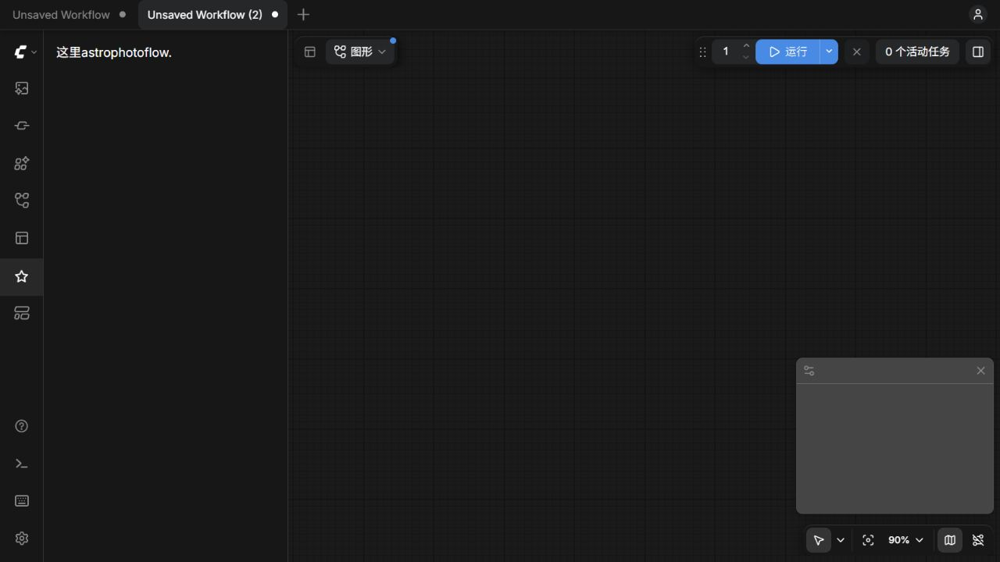
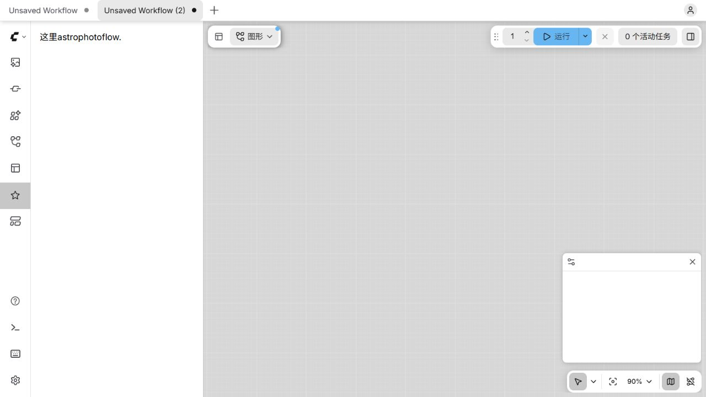
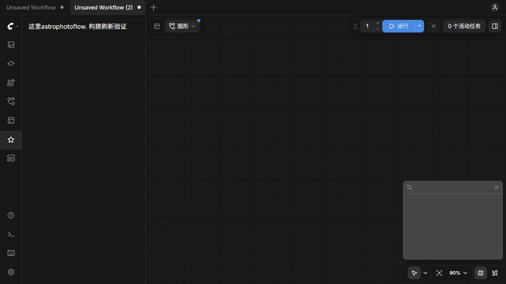

# AstroPhotoFlow Sidebar Smoke Test

**Date:** 2026-10-22

**Result:** Passed

Scope: independent Python Extension entry, native ComfyUI sidebar registration, bundled Vue panel, layout-only CSS, and build/reload behavior. No database, astronomy operation, MCP, or Agent implementation is included.

## Environment

- ComfyUI `0.42.0`
- ComfyUI Frontend `1.57.1`
- Python `3.12.13`, CPU PyTorch `2.14.1+cpu`
- Node `22.22.2`, pnpm `11.13.1`
- Vue `3.5.44`, TypeScript `6.0.3`, Vite `8.3.5`, Vue plugin `6.0.10`
- Tailwind CSS and its Vite plugin `4.3.2`, vue-tsc `3.3.11`
- Extension loaded through `custom_nodes/ComfyUI-AstroPhotoFlow`
- Host `.venv/pyvenv.cfg` records uv `0.11.11`, isolated Python `3.12.13`

## Build and integration checks

Run from the repository root with the Node 22.22.2 directory on `PATH`:

```bash
npm exec --yes --package=pnpm@11.13.1 -- pnpm --dir frontend install --frozen-lockfile
npm exec --yes --package=pnpm@11.13.1 -- pnpm --dir frontend typecheck
npm exec --yes --package=pnpm@11.13.1 -- pnpm --dir frontend build
bash -n scripts/link-comfyui.sh
```

All checks passed. The production build emitted fixed `web/astrophotoflow.js` and `web/astrophotoflow.css` files. JavaScript retains the external `../../scripts/app.js` import and bundles Vue. CSS contains only `.m-0` and `.p-4` layout rules, with no global reset, font/color declarations, or host theme variable definitions.

Python import verification confirmed both node mappings are empty and `WEB_DIRECTORY` resolves to the root build directory. Re-running the link script against the existing symlink returned exit code 1 and preserved its original target.

The idle CPU host was restarted during final verification. Its startup log recorded loading `custom_nodes/ComfyUI-AstroPhotoFlow`; `/extensions` listed exactly one AstroPhotoFlow module. The served JavaScript and CSS bytes matched the local build. `/system_stats` confirmed Frontend `1.57.1` and CPU PyTorch.

## Browser checks

| Check | Observed result |
|---|---|
| Native button | Exactly one `[data-testid="astrophotoflow-tab-button"]`; native `side-bar-button` styling and `pi pi-star` icon; accessible tooltip label `AstroPhotoFlow`; registered title `天文` |
| Vue content | Clicking opens a panel with the exact text `这里astrophotoflow.` |
| Lifecycle | Three close/reopen cycles retain one button and one rendered message |
| Dark theme | White panel text on host background `rgb(23, 23, 24)` |
| Light theme | Black panel text on white host background |
| Typography | Both themes use the host body font `Inter, Arial, sans-serif` at `16px`; layout padding is `16px` |
| Stylesheet | The AstroPhotoFlow stylesheet is present in `document.styleSheets` before panel verification |
| Watch and refresh | Changing the message to `这里astrophotoflow. 构建刷新验证` triggered a successful watch build; browser refresh showed the changed text |
| Restore and rebuild | The exact final message was restored, watch rebuilt it, and a final production build passed |
| Host restart and repeated refresh | The restored panel remains available, exactly one button is registered, and a fresh stable page load produced no console errors |

The build watcher was intentionally terminated after the restored build completed. Its termination can produce an npm lifecycle exit message; the observed watch rebuilds and the final production build succeeded.

While the host was deliberately stopped, the already-open page logged host Jobs API fetch failures. After the host restarted, a fresh load had no new console errors. Existing host deprecation/layout warnings are separate from the Extension. The original dark theme was restored, and the existing workflow was preserved while verification used a separate blank workflow tab.

## Screenshots

Final dark theme:



Light theme:



Temporary text change used to verify watch build and refresh:



## Review and delivery

The baseline is `39a8bee4c85c8a9b38f2bf9356cd5234f3cebed2`. Two independent read-only reviewers examined the frozen product sources for correctness/lifecycle/CSS and host integration/build/documentation. Both reported no confirmed blocking product-code defects and independently passed type checking and shell syntax checking. Runtime evidence above was gathered separately against the actual Frontend `1.57.1` host.

The final PR records its exact candidate commit, parallel review confirmation, screening decision, and delivery status. The repository has no active CI workflow in the baseline; local checks are reported as local checks, not CI results. The existing Cookiecutter template and requirements baseline remain intact.
