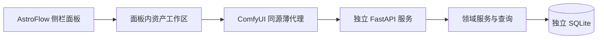

# AstroPhotoFlow 第一阶段技术与接口设计

**更新日期：2026-10-22；关联任务：T01；状态：第一阶段实现及验收完成，第二阶段未开始。**

本文是资产管理第一阶段的技术与接口实施依据。第一阶段代码在 `feature/database` 实现；实现和验收证据见[第一阶段交付与验收记录](第一阶段交付与验收记录.md)。本文列出的设计细节需与实际实现共同阅读；未列为已验证的后续能力仍未实现。

上位计划为[开发计划](开发计划.md)及[资产管理三阶段实施计划](资产管理三阶段实施计划.md)。[数据库与图像资产管理实施计划](数据库与图像资产管理实施计划.md)保留完整资产模块的后续需求；其中 A0–A7 不是本阶段的执行清单。本阶段范围、共享资产模型、API 和停止线以本文为准。

**分支约束：**本阶段及后续两个资产管理阶段统一在 Git 分支 `feature/database` 上开发，实现 worktree 必须检出该分支。该名称不是源码目录，`service/` 等目录约定不变。第一阶段验收完成后仅保留阶段成果并停止，不合并到 `dev`；只有三个阶段全部完成、各阶段验收及必要的集成回归通过、无未解决阻断性问题后，才具备合并到 `dev` 的条件。实际合并按用户后续指令执行。

可复制到实现 worktree 的指令见[第一阶段执行 Prompt](第一阶段执行Prompt.md)。

## 一、目标、业务边界与停止范围

### 1. 第一阶段目标

建立 AstroPhotoFlow 天文资产管理的整体框架，使以下链路真实连通：

> AstroFlow 侧栏内工作区 → ComfyUI 同源代理 → FastAPI 领域服务 → 独立 SQLite 数据库。

本阶段交付项目、设备及拍摄配置的实际管理能力；本机共享天文资产库、校准素材库及项目资产的只读查询；独立数据库、迁移、访问凭据、接口契约和错误处理；在 AstroFlow 侧栏面板内提供接近官方 Assets 布局与交互的资产工作区。

资产库在未导入素材时保持真实空库。第一阶段自身不提供任何入库途径，资产查询的非空场景通过隔离测试数据库验证。

### 2. 已确认的业务规则

| 业务对象 | 规则 |
|---|---|
| 共享资产库 | 本机单用户跨项目共享，不表示互联网公开 |
| 共享素材 | 原始素材、校准素材及用户明确发布的成品可进入共享库；入库与发布属于后续阶段 |
| 项目资产 | 项目使用共享素材的指定版本；处理中间产物归属项目 |
| 项目 | 代表一个处理目标或作品，可包含多晚、多批次和不同设备组合 |
| 相机 | 每台具体设备独立建档；同型号相机允许拥有不同 ID |
| 成像系统 | 表示镜筒／镜头及减焦、增焦配置，不仅记录裸镜筒 |
| 有效焦距 | 用户直接填写，不根据倍率或说明自动推算 |
| 拍摄配置 | 同时关联设备并保存拍摄参数默认值 |
| 校准分类 | Bias、Dark、Flat、Dark Flat；分别区分原始单帧与 Master |
| 历史事实 | 配置修改只改变默认值，不追写历史资产与运行的实际参数 |
| 成品共享 | 后续由用户手动发布选定版本，并保留项目来源 |

上述共享模型取代此前“所有资产必须属于某个项目”的设计。

### 3. 本期读写边界

| 对象 | 本期允许 | 本期不允许 |
|---|---|---|
| 项目 | 创建、读取、编辑、归档、恢复 | 物理删除 |
| 设备 | 创建、读取、编辑、停用、恢复 | 改变设备类型、物理删除 |
| 拍摄配置 | 创建、读取、编辑、停用、恢复 | 物理删除、回写历史科学参数 |
| 项目与拍摄配置关联 | 随项目创建或编辑设置关联集合 | 将关联解释为处理顺序 |
| 共享资产、校准素材 | 查询资产及已保存的当前版本记录 | 导入、修改、删除、发布 |
| 项目资产 | 查询已存在的具体版本引用 | 选入素材、移除引用、跟随最新版 |

设备和拍摄配置的“停用”统一以 `status=archived` 表示。归档不会删除记录或使既有引用失效。

### 4. 必须停止的位置

完成以下条件后，第一阶段结束：

1. 工作区、代理、服务和数据库真实连通。
2. 项目、设备及拍摄配置形成可持久化的管理闭环。
3. 共享／项目资产查询正确，空列表与错误状态可区分。
4. 配置并发修改受到 `revision` 保护。
5. 初始化、显式迁移、必要备份及接口文档完成。
6. 本阶段新增行为的测试和交付记录完成。

**到此停止，不自动实施：**

- 文件导入、复制、扫描和批量索引。
- BLAKE3 计算或科学文件完整性检查。
- 项目选入素材、移除资产引用或成品发布。
- FITS、RAW、XISF、视频、NPY／NPZ 解析。
- 图像预览、视频逐帧读取、数组切片。
- 校准素材自动匹配、校准、配准或叠加。
- 后台资产任务表、处理队列或 runner。
- 软件 Node、MCP、Agent。
- 生产库演示资产、模拟处理结果或虚构执行状态。

不得以“后续会用到”为由预建上述模块、空接口或后台进程。未通过本阶段验收时，仅修复本阶段问题；验收通过并完成交付记录后，等待下一阶段指令。

第一阶段通过不表示整个资产模块完成。成果保留在 `feature/database`，不得以本阶段验收通过为由合并到 `dev`，也不得为了尽快合并而自动开始第二、第三阶段。

## 二、架构、运行与界面

### 1. 技术组成

| 层 | 选型 |
|---|---|
| 前端 | Vue 3、TypeScript、Vite、Tailwind 4、Pinia、Zod |
| HTTP 服务 | 独立 FastAPI、Pydantic |
| 数据访问 | SQLAlchemy 2 同步 ORM |
| 数据迁移 | Alembic |
| 数据库 | 独立 SQLite，启用外键和 WAL |
| Python 环境 | uv，独立服务依赖及锁文件 |
| 浏览器连接 | ComfyUI 扩展提供同源薄代理 |
| 内容散列 | BLAKE3；本阶段仅确定字段契约，不执行计算 |

ComfyUI 扩展不导入领域服务的 ORM、迁移或科学文件处理依赖，也不负责启动领域服务进程。本阶段不因未来的散列、解析或预览能力安装相应处理依赖。

### 2. 调用路径与职责



FastAPI 是唯一业务入口。代理只处理路径与方法白名单、来源检查、转发、凭据和连接错误，不维护第二份业务状态。前端 Pinia 保存工作区、请求和草稿状态，不能替代服务的持久化事实。

沿用现有根目录模板及扩展入口，服务项目放在 `service/`。实现时按实际职责组织配置／启动、数据库／迁移、模型／契约、业务／查询、路由和测试；不要求为单次使用预建通用仓储或插件框架。

### 3. 工作区结构

在已有 AstroFlow 侧栏面板中直接展示 AstroPhotoFlow 工作区，不打开模态框、独立窗口或页面。左侧提供五个 AstroPhotoFlow 模块入口：素材库、节点仓库、可安装软件、Agent 聊天、设置；每个入口在同一面板中显示自己的区域。素材库连接本机共享天文资产查询，设置包含项目、设备及拍摄设置管理；节点仓库、可安装软件和 Agent 聊天仅显示未接入提示，不实现对应功能。校准素材属于资产库用途筛选，不独占入口。保留画布及宿主主题。

| 区域 | 内容 |
|---|---|
| 模块导航 | 素材库、节点仓库、可安装软件、Agent 聊天、设置；按钮在 AstroPhotoFlow 面板内切换，不触发宿主页面跳转 |
| 素材库区域 | 展示本机共享资产及筛选 |
| 设置区域 | 项目、设备和拍摄设置在同一区域内切换 |
| 预留区域 | 节点仓库、可安装软件、Agent 聊天显示明确的未接入状态 |
| 顶部工具区 | 导入入口、搜索、筛选、刷新、网格／列表切换 |
| 主内容区 | 资产列表、项目列表或配置管理 |
| 详情区 | 选中记录的信息；未实现的资产预览明确不可用 |

配置页面提供实际创建、编辑、归档／恢复表单。项目详情可显示关联配置及项目已引用的资产版本；本期没有添加素材按钮或可用的引用修改入口。资产卡片可用文件信息占位布局，但不得以示例图片冒充真实缩略图。

界面约束：

- 点击五个 AstroPhotoFlow 模块按钮只切换同一侧栏面板区域，不创建窗口或触发宿主页面跳转。
- 未接入的节点仓库、软件安装和 Agent 聊天区域明确显示未接入状态，不展示虚构数据、进度或操作。
- 工作区随宿主侧栏挂载和卸载；关闭／切换宿主侧栏时由 ComfyUI 管理其生命周期。
- 切换内部视图或放弃编辑表单时，有未保存修改必须提示；用户取消时保留当前视图及草稿。
- 不拦截宿主键盘行为；输入控件保留正常键盘操作。
- 字体与颜色继承宿主；扩展样式限定在自己的界面范围。
- 不导入官方私有 Store，也不直接绑定官方资产数据库。
- 列表切换、搜索、筛选和分页对应真实请求；只读资产操作由能力控制为不可用。
- 不将接口错误、认证错误或响应校验失败转为空列表。

### 4. 界面请求状态

| 状态 | 显示及操作 |
|---|---|
| 加载中 | 显示真实请求状态，不填充假资产 |
| 成功且有数据 | 展示实际记录、总数及分页 |
| 成功且为空 | 显示当前范围没有记录；筛选结果为空与共享库未入库可通过当前筛选条件辨认 |
| 未配置／服务不可用／超时 | 显示对应原因及刷新入口 |
| 认证失败 | 显示后端凭据异常，不要求浏览器输入服务令牌 |
| 响应契约不符 | 显示响应校验失败，不使用部分猜测结果 |
| 保存冲突 | 保留草稿，提示记录已变化，允许用户重新读取后决定是否放弃或再次编辑 |

读取健康及能力后决定可用操作。切换查询条件后，已过期请求的结果不能覆盖当前视图。写请求失败不显示保存成功，也不自动重试。

### 5. 本机配置

两个进程读取同一份 `~/.config/astrophotoflow/config.toml`：

```toml
[server]
host = "127.0.0.1"
port = 8190

[storage]
data_dir = "~/.local/share/astrophotoflow"

[comfyui]
allowed_origins = [
  "http://127.0.0.1:8188",
  "http://localhost:8188"
]
```

- 第一阶段只支持本机绑定；`host` 使用本机回环地址，不接受 `0.0.0.0` 或远程主机。
- `data_dir` 展开当前 WSL 用户的 `~`，独立于 ComfyUI 和产品仓库。
- 配置缺失、格式错误、端口占用等明确失败，不自动换地址，不自动生成另一份运行配置。
- 修改服务运行配置后重启领域服务；代理后续请求读取同一配置及令牌，不缓存过期凭据。
- 扩展可以先加载；领域服务未启动或配置缺失时，工作区显示对应状态，不导致 ComfyUI 扩展加载失败。

### 6. 本地认证与代理

首次启动领域服务生成随机访问令牌，保存到 `<data_dir>/service.token`，仅当前用户可读写（WSL 文件权限 `0600`）。既有令牌保留，重启不轮换。ComfyUI 后端代理读取令牌，使用 `Authorization: Bearer …` 请求 FastAPI。

浏览器不填写、不保存、不接收该服务令牌。令牌不进入工作流、数据库业务记录、前端构建产物、版本库或日志。

浏览器通过宿主 `fetchApi` 调用：

```text
/astrophotoflow/api/v1/...
```

代理按配置转发至：

```text
http://127.0.0.1:8190/api/v1/...
```

代理要求：

1. 只转发本文第四节登记的路径和 HTTP 方法；不提供任意 URL 转发能力。资源 ID 按路径中的 UUID 解析。
2. 上游地址仅来自本机配置，不接受请求体、查询参数或请求头指定任意目标。
3. 有 `Origin` 时与配置允许来源完整匹配；没有 `Origin` 时，要求 `Sec-Fetch-Site: same-origin`，且请求的协议、主机和端口组成的来源在允许列表中。其余请求返回 `403 ORIGIN_NOT_ALLOWED`。
4. 仅转发业务所需的 JSON 内容、查询参数及请求关联信息；不转发浏览器 Cookie、ComfyUI 云端凭据、浏览器 Authorization 或客户端声称的授权身份。代理自身附加服务 Bearer 令牌。
5. 总超时为 10 秒，不自动重试写请求。
6. 缺少／无效配置或缺少令牌返回 `SERVICE_NOT_CONFIGURED`；连接失败返回 `SERVICE_UNAVAILABLE`；上游认证失败保留 `401 AUTHENTICATION_REQUIRED`；超时返回 `SERVICE_TIMEOUT`。
7. 不代理 `/openapi.json` 或文档 UI；不通过代理增加本文以外的业务路由。

CLI 或未来其他客户端直接使用令牌访问 FastAPI，不借用浏览器代理。当前模型为本机单用户访问控制，不引入账户、角色或远程多租户权限系统。

### 7. 数据库生命周期

规划命令契约（待实现）：

```bash
uv run --project service apf-service serve
uv run --project service apf-service db status
uv run --project service apf-service db upgrade
```

| 情况／命令 | 行为 |
|---|---|
| 数据库不存在，启动服务 | 通过 Alembic 建立新库并升级到当前头版本，再启动 HTTP 服务 |
| 已有数据库版本正确 | 正常启动 |
| 已有数据库需要迁移或版本无法识别 | 拒绝正常启动，显示当前／期望版本及显式升级命令；不自动改写已有库 |
| `db status` | 显示数据库位置、存在状态、当前及期望 revision；不创建或升级数据库 |
| `db upgrade` | 获取管理锁；新库通过 Alembic 初始化，无需为不存在的库备份；已有库需要升级时先做一致备份，再执行 Alembic；已是目标版本则报告无需升级；成功后报告 revision |
| 迁移或备份失败 | 命令失败，不继续启动服务，保留已有备份及诊断 |

初始 schema revision 固定为 `0001_foundation`。数据库名为 `astrophotoflow.sqlite3`，备份位于 `<data_dir>/backups/`，令牌与数据库分开保存。

- 同一数据目录只允许一个服务或迁移进程持有数据库管理锁；锁冲突明确失败。`db status` 仅检查状态，不占用长期服务锁。
- 使用 SQLite 备份接口生成一致备份，不能仅复制可能仍有 WAL 内容的主文件。备份文件名须可区分生成时间及本次升级，不能覆盖上一份备份。
- 启用外键和 WAL；普通读取与短写事务分开，写事务采用 `BEGIN IMMEDIATE`。
- Session 不跨线程共享。事务范围只包含本次数据库操作；文件操作不占用数据库写事务。
- 不接入或迁移 ComfyUI 自身的数据库，不使用 `create_all` 代替 Alembic 版本管理。

实现交付的恢复说明必须覆盖：停止服务及迁移进程，确认备份及匹配的代码／迁移版本，保留失败库以便诊断，恢复一致备份，避免旧 WAL／SHM 与恢复后的主库混用，检查 revision 后重新启动。恢复只针对业务数据库，不能误覆盖令牌或其他用户数据。

## 三、数据模型与字段

### 1. 通用约定

- ID：服务端生成 UUID，API 使用 UUID 字符串。
- 时间：UTC；API 输出 ISO 8601 `Z` 格式，例如 `2026-10-22T20:00:00Z`。
- 名称不作为唯一身份；必填名称不能为空或仅含空白，允许同型号设备独立建档。
- 科学参数未知时为 `null`，不使用零代替。
- 项目、设备、拍摄配置包含 `revision`，初始为 `1`。
- 归档不删除记录、改变 ID 或使既有引用失效；第一阶段不提供物理删除接口。
- 请求只接受声明的字段；创建时不能由客户端写入 ID、时间、`revision` 或系统维护字段。
- 数值必须有限，不能通过数字字符串猜测转换；整数参数不接受小数或布尔值。
- 响应完整输出本资源已声明字段；允许为空的字段显式返回 `null`。

### 2. 数据实体

| 实体 | 职责 |
|---|---|
| Project | 处理目标／作品的组织容器 |
| Equipment | 相机、成像系统、滤镜的统一设备档案，使用明确的类型化参数 |
| CaptureProfile | 设备关联与拍摄参数默认值 |
| ProjectCaptureProfile | 项目与多个拍摄配置之间的关联 |
| Asset | 资产逻辑身份、用途及共享／项目归属 |
| AssetVersion | 固定内容版本和已记录的科学信息 |
| ProjectAssetReference | 项目引用的具体资产版本；本期仅查询 |

本期仅建立上述七类实体。不建立 AssetTask、预览、文件夹索引、标签、集合或运行处理表。

### 3. 项目

| 字段 | 类型 | 约定 |
|---|---|---|
| `id` | UUID | 服务端生成 |
| `name` | string | 创建必填，显示名称 |
| `target_name` | string / null | 天体、目标或作品名称 |
| `notes` | string / null | 用户说明 |
| `capture_profile_ids` | UUID[] | API 关联集合，默认 `[]`；数据库通过关联表保存 |
| `status` | `active` / `archived` | 创建为 `active` |
| `revision` | integer | 初始为 1，成功 PATCH 后加 1 |
| `created_at`、`updated_at` | UTC datetime | 服务端维护 |

项目可关联多份拍摄配置，不强制对应单一设备或单晚拍摄。`ProjectCaptureProfile` 的项目及配置 ID 组成唯一关联，不表达科学处理顺序。

### 4. 设备

公共字段：`id`、`kind`、`name`、`model`、`serial_number`、`notes`、`specs`、`status`、`revision`、`created_at`、`updated_at`。

- `kind` 为 `camera`、`optical_system` 或 `filter`，创建后不能修改。
- `name` 必填；`model`、`serial_number`、`notes` 为 string / null。
- `specs` 必须是与类型匹配的对象，创建时未填写的科学参数保存为 null，不接受任意未声明字段。
- `status`、`revision` 及时间规则与项目相同。

| 类型 | `specs` 字段 | 类型／数值规则 |
|---|---|---|
| 相机 | `sensor_mode` | `mono` / `color` / null |
| 相机 | `sensor_width_px`、`sensor_height_px` | 正整数 / null |
| 相机 | `pixel_size_x_um`、`pixel_size_y_um` | 大于零的有限数值 / null，单位 μm |
| 相机 | `native_bit_depth` | 正整数 / null |
| 相机 | `cfa_pattern` | string / null，不根据相机型号推测 |
| 成像系统 | `aperture_mm` | 大于零的有限数值 / null |
| 成像系统 | `native_focal_length_mm` | 大于零的有限数值 / null |
| 成像系统 | `effective_focal_length_mm` | 用户直接填写的大于零有限数值 / null |
| 成像系统 | `focal_adjustment_note` | string / null，记录减焦／增焦配置 |
| 滤镜 | `filter_type` | string / null |
| 滤镜 | `central_wavelength_nm`、`bandwidth_nm` | 大于零的有限数值 / null |
| 滤镜 | `bandpass_note` | string / null |

成像系统不根据基础焦距或说明自动覆盖有效焦距。可空不表示自动检测；本期不读取设备或文件获取参数。

### 5. 拍摄配置

创建必填 `name`、`camera_id`、`frame_type`。系统字段为 `id`、`status`、`revision`、`created_at`、`updated_at`，规则与项目相同。

| 字段 | 类型与含义 |
|---|---|
| `camera_id` | UUID，必须指向相机 |
| `optical_system_id` | UUID / null，必须指向成像系统 |
| `filter_id` | UUID / null，空表示未指定，不推测为无滤镜 |
| `frame_type` | `light` / `bias` / `dark` / `flat` / `dark_flat` |
| `exposure_seconds` | 有限数值 / null，必须 ≥ 0，单位秒 |
| `gain` | 有限数值 / null，允许零，不套用未经设备验证的范围 |
| `offset` | 有限数值 / null，允许零，不套用未经设备验证的范围 |
| `sensor_temperature_c` | 有限数值 / null，允许负值，单位 °C |
| `binning_x`、`binning_y` | 正整数 / null，分别保存，允许非方形 binning |
| `notes` | string / null |

引用对象必须实际存在且设备类型正确；不自动创建缺失设备，不按名称猜测关联。归档设备或配置不会自动修改其他记录；已有引用继续显示并标明归档状态。归档是默认管理列表的过滤条件，不增加“既有引用失效”的业务含义。

### 6. 资产、版本及项目引用

以下字段仅为数据库和只读响应契约，不构成资产写入接口。

| Asset 字段 | 类型与含义 |
|---|---|
| `id`、`name` | UUID、显示名称 |
| `scope` | `shared` / `project` |
| `owner_project_id` | UUID / null；`scope=project` 时必填 |
| `role` | `raw` / `calibration` / `intermediate` / `final` |
| `current_version_id` | UUID / null；存在时必须属于该 Asset |
| `created_at` | UTC datetime |

| AssetVersion 字段 | 类型与含义 |
|---|---|
| `id`、`asset_id` | UUID、所属资产 UUID |
| `version_number` | 正整数；同一资产内唯一 |
| `storage_mode` | `reference` / `managed` |
| `storage_location` | string；引用文件的外部位置或托管文件相对数据目录的位置 |
| `byte_size` | 非负整数 / null，未记录时为空 |
| `content_hash` | string / null，已记录值采用 `blake3:` 加 64 位小写十六进制字符 |
| `availability` | `unknown` / `available` / `changed` / `missing`，只返回数据库已有事实 |
| `camera_id`、`optical_system_id`、`filter_id` | UUID / null，已记录的设备关联，用于筛选 |
| `capture_profile_id` | UUID / null，记录采用过的配置来源，不用于重新拼装历史数值 |
| `frame_type` | `light` / `bias` / `dark` / `flat` / `dark_flat` / null |
| `calibration_level` | `individual` / `master` / null |
| `capture_snapshot` | object / null，已保存的实际拍摄信息 |
| `scientific_metadata` | object / null，已保存的科学元数据；本期不建立格式解析子模型 |
| `created_at` | UTC datetime |

`capture_snapshot` 记录已知的实际参数，如曝光、gain、offset、温度、binning 及设备参数；缺失信息保持缺失。它与当前 CaptureProfile、Equipment 的默认值相互独立。第一阶段只读原有快照，不执行解析、填充或自动同步。

| ProjectAssetReference 字段 | 类型与含义 |
|---|---|
| `id` | UUID |
| `project_id` | UUID |
| `asset_version_id` | UUID，固定版本引用 |
| `added_at` | UTC datetime |

约束：

- `scope=shared` 时不要求所属项目；存在项目来源不改变共享查询范围，成品发布来源的具体扩展在后续阶段设计。
- `scope=project` 时必须有 `owner_project_id`；中间产物归属项目。
- 项目引用固定 `asset_version_id`，不自动跟随共享资产最新版本；不能引用其他项目私有资产。
- 相同散列不作为合并逻辑资产的依据；未计算时为空，不生成虚构散列。
- 校准分类保存在版本中，区分四类校准帧及 `individual` / `master`；非校准素材的 `calibration_level` 为 null。
- 第一阶段只返回已保存记录，不访问文件来刷新可用性，也不执行完整性检查。
- 外键、必要的唯一约束和范围查询共同维护关系。`Asset.current_version_id` 与 AssetVersion 的循环引用须由迁移明确建立，并校验其所属资产；不能仅凭任意版本 ID 返回内容。

本期的“查看版本”指共享资产当前版本及项目固定引用版本。不增加版本编辑、切换当前版本或完整历史版本浏览 API。

## 四、HTTP API 契约

### 1. 通用约定

下文路径均相对于 `/api/v1`。业务接口（含健康及能力）要求 Bearer 认证。请求与响应采用 JSON，创建返回 `201`，读取及 PATCH 成功返回 `200` 和完整资源。

列表统一返回：

```json
{
  "items": [],
  "total": 0,
  "limit": 50,
  "offset": 0
}
```

| 查询参数 | 规则 |
|---|---|
| `limit` | 默认 50，整数，范围 1–200 |
| `offset` | 默认 0，非负整数 |
| `sort_by` | `created_at` 或 `name`，默认 `created_at` |
| `order` | `asc` 或 `desc`，默认 `desc` |
| `q` | 名称子串检索；设备同时检索型号；不解释为 SQL 通配表达式 |
| `status` | 配置资源列表支持 `active` / `archived` / `all`，默认 `active` |

排序同值再按 ID 升序，保证相同查询的稳定顺序；`total` 为全部筛选后的总数。项目、设备和拍摄配置按 ID 读取时，归档对象仍可返回。查询参数经 HTTP 文本解析为声明类型；请求体 JSON 数值则不接受数字字符串转换。

### 2. 健康与能力

| 方法 | 路径 | 用途 |
|---|---|---|
| GET | `/health` | 检查服务及数据库就绪 |
| GET | `/capabilities` | 返回本阶段实际支持能力 |

健康响应：

```json
{
  "status": "ok",
  "api_version": "v1",
  "database": "ready",
  "schema_revision": "0001_foundation"
}
```

数据库未就绪时不得返回上述成功响应；需要迁移时服务拒绝正常启动。能力响应：

```json
{
  "stage": "foundation",
  "shared_library_read": true,
  "project_assets_read": true,
  "project_management": true,
  "equipment_management": true,
  "capture_profile_management": true,
  "asset_import": false,
  "asset_reference_write": false,
  "asset_preview": false,
  "calibration_matching": false,
  "asset_publish": false
}
```

界面以服务能力控制操作状态，不把“能力可查询”解释为资产已存在，也不显示虚构进度。

### 3. 项目接口

| 方法 | 路径 | 行为 |
|---|---|---|
| GET | `/projects` | 分页查询项目 |
| POST | `/projects` | 创建项目，返回 201 |
| GET | `/projects/{project_id}` | 读取项目 |
| PATCH | `/projects/{project_id}` | 编辑、归档、恢复及修改拍摄配置关联 |

创建示例：

```json
{
  "name": "M31 处理项目",
  "target_name": "M31",
  "notes": null,
  "capture_profile_ids": []
}
```

响应：

```json
{
  "id": "9a9a75d4-3d30-40f6-863e-c98726623bf1",
  "name": "M31 处理项目",
  "target_name": "M31",
  "notes": null,
  "capture_profile_ids": [],
  "status": "active",
  "revision": 1,
  "created_at": "2026-10-22T20:00:00Z",
  "updated_at": "2026-10-22T20:00:00Z"
}
```

`capture_profile_ids` 是集合，响应按 UUID 升序输出，不表示处理顺序；重复 ID 是无效请求。关联对象缺失返回 `INVALID_REFERENCE`，项目及关联均不部分写入。

### 4. 设备接口

| 方法 | 路径 | 行为 |
|---|---|---|
| GET | `/equipment` | 查询设备；除通用参数外支持 `kind` 筛选 |
| POST | `/equipment` | 创建设备，返回 201 |
| GET | `/equipment/{equipment_id}` | 读取设备及类型化参数 |
| PATCH | `/equipment/{equipment_id}` | 编辑、停用或恢复 |

创建相机示例：

```json
{
  "kind": "camera",
  "name": "主相机",
  "model": null,
  "serial_number": null,
  "notes": null,
  "specs": {
    "sensor_mode": "color",
    "sensor_width_px": null,
    "sensor_height_px": null,
    "pixel_size_x_um": null,
    "pixel_size_y_um": null,
    "native_bit_depth": null,
    "cfa_pattern": null
  }
}
```

响应为完整设备对象，补充 ID、`status`、`revision` 和时间。设备 PATCH 必须携带既有 `kind` 作为参数模型判别值；试图修改类型返回 `422 VALIDATION_ERROR`。

局部更新示例：

```json
{
  "base_revision": 1,
  "kind": "optical_system",
  "specs": {
    "effective_focal_length_mm": 400,
    "focal_adjustment_note": "使用减焦配置，实测有效焦距 400 mm"
  }
}
```

该请求不改变未提供的口径或基础焦距；之后修改基础焦距也不重算有效焦距。

### 5. 拍摄配置接口

| 方法 | 路径 | 行为 |
|---|---|---|
| GET | `/capture-profiles` | 查询拍摄配置 |
| POST | `/capture-profiles` | 创建配置，返回 201 |
| GET | `/capture-profiles/{profile_id}` | 读取配置 |
| PATCH | `/capture-profiles/{profile_id}` | 编辑、停用或恢复 |

列表除通用参数外支持 `camera_id`、`optical_system_id`、`filter_id`、`frame_type`，多个条件取交集。筛选参数不负责创建或推测关联。

创建示例：

```json
{
  "name": "暗平场配置",
  "camera_id": "30db58b5-6b17-4b80-80eb-39d89916e2dc",
  "optical_system_id": null,
  "filter_id": null,
  "frame_type": "dark_flat",
  "exposure_seconds": null,
  "gain": null,
  "offset": null,
  "sensor_temperature_c": null,
  "binning_x": null,
  "binning_y": null,
  "notes": null
}
```

响应返回上述字段及 ID、`status`、`revision` 和时间。归档设备及配置仍可按 ID 读取，前端据此展示既有引用的状态；管理列表默认排除归档记录。

### 6. 资产只读接口

| 方法 | 路径 | 行为 |
|---|---|---|
| GET | `/library/assets` | 查询共享资产 |
| GET | `/library/assets/{asset_id}` | 读取共享资产及当前版本记录 |
| GET | `/projects/{project_id}/assets` | 查询项目引用的固定资产版本 |
| GET | `/projects/{project_id}/asset-references/{reference_id}` | 读取项目的一项具体版本引用 |

资产列表除通用分页、排序及 `q` 外，支持 `role`、`frame_type`、`calibration_level`、`camera_id`、`optical_system_id`、`filter_id`。校准素材库复用共享查询，固定 `role=calibration` 后叠加帧类型／单帧或 Master 筛选，不另建校准资产 API。

共享列表 `items` 与共享详情均使用：

```text
{
  ...Asset 的全部字段,
  current_version: AssetVersion 的全部字段 | null
}
```

项目列表 `items` 与引用详情均使用：

```text
{
  id: ProjectAssetReference.id,
  project_id: UUID,
  asset_version_id: UUID,
  added_at: UTC datetime,
  asset: Asset 的全部字段,
  version: 固定引用的 AssetVersion 的全部字段
}
```

以上为对象结构说明；实际响应是 JSON，不包含省略符。项目列表按 `asset.name` 或 `asset.created_at` 排序，使用引用 ID 作为最终同值排序键；`q` 检索资产名称。项目筛选中的科学条件作用于固定引用版本，共享查询则作用于当前版本。当前版为空的资产不匹配版本字段筛选。

返回规则：

- 共享库只返回 `scope=shared` 的资产，不返回项目私有资产。
- 项目视图返回已经存在的引用；不会自动枚举或创建 `owner_project_id` 对应资产的引用。
- 项目视图的 `version` 为引用版本，不替换为 `asset.current_version_id` 指向的最新版。界面科学参数展示以 `version` 为准。
- 项目引用可指向共享资产或本项目私有资产，不能读取其他项目私有内容。
- 项目不存在时返回 404，不返回假空列表；存在但没有引用时正常返回空列表。
- 不属于查询范围的资产或引用返回 404。
- 未导入时返回正常空列表；无当前版本时 `current_version` 为 null。
- 不返回科学文件字节、完整像素数组或虚构预览 URL；不在查询中读取文件校验数据。

**本期没有任何资产 POST、PATCH、PUT 或 DELETE 接口。**

### 7. PATCH 与并发更新

所有可变配置记录采用相同规则：

```json
{
  "base_revision": 1,
  "name": "更新后的名称"
}
```

- `base_revision` 是必填正整数，不是持久化业务字段。
- 省略字段：保留原值；可空字段传 `null`：清空；不可空字段传 `null`：422。
- `capture_profile_ids` 传数组：替换关联集合；空数组清空关联。
- 设备 `specs` 按提供的字段局部更新，不清除其他参数；清空某个可空参数用该键的 `null`，不能用 `specs=null` 清空整个对象。
- 每次成功 PATCH 增加 `revision`，更新 `updated_at`，返回完整更新后对象；只含 `base_revision`（以及设备判别 `kind`）也遵循这一成功更新规则，不另设静默跳过语义。
- 更新及关系变化在一个短事务中完成；条件更新同时匹配 ID 和 `base_revision`，不能先无条件覆盖再检查。
- 对象不存在返回 404；已有对象的旧 revision 返回 `409 REVISION_CONFLICT`。
- 引用验证失败、冲突或其他失败均不留下部分字段或关联修改。
- 前端保留未保存表单，允许用户重新读取后决定，不自动重试、覆盖或合并。

归档示例（设备还需提供原有 `kind`）：

```json
{
  "base_revision": 2,
  "status": "archived"
}
```

恢复使用 `status=active` 和当前 revision，不创建新记录或改变 ID。

### 8. 错误契约

```json
{
  "error": {
    "code": "REVISION_CONFLICT",
    "message": "配置已被其他窗口修改，请重新读取后保存。",
    "fields": []
  },
  "request_id": "ce88796a-b7bb-488d-9f15-645d04a87be5"
}
```

字段错误的 `fields` 为数组，元素结构为 `{ "path": "specs.aperture_mm", "message": "必须大于零。" }`；请求体错误路径相对于对象，查询错误以 `query.` 开头。不返回令牌、请求原文或敏感输入值。没有具体字段时为 `[]`。

| HTTP 状态 | 错误码 | 含义 |
|---|---|---|
| 401 | `AUTHENTICATION_REQUIRED` | 缺少或无效服务令牌 |
| 403 | `ORIGIN_NOT_ALLOWED` | 代理拒绝非允许来源 |
| 404 | `RESOURCE_NOT_FOUND` | 对象不存在或不属于查询范围 |
| 405 | `METHOD_NOT_ALLOWED` | 已登记资源不支持该方法 |
| 409 | `REVISION_CONFLICT` | 旧版本覆盖被拒绝 |
| 422 | `VALIDATION_ERROR` | JSON、字段、数值或枚举不符合契约 |
| 422 | `INVALID_REFERENCE` | 引用对象不存在或设备类型不匹配 |
| 503 | `SERVICE_NOT_CONFIGURED` | 代理缺少有效运行配置或本地令牌 |
| 503 | `SERVICE_UNAVAILABLE` | 独立服务不可用 |
| 504 | `SERVICE_TIMEOUT` | 代理等待服务超时 |
| 500 | `INTERNAL_ERROR` | 未预期服务错误 |

未知路由返回 404，已知路由的方法不匹配返回 405。JSON 解析、Pydantic 校验、路由错误、业务错误及未预期错误均使用同一错误外壳，不能保留另一套框架默认响应供前端猜测。

请求与响应通过 `X-Request-ID` 关联。浏览器代理入口生成本次请求 UUID 并转发，上游回传同一 ID；直接请求 FastAPI 时由服务在缺少请求 ID 时生成。代理自身错误也携带 ID。错误体的 `request_id` 与响应头一致。日志不包含令牌，500 响应不暴露原始堆栈。

响应校验失败属于前端客户端错误状态，不伪造为服务返回的业务成功或 HTTP 错误码。界面应保留实际 HTTP 状态、服务错误码及 request ID，便于诊断。

### 9. OpenAPI 与契约维护

FastAPI 自动提供 `/openapi.json`。本期不新增独立文档站或外部文档 UI 依赖；OpenAPI 描述请求、成功响应、错误外壳、认证、分页和枚举。

Pydantic 请求／响应模型、Zod 响应模型、代理白名单及本文必须一致。实现交付时保存一份从实际应用导出的 OpenAPI JSON，并记录导出命令；设计阶段不手写一份假装由运行服务生成的文件。

代理白名单恰好覆盖本节的 12 个路径模板、18 个方法与路径组合。不增加兜底业务转发规则；未开放能力在 capabilities 中为 false，不能以空成功结果代替未实现。

## 五、实现批次、验收与交付

### 1. 第一阶段内部实现顺序

| 批次 | 内容 | 出口 |
|---|---|---|
| S1 | 本机配置、独立服务、认证、数据库与初始迁移 | 新库可启动，旧库升级规则明确；扩展不承担服务启动 |
| S2 | 项目、设备、拍摄配置及 revision 接口 | 配置可持久化，类型／引用正确，旧版本更新被拒绝 |
| S3 | 共享／项目资产模型和只读查询 | 范围正确，项目引用固定版本；产品库保持真实空库 |
| S4 | 同源代理、侧栏内工作区及配置页面 | 面板连接真实服务，空库与错误可辨；内部导航不跳转，草稿保护正确 |
| S5 | 本期测试、OpenAPI、启动说明和交付记录 | 达到停止线，结束第一阶段 |

S1–S5 已完成并按 S1-AT-01 至 S1-AT-14 验收。实现顺序不改变本阶段总体边界；阶段证据见[交付与验收记录](第一阶段交付与验收记录.md)。

### 2. 必须覆盖的验收场景

| 编号 | 场景 | 通过条件 |
|---|---|---|
| S1-AT-01 | 初始化与升级 | 新库通过 Alembic 建立；旧库未迁移时拒绝正常启动；显式升级有一致备份及失败恢复说明；第二个服务／迁移进程不能同时取得管理锁 |
| S1-AT-02 | 持久化 | 项目、设备、配置及关联在服务重启后可读 |
| S1-AT-03 | 相机身份 | 同型号两台设备拥有不同 ID，不自动合并 |
| S1-AT-04 | 科学字段 | 空参数、零曝光、零 gain、零 offset、负温度及非方形 binning 正确保存；数字字符串、非有限数值及非法正数明确失败 |
| S1-AT-05 | 成像系统 | 有效焦距按用户输入保存，不因基础焦距或减焦说明变化而自动重算 |
| S1-AT-06 | 引用验证 | 错误类型设备、缺失引用及重复关联 ID 明确失败，无部分写入 |
| S1-AT-07 | 并发修改 | 两个窗口读取相同 revision；第一次成功，第二次 409；数据库不被覆盖，草稿保留 |
| S1-AT-08 | 归档 | ID 与引用保留；默认列表排除归档，按 ID 可读并可恢复 |
| S1-AT-09 | 共享与项目范围 | 共享查询不含项目私有资产；项目查询不读取其他项目私有内容；不存在项目与空项目可区分 |
| S1-AT-10 | 固定版本 | 共享资产当前版改变后，项目仍返回原先指定版本；科学筛选和详情基于所查询版本 |
| S1-AT-11 | 真实空库 | 产品库不预置演示资产；资产页面显示正常空状态；隔离测试夹具不进入产品库 |
| S1-AT-12 | 错误区分 | 未配置、服务离线、认证失败、超时和响应校验失败不转为空列表；来源检查有效，浏览器及日志不含服务令牌 |
| S1-AT-13 | 界面整合 | 五个模块按钮各显示独立区域，模块切换不跳转；三个未接入区域显示明确提示；设置区可进入配置管理；继承宿主主题，草稿受保护 |
| S1-AT-14 | 停止范围 | OpenAPI 与代理白名单没有资产写入、导入、预览、执行或发布接口；不创建禁止的后续模块及处理表 |

资产查询测试使用隔离数据库中的测试夹具，不向产品库写入演示数据。查询固定版本和私有范围所需的非空记录通过测试数据准备建立，不增加产品接口。

已有侧栏通过性结果直接沿用，只验证本阶段新增或实际修改的行为。配置、API、持久化、并发和代理采用针对性测试；新增工作区在真实 ComfyUI 宿主中验证。原模板生成测试不替代本期行为验收。

### 3. 最终实现交付物

- 本技术与接口文档，与实现偏差一并修订。
- 独立领域服务、数据库初始迁移及 uv 锁文件。
- 同源薄代理和 AstroFlow 侧栏内工作区。
- 本机配置示例、启动及显式迁移／备份恢复说明。
- 从实际应用导出的 OpenAPI。
- 本期测试结果、版本组合、已知限制和验收记录。
- 与共享资产模型及第一阶段停止线一致的三阶段计划、旧详细计划及开发计划。

交付记录逐项对应 S1-AT-01 至 S1-AT-14，注明实际命令／人工步骤、结果及证据。尚未执行的检查标记为未执行，不能以本文中的设计断言替代结果。

**第一阶段交付后停止，不自动进入第二阶段，不合并到 `dev`。成果保留在 `feature/database`；待三阶段全部完成且测试通过后，再按用户指令合并。**
