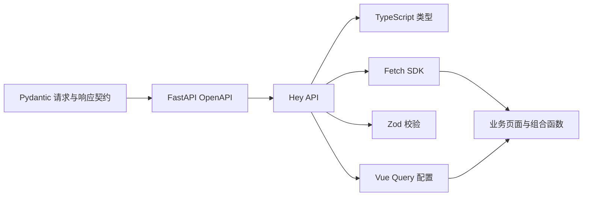

# AstroPhotoFlow 与 Siril Bundle 现代化重构计划

本轮纠正与收尾（2026-11-01）：前次完成判断遗漏旧浏览器入口及CI uv差异，现已补齐，并按[58项审计](modernization-audit.md)重新复核G1—G7。最新证据见[本轮收尾记录](test-matrix.md#modernization-g7-browser-closure)，未提交、合并或发布。

制定／版本核查日期：2026-10-31；候选收尾日期：2026-11-01。G0—G7本地实现及本轮授权验证已完成，交付仍为未提交、未集成的Feature候选。完整证据与限制见[最终记录](test-matrix.md#modernization-g7-browser-closure)，不等于用户真实天文素材验收或正式发布。

G7审计发现G5曾把主体逻辑集中转入WorkspacePage，文件职责完成判断过早；现已按实际能力补拆并完成清单、构建及浏览器复验，最新自研UI521项通过。详见[职责审计纠偏](test-matrix.md#modernization-g7-capability-audit)。

本文供后续执行 Agent 按 Goal 分阶段实施。下述模型、接口和技术组合是目标设计，不代表当前已实现的 schema；实施后的字段、签名与 schema 以代码和生成物为准。执行入口和验证授权遵循[开发流程](README.md)，现状见[当前上下文](current-context.md)，源码按[模块导航](../architecture/module-map.md)定位。

2026-10-31追加确认：工作流全部使用ComfyUI原生体系，取消独立workflows业务模块及自研项目图关联、工作流生命周期、完整运行库和完整图快照；有效业务边界见[需求](../requirements/README.md#native-workflow-ownership)。G6已拆除workflows代码及完整图快照；当前清单与验证状态见[执行记录](test-matrix.md#modernization-g6-media-cleanup)。文件结构与技术栈在同一G0—G7阶段改造，具体路径、函数定义、依赖、调用方及验证映射见[文件重构计划](file-refactoring-plan.md)，不再单独进行先搬文件、以后改实现的两轮改造。

实施前先读[本地官方文档索引](../references/modernization/README.md)及[来源清单](../references/modernization/manifest.json)，按当前阶段读取原文，不一次性加载整个文档包。清单记录固定提交、抓取时间、大小、SHA-256和许可证；滚动文档明确标为日期快照。

## 1. 目标与已确认的边界

目标是减少重复维护，让接口、数据库、前端和 Bundle 的职责清晰，后续新增能力时需要修改的地方更少。

本计划按以下条件制定：

- 本地、单用户使用，不引入云服务或额外常驻服务。
- 保留素材、固定版本、集合、设备、组合、拍摄预设这些业务概念，同时重整其数据结构。
- 可以删除旧实现、旧接口和重复抽象；所有调用方同步更新。
- 使用新数据库基线，不编写历史数据迁移，不保留旧 MCP／CLI 或 Bundle SDK v1 兼容分支。
- 保留 ComfyUI 原生画布、撤销、自动保存、队列、进度及取消机制。
- core、data、software、nodes保留职责边界；HTTP／MCP／CLI、原生桥接和具体跨模块装配归interfaces。项目资料与固定素材／集合引用保留在data，不关联工作流文件。
- 按G0—G7执行技术栈与文件结构同步改造；依赖解析、代码、自动验证和科学验收分别记录。

这里保留的几项业务规则，含义是：

| 规则 | 重构后应有的行为 |
|---|---|
| 固定科学输入 | 一次运行使用明确的照片版本、成员范围和顺序；后来增加照片不会改变该次输入。 |
| 原件保护 | 处理结果写到输出位置，不覆盖导入的科学原件。 |
| 画布内容校验 | Agent 读取画布后，如果用户改图或切图，过期修改请求停止。 |
| 真实取消结果 | 分清“取消请求已受理”“进程已经停止”和“结果无法核实”。 |

这些约束保护处理正确性，实现方式可以重写。

文件改造遵循原子化、抽象化、模块化、一致性，具体可检查标准统一见[四条规则](file-refactoring-plan.md#rules)。不规定一文件一函数或机械行数上限；完整图与执行历史归ComfyUI，具体科学输入、软件调用和已检查结果分别由现有业务能力负责。

**调研基线**

- AstroPhotoFlow：`bbb6f4a9f872fc1b79defa6dddf849247b5099d6`。
- Siril Bundle：调研时远端 `dev` 为 `f4f11b34587f989fb026607b483b740ee3b74cac`；本机适配器、recipes、目录生成器及主要测试与该提交对应文件一致。
- 平台锁文件已包含 FastAPI `0.161.1`、Pydantic `2.14.1`、SQLAlchemy `2.1.6`、Alembic `1.20.1`，这部分基础框架已经较新。
- 调研基线的 OpenAPI 有 142 个操作、212 个 schema。主要问题是部分响应声明不完整，以及前端继续手写另一套类型、校验和请求参数。
- Siril Bundle 已经从 recipes 生成操作、节点和双语目录。需要改进类型与内部组织，不需要另造目录生成体系。

以上为本次调研快照；执行 G0 时重新记录两个仓库的准确起点，不把分支名或“当前版本”作为固定提交身份。

## 2. 技术选型与取舍

以下为执行默认方案，避免实施者重新选型。

| 部分 | 采用方案 | 收益 | 成本与限制 |
|---|---|---|---|
| MCP | **FastMCP** | 类型化工具、组合、检索、中间件和开发命令由框架提供 | 增加框架依赖；必须核对实际版本的 API |
| 业务 CLI | **FastMCP 自动生成 CLI** | 参数、帮助及工具定义共用来源 | 复杂对象仍用 JSON；生成物需要随 schema 更新 |
| 本机管理 CLI | **Cyclopts** | 简化初始化、启动、停止等命令 | 这类命令不能完全靠业务 MCP 自动生成 |
| 前端接口 | **Hey API：Fetch SDK＋TypeScript＋Zod 4** | 路径、参数、类型和结构校验由 OpenAPI 生成 | 依赖契约完整性；生成器不能表达全部科学业务规则 |
| 前端请求状态 | **TanStack Vue Query** | 统一缓存、去重、取消、失效和轮询 | 需要管理查询键、失效范围及明确的默认配置 |
| 界面状态 | **继续使用 Pinia** | 与原生 Vue／ComfyUI 保持一致 | 要明确界面状态与服务数据的分工 |
| 数据库 | **继续使用 SQLAlchemy＋SQLite WAL＋Alembic** | 适合本地事务、查询、索引和单用户部署 | 复杂聚合仍需认真设计 SQL，不能靠换 ORM 消除 |
| Siril 执行 | **继续使用固定版 Siril CLI／脚本** | 保持独立进程、明确输入输出和现有能力覆盖 | 部分分析仍需要解析文件或日志 |
| Bundle 内部 | **dataclass＋SDK 类型＋按职责拆分的函数** | 减少裸字典与大分支，便于检查和测试 | 需要一次集中整理，不新增插件框架 |
| 文件监听 | **watchfiles** | 使用统一的事件监听、防抖与停止机制 | 文件变化事件不代表构建、加载和运行成功 |
| 验证工具 | **pytest＋Vitest＋Playwright Test＋Ruff** | 延续现有工具，改善隔离、诊断和一致性检查 | 需要整理现有测试入口 |

### 2.1 精确版本与本地资料

新增依赖已在G0完成**解析与本Feature开发环境安装**，契约／MCP／CLI样例已验证；本轮业务接入与合成输入／真实Siril联调已完成，范围及限制见最终记录。具体证据见[执行记录](test-matrix.md#modernization-g0)，不能将样例通过写成整体兼容性完成。继续按本表执行，不重新选择latest或预发布版本。

| 包 | 固定版本 | 本地文档 | 官方版本依据 |
|---|---|---|---|
| `fastmcp` | `4.1.4` | [目录](../references/modernization/fastmcp/4.1.4/INDEX.md) | [发布](https://github.com/PrefectHQ/fastmcp/releases/tag/v4.1.4) |
| `cyclopts` | `5.3.2` | [目录](../references/modernization/cyclopts/5.3.2/INDEX.md) | [发布](https://github.com/BrianPugh/cyclopts/releases/tag/v5.3.2) |
| `@hey-api/openapi-ts` | `0.99.0` | [目录](../references/modernization/hey-api/0.99.0/INDEX.md) | [发布](https://github.com/hey-api/hey-api/releases/tag/2026-06-22) |
| `@tanstack/vue-query` | `5.105.0` | [目录](../references/modernization/vue-query/5.105.0/INDEX.md) | [对应发布](https://github.com/TanStack/query/releases/tag/release-2026-10-26-0932) |
| `watchfiles` | `1.3.0` | [目录](../references/modernization/watchfiles/1.3.0/INDEX.md) | [发布](https://github.com/samuelcolvin/watchfiles/releases/tag/v1.3.0) |
| `ruff` | `0.17.3` | [目录](../references/modernization/ruff/0.17.3/INDEX.md) | [发布](https://github.com/astral-sh/ruff/releases/tag/0.17.3) |
| `pytest-asyncio` | `1.4.1` | [目录](../references/modernization/pytest-asyncio/1.4.1/INDEX.md) | [发布](https://github.com/pytest-dev/pytest-asyncio/releases/tag/v1.4.1) |

现有相关依赖保持以下锁定版本。各库本地原文、官方仓库与许可证统一从[文档包目录](../references/modernization/README.md#各库目录)进入。

| 部分 | 保留版本 |
|---|---|
| 后端 | FastAPI `0.161.1`、Pydantic `2.14.1`、SQLAlchemy `2.1.6`、Alembic `1.20.1` |
| HTTP／服务 | HTTPX `0.28.1`、Uvicorn `0.54.0` |
| 前端 | Vue `3.5.42`、Pinia `4.0.2`、Zod `4.6.5` |
| 前端编译 | TypeScript `6.0.3`、vue-tsc `3.3.11`、Vite `8.2.2` |
| 验证 | pytest `8.4.2`、Vitest `5.0.2`、Playwright Test `1.63.0` |
| 工具／软件 | uv `0.13.5`、Node `26.8.2`、pnpm `11.13.1`、Siril `1.4.4` |

Python产品runtime为`3.12.15`，开发venv基于`3.12.4`；标准库资料固定到3.12分支的`v3.12.15`。SQLite由Python提供，实际观察到runtime为`3.53.1`、开发环境为`3.45.3`，不把SQLite当作另一个待安装的pip包。SQLite官网资料为日期快照，不能冒充精确补丁版手册。

实施时注意：

- `fastmcp==4.1.4`引入同版本的`fastmcp-slim[client,server]`；删除旧服务实现不等于删除底层`mcp`依赖。核对[固定版本的依赖声明](../references/modernization/fastmcp/4.1.4/fastmcp_slim/pyproject.toml)。
- FastMCP内部使用HTTPX2，平台业务客户端仍使用HTTPX；不机械替换全部导入。当前锁文件已有`httpx2==2.16.0`、`mcp==2.3.0`、`mcp-types==2.3.0`和`starlette==1.9.0`，这些是现状观察，不另建手工传递依赖锁。
- Hey API的Fetch、Zod、Vue Query名称是生成插件标识，不逐个当作额外npm依赖安装；按[该版本的插件配置](../references/modernization/hey-api/0.99.0/INDEX.md)接入。
- 原始文档中的`latest`、示例版本和第三方框架示例不覆盖本表；版本冲突先核对固定来源并记录差异，不自行升级目标版本。

文档包只是参考快照；重构后的实际安装结果以`uv.lock`和`frontend/pnpm-lock.yaml`为准。Vue、TypeScript、pnpm文档采用固定提交的滚动源码快照，Siril与SQLite网站资料注明抓取时的来源状态。必要的TanStack公共章节、FastAPI示例及watchfiles API源码已一并收录，不把文档生成占位页当作完整正文。

### 2.2 主要备选方案为何不采用

**Hey API 与 Orval**

两者都支持 Vue Query 和 Zod。选择 Hey API，是因为其 SDK、Fetch、Zod 和查询配置可以组成一条生成链，符合当前前端已有 Zod 的情况。Orval 是可行备选，不同时引入第二套生成器。[Hey API Zod](https://heyapi.dev/docs/openapi/typescript/plugins/zod)、[TanStack Query 插件](https://heyapi.dev/docs/openapi/typescript/plugins/tanstack-query)、[Orval Vue Query](https://orval.dev/docs/guides/vue-query/)、[Orval Zod](https://orval.dev/docs/guides/zod/)

`openapi-typescript＋openapi-fetch` 更轻，适合主要需要静态类型的项目；它本身提供的是无运行时类型，当前项目还需要响应结构校验，因此不作为首选。[官方说明](https://openapi-ts.dev/introduction)

**TanStack Vue Query 与 Pinia Colada**

“服务数据管理”指浏览器向本机 FastAPI 读取数据，与云端无关。素材搜索、设备详情、导入进度都属于此类数据。

Pinia Colada 更贴合 Vue／Pinia，目前也有 Hey API 官方生成插件。选择 TanStack Vue Query，主要考虑其取消、轮询、失效、分页和测试文档完整，便于后续 Agent 按文档实施；代价是多一套独立查询机制。两者不并存。[Pinia Colada](https://pinia-colada.esm.dev/guide/queries.html)、[Hey API Colada 插件](https://heyapi.dev/docs/openapi/typescript/plugins/pinia-colada)

**SQLite 与 PostgreSQL／SQLModel**

继续使用 SQLite。当前观察到的瓶颈是全量读取、Python 汇总和分页，并没有证据要求增加数据库服务。SQLModel 也不采用：数据库模型与公共业务契约承担不同职责，合并两者不能解决当前查询和元数据归属问题。

**Siril CLI 与 Sirilpy**

继续使用 CLI。Sirilpy 提供运行中实例的图像、序列和元数据访问，但大量处理仍通过命令完成，官方也建议许多操作继续使用成熟命令集。全面替换会改变会话、环境及取消方式，目前收益不足。未来有明确的结构化读取需求时，再针对该能力采用 Sirilpy。[Sirilpy 官方文档](https://siril.readthedocs.io/en/stable/Python-API.html)

**暂不增加的技术**

不引入 Redis、Celery、Docket、GraphQL、微服务、另一套画布或通用插件平台。已有原生队列和本地处理模型继续承担执行职责。

## 3. 目标结构与具体改造

### 3.1 图片、设备与数据库

**数据归属**

| 数据 | 目标归属 |
|---|---|
| 素材名称、备注、当前纠正资料 | `Asset` 及其当前元数据 |
| 文件路径、内容哈希、大小、存储方式 | `AssetVersion` |
| 导入时观察到的拍摄资料、设备资料 | 版本上的类型化快照 |
| 原始 FITS 头、格式相关科学资料 | 版本／HDU 的结构化 JSON |
| 集合成员和顺序 | `DatasetVersion → DatasetMember → AssetVersion` |
| 可编辑设备 | `Equipment` |
| 设备组合成员 | 独立的组合成员关系表 |
| 拍摄预设 | 归属设备组合，保存稀疏参数覆盖和设备选择 |
| 校准绑定 | 固定版本之间的关系表 |
| 科学图像字节 | 独立文件 |

**图片模型**

- 把经常筛选、排序的当前资料改为明确列：帧分类、帧用途、相机／光学系统／滤镜引用、参数模式、ISO、Gain、Offset、曝光、总积分、温度、Binning、CFA。
- API 可以继续按 `classification`、`parameters` 分组表达；数据库不再同时保存同一份可编辑值的列和 JSON 副本。
- 设备快照、值来源、原始科学元数据保留 JSON，但公开接口使用具体 Pydantic 类型；格式确实开放的部分使用 `JsonValue`。
- 内容版本保存其观察快照，不依赖现存设备行来解释过去的文件。
- 元数据纠正影响后续处理采用的资料，不修改已记录的运行快照。

**设备、组合和预设**

- 保留现有设备类别，以 `kind` 区分具体规格类型；不引入 EAV 属性表。
- 设备输出和快照使用按 `kind` 区分的类型，替换通用 `specs: dict`。
- 组合成员具有稳定 ID、顺序，以及“引用已注册设备／组合内设备”两种来源；数据库约束保证两者互斥。
- 拍摄预设仍归属组合。设备选择引用组合成员，支持组合内设备和多滤镜中的明确选择。
- 预设的设备选择用关系表达：缺少选择记录表示使用组合默认，明确空选择表示不使用，选择记录可以指向具体组合成员。
- 其他预设参数保留经过类型校验的稀疏覆盖 JSON，以区分“未设置”“明确清除”和数值 `0`。
- 删除设备或组合成员时，预检展示影响；相关当前选择清除，保留文件和运行中的既有快照。
- 字段按当前有效需求收敛，包括相机单一像元尺寸、滤镜名称与可选带宽、Gain／Offset 的 `0`、组合多滤镜及预设单选规则。

**校准与数据库基线**

- 集合版本默认校准和成员覆盖分别使用关系表。
- 绑定指向固定素材版本或固定集合版本，目标互斥；成员没有覆盖记录表示继承，明确禁用记录表示不使用。
- Alembic 建立新的初始基线，删除旧迁移链及旧模型兼容代码。
- 使用新隔离 workspace 验证新基线；已有不匹配数据库明确要求重建，不自动转换旧库。

关系和查询采用 SQLAlchemy 原生机制，避免新增通用 Repository／Unit of Work 框架。[关系建模文档](https://docs.sqlalchemy.org/en/21/orm/basic_relationships.html)、[查询文档](https://docs.sqlalchemy.org/en/21/orm/queryguide/select.html)

### 3.2 素材列表、查询与分页

当前素材列表会先读取全部素材和集合，再用 Python 计算成员、筛选、排序及分页。重构为：

1. 使用 SQL 子查询／CTE 形成可见素材和集合范围。
2. 使用 `EXISTS`、聚合和连接完成成员匹配、回收站排除及错误状态查询。
3. 在数据库中完成稳定排序、总数和分页。
4. 只装配当前页所需的摘要数据。

**接口调整**

- 素材列表返回 `LibraryItemSummary`，包含身份、固定版本引用、成员数、匹配成员数、摘要资料、缩略图引用及问题状态。
- 集合成员通过独立分页接口读取，列表响应不嵌入整组全部成员。
- 摘要明确表达“一致”“混合或部分缺失”“全部未知”，避免用空字符串冒充未知。
- 筛选选项使用 SQL `DISTINCT／MIN／MAX` 等聚合，不再展开全部 ORM 对象。
- 设备组合按成员筛选、排序也使用关系查询。
- 名称建立派生的 Unicode casefold 搜索键；排序追加稳定身份作为最终顺序。
- 初期继续使用 `limit／offset`，不同时引入游标分页。

索引首先覆盖可见状态与时间、组合成员反向引用、集合成员反向引用及常用设备筛选。其他索引根据查询计划添加，不给所有字段机械建索引。[SQLite 索引官方文档](https://www.sqlite.org/expridx.html)

### 3.3 Pydantic → OpenAPI → 前端生成链

目标链路：



**后端**

- 请求体、查询参数及 JSON 响应都有明确类型。
- 长列表参数整理为 Pydantic 查询模型，HTTP 与 MCP 使用同一字段定义。[FastAPI 查询模型](https://fastapi.tiangolo.com/tutorial/query-param-models/)
- 固定、明确的 `operationId` 作为生成函数身份。
- 补齐健康、能力、选择目录、上传回执等响应契约。
- 文件、图片、瓦片和日志声明真实媒体类型；空响应使用对应状态，不留下误导性的空 JSON schema。
- 统一保留错误码、消息、字段诊断和请求标识。

**生成与前端接入**

- Hey API 从本地 OpenAPI 文件生成，不依赖在线服务。
- 生成 TypeScript、Fetch SDK、Zod 4 schema 和 Vue Query 配置，启用 SDK 响应结构校验。
- 生成物提交入库，通过固定入口重新生成；禁止手改生成文件。
- 前端保留一层薄配置，处理同源代理地址、认证、错误分类和工作区实例。
- 上传二进制请求、类型和地址由OpenAPI生成；前端传输的当前实现与无调用XHR清理见[文件计划](file-refactoring-plan.md)。
- 科学业务规则仍由后端服务校验；前端表单保留必要的即时提示。
- 非 HTTP 的原生画布事件继续由宿主桥接管理，共用生成的业务 DTO，不复制整套接口类型。

### 3.4 前端查询与界面状态

**职责划分**

- Vue Query：素材、集合成员、设备、预设、导入任务、软件状态等服务数据。
- Pinia：当前页签、选中项、布局、筛选条件和表单草稿。
- 原生 Store／画布桥接：工作流、节点、撤销、转换和执行事件。

不把 Vue Query 的响应再复制一份到 Pinia。

**明确配置**

| 项目 | 采用值或行为 |
|---|---|
| 网络模式 | 本机 API 使用 `networkMode: 'always'`，断开互联网仍可调用本机服务 |
| 自动重试 | 查询、写入均默认关闭 |
| 普通读取新鲜期 | 默认 5 秒，具体任务状态另设 |
| 缓存回收 | 默认保留非活动缓存 5 分钟 |
| 窗口聚焦刷新 | 默认关闭 |
| 页面可见列表 | 10 秒低频刷新，覆盖 MCP／CLI 从其他入口产生的变化 |
| 活动导入任务 | 1.5 秒轮询，全部进入终态后停止 |
| 切页与切工作区 | 取消过期读取，把 `AbortSignal` 传到实际请求 |
| 写入成功 | 按资源失效相关查询，不全局清空缓存 |
| 编辑表单 | 后台刷新不覆盖尚未保存的草稿 |
| 原生 Bundle 变化事件 | 用于失效软件及节点目录查询 |

查询键包含工作区身份、资源、参数和分页信息；切换工作区不复用原工作区结果。默认不持久化查询缓存，不做离线写入队列。

这些配置针对本地应用调整了库的通用默认值。[默认行为](https://tanstack.com/query/latest/docs/framework/vue/guides/important-defaults)、[取消](https://tanstack.com/query/latest/docs/framework/vue/guides/query-cancellation)、[网络模式](https://tanstack.com/query/latest/docs/framework/vue/guides/network-mode)

按查询、编辑、选择和预览职责拆解大型数据页面，删除重复的 loading、错误状态、请求代次和定时器；不同时重做视觉系统。

Workspace只保留装配和导航；删除万能WorkspaceContext和跨页面响应副本。各能力的queries／mutations／编辑草稿组合函数及原生桥接位置见[前端文件映射](file-refactoring-plan.md#frontend)。显式“全部”模式通过分页接口逐批读取，默认列表及集合摘要不全量读取成员。

### 3.5 FastMCP、CLI 与错误处理

**组织结构**

```text
AstroPhotoFlow
├─ data
│  ├─ library / assets / datasets
│  ├─ equipment / setups / presets
│  ├─ imports / tasks
│  ├─ projects
│  └─ exports / trash / calibration
├─ software
│  ├─ packages / operations
│  └─ calls / analysis / previews
└─ graph
   ├─ nodes
   └─ canvas / receipts
```

- 子模块通过本地 `mount()` 组合，运行在同一个 MCP 进程中。
- 每个真实操作都是类型化工具；移除旧双网关、自建参数模型生成和重复操作映射。
- 工具只提供现有业务能力，经共享 HTTP 客户端调用，不访问 ORM。
- Siril 节点仍通过节点／操作目录发现，不把 160 个节点机械复制为 160 个 MCP 工具。
- 原计划graph.runs调整为software.calls查询；只提供已有业务能力，不增加绕过ComfyUI队列的整图执行入口。
- 协议工具名采用命名空间展开后的名称，例如 `data_assets_get`。[组合文档](https://gofastmcp.com/servers/composition)

**检索与 CLI**

- Agent 视图采用内置 BM25 检索，最多返回 10 项及完整 schema；明确工具名可直接调用。
- 中英文描述和关键词进入代表性检索测试，不将关键词排序宣称为语义模型检索。
- CLI 从未添加搜索变换的完整工具目录生成，避免只生成 `search_tools／call_tool`。
- CLI 保留框架生成的 `call-tool <工具名>` 形式，不另外维护一套手工业务命令树。
- 根 `apf` 使用 Cyclopts，组合生成的业务命令与本机初始化、启停、状态等命令。
- 更新项目内 Skill、示例、脚本及测试，删除旧命令入口。[工具检索](https://gofastmcp.com/servers/transforms/tool-search)、[CLI 生成](https://gofastmcp.com/cli/generate-cli)、[Cyclopts 组合命令](https://cyclopts.readthedocs.io/en/stable/commands.html)

**错误与开发体验**

- 成功结果返回类型化对象；预览保留原生图片内容。
- 业务错误统一转换，保留错误码、字段诊断和请求标识，使用 MCP 错误结果语义。
- 未预期异常记录到日志，客户端获得可诊断的通用错误。
- 超时、未知受理结果不触发自动重放；继续查询原操作。
- 工厂构建目录时不访问业务 HTTP 或数据库，支持离线生成与检查。
- 开发热重载采用官方 `fastmcp run --reload`。stdio 进程重启后客户端需要重连，不承诺已有连接无感更新。
- 本轮不再叠加 FileSystemProvider 热加载机制。[工具与错误处理](https://gofastmcp.com/servers/tools)、[开发运行](https://gofastmcp.com/cli/running)

MCP Resource 继续作为按需提供的只读视图，不与数据库表一一对应，也不建立第二份数据存储。

### 3.6 Siril Bundle 与开发基础

**Siril Bundle**

- 保留 Siril 1.4.4 和现有真实操作能力，本次不同时升级科学软件。
- recipes 改为明确类型的描述对象，复用 SDK 参数、输入和输出类型。
- 继续从同一份定义生成操作、节点、双语目录和覆盖清单。
- 按参数编码、运行配置、序列准备、脚本构造、输出收集、分析解析拆分适配器。
- 仅对已有真实差异使用处理函数映射，不新增通用插件框架。
- 平台与 Bundle 同步收敛到 SDK v2，删除 SDK v1 分支和单输入／单输出兼容转换。
- 使用标准模块加载机制管理 Bundle 自有模块；修改 Python helper 后也必须重新加载。
- 同步拆分平台软件执行、data结果服务和接入装配；取消workflows后的函数去向见[原生接入与执行](file-refactoring-plan.md#native-execution)，Siril文件和SDK入口见[Bundle映射](file-refactoring-plan.md#siril)。
- 优先解析结构化文件；只有实际需要时解析日志。解析失败不伪造空分析结果。
- 保留单帧序列、压缩输出、成员顺序、多输出、分析文件及原件保护的业务断言。
- `seqprofile` 的已知 Windows 运行问题继续明确报告，不因重构声明通过。[Siril 命令](https://siril.readthedocs.io/en/stable/Commands.html)、[序列格式](https://siril.readthedocs.io/en/stable/Sequences.html)

**监听、连接与配置**

- watchfiles 替代每秒全量扫描；只监听绑定的源码、声明和安装状态范围。
- 防抖合并变化，避免生成物再次触发无限构建。
- 继续用内容指纹判断采用内容；生成失败阻止新调用并展示原因。
- 不新增运行占用拒绝或在途旧实现保护。[watchfiles](https://watchfiles.helpmanual.io/api/watch/)
- 使用已有 FastAPI lifespan 管理长期 HTTPX 客户端，复用连接并正常关闭。[FastAPI lifespan](https://fastapi.tiangolo.com/advanced/events/)、[HTTPX 客户端](https://www.python-httpx.org/advanced/clients/)
- 配置解析复用 Pydantic 校验和标准库 TOML；保留工作区路径解析，不新增另一套配置框架。
- 统一 bootstrap 与 CI 的 uv 版本，保留 uv／pnpm 锁文件和现有构建目录。
- 启用自研代码范围内的 Ruff 检查，不格式化整个上游前端。[Ruff](https://docs.astral.sh/ruff/)

## 4. 按 Goal 执行的阶段

各阶段串行推进；涉及契约的改动同步重新生成调用方，不建设旧版兼容层。

| 阶段 | 交付内容 | 阶段完成条件 |
|---|---|---|
| **G0：固定目标与生成入口** | 核对两个仓库基线、四项职责与接入边界、固定版本及本地原文；解析依赖；完善递归检查和应用生命周期，建立生成入口与隔离样例 | 生成可重复，不要求业务服务或数据库在线；依赖解析写入锁文件；已取消的workflow目标明确 |
| **G1：数据模型与业务服务** | 同步拆分模型、服务与路由；新数据库基线、图片资料、组合与预设选择、校准关系 | 新workspace可初始化；固定成员、覆盖语义及删除影响有必要测试；调用方同步 |
| **G2：SQL 查询与摘要接口** | 同步拆分查询、摘要与成员分页，删除后端及前端全库／全成员分页逻辑 | 筛选、聚合和分页在数据库完成；列表不返回整组成员 |
| **G3：完整契约与前端 SDK** | HTTP与原生消息契约、媒体类型、查询模型；生成TS／Zod／SDK；拆客户端传输及统一错误 | 不再手写重复路径和DTO；旧workflows契约改为画布／软件包／原生消息和结果契约，无占位工作流字段 |
| **G4：FastMCP 与 CLI** | data／software／graph类型化工具、组合、检索、生成CLI、统一错误与重载 | 完整目录生成CLI；旧网关与参数表移除；不存在整图执行替代入口 |
| **G5：前端请求与页面结构** | Vue Query、能力页面、草稿与宿主桥接；移除UI中的workflows归属 | 快速切页不串数据；草稿不被刷新覆盖；断网可用本机API；无万能上下文 |
| **G6：Siril 与原生执行接入** | 拆除后端workflows，落实软件调用、data结果与接入装配；删除完整图快照；类型化recipes、SDK v2、模块加载、watchfiles | 无自研workflow模块／运行库；未命名原生草稿可运行；helper修改生效；输入、结果及取消事实保持 |
| **G7：验证、清理与交接** | Playwright Test、生成一致性、依赖检查、原生闭环、受影响文档及最终Brief | 无旧入口、双份权威类型、独立图副本或未解释的失败；两个仓库准确SHA和证据齐全 |

G0 对生成器的验证覆盖：可空性、可省略字段、判别联合、数组查询、日期、二进制响应和统一错误。发现问题时修正真实契约或生成配置，不补一套手写替代 schema。

G0的FastMCP／CLI验证使用隔离样例，正式业务CLI在G4生成，不提前创建空入口。自G0建立生成工具后，每阶段改变公共契约都同步更新相关生成物和调用方。依赖规则随对应文件完成改造逐步收紧，不以永久排除项掩盖旧边界。

新增依赖采用2.1节的精确版本；现有Vue、Vite、Python、科学计算和打包工具不做无关升级。各阶段先按[本地阅读顺序](../references/modernization/README.md#按阶段阅读)查阅官方原文；实际依赖与文档不一致时核对固定版本来源并记录差异。不能以改用latest或补手写替代schema跳过G0验证。

## 5. 验证、完成标准与交接要求

### 必须覆盖的场景

| 范围 | 验证场景 |
|---|---|
| 数据模型 | 注册／组合内设备、多滤镜选择、删除影响、固定成员顺序、省略／null／0、元数据纠正 |
| 列表查询 | 独立素材与集合混排、空集合、回收站排除、成员组合筛选、混合资料、缺失值、Unicode 名称和稳定分页 |
| 契约 | Pydantic、OpenAPI、Zod、SDK 对可空性、联合类型、数组参数和错误结构一致 |
| 前端 | 快速搜索及翻页、取消旧读取、工作区切换、草稿保护、跨入口变更刷新、任务终态停止轮询 |
| MCP／CLI | schema、已知工具直达、检索、图片返回、JSON 参数、错误、真实 stdio 调用及重连 |
| 画布 | 正常修改、内容过期、切图、网页关闭、未知结果查询、原生撤销 |
| Siril | Auto Stretch、校准、配准／叠加、单帧序列、多输出、分析、压缩、依赖缺失与取消 |
| 开发工具 | helper 修改、新增／删除声明、生成失败、安装／卸载刷新、服务关闭后资源释放 |
| 原生工作流归属 | 未命名草稿、原生保存／撤销／队列／历史／进度／取消；删除完整图快照后自动结果正确匹配；无自研项目图关联、工作流运行库或替代调度器 |

**查询规模验证**

使用合成元数据构建 1 千、1 万、10 万条素材及不同大小集合：

- 记录查询耗时、响应大小、SQL 查询数量和查询计划。
- 列表装配的 ORM 对象数量受页大小约束，不随全库素材数增长。
- 返回大小不随单个集合全部成员数增长。
- 数据库允许为精确总数和复杂筛选扫描必要数据，不把“没有任何扫描”作为错误指标。

**测试入口**

保留 pytest、Vitest 的有效业务断言；将手动启动浏览器的大脚本改为 Playwright Test 的场景和 fixture，失败保留 trace，默认不自动重试有写入的测试。[Playwright fixture](https://playwright.dev/docs/test-fixtures)、[Trace](https://playwright.dev/docs/trace-viewer)

执行遵循仓库开发流程：Feature 编写必要测试、完成授权范围内的检查和独立预览；用户确认可集成后，由 Git Manager 组织独立审查及必要验证。不把“编译通过”“合成数据通过”和“真实科学处理通过”混写。

### 整体完成标准

- 一个后端接口字段不再分别手改前端类型、Zod、URL 和 CLI 参数表。
- 素材列表不再全量展开后用 Python 分页。
- 数据页面不再各自维护重复的请求生命周期。
- MCP、CLI 和网页使用同一业务能力与契约。
- Siril 操作、节点和目录继续共用一份来源，适配器职责可独立理解和测试。
- 新 workspace 能完成“导入 → 选材入图 → Siril 处理 → 查看 → 保存所选完整结果”。
- 已执行的验证有结果证据；未验证的科学操作与环境限制明确列出。
- 文件、符号、直接依赖和调用方有完整覆盖；data不读software私有调用文件，软件执行器不读data私有模型；跨模块用例仅装配公开能力。
- 不存在自研workflows业务模块、完整图副本或以其他名字恢复的工作流管理系统；现有原生身份只用于定位和结果关联。

### 给执行 Agent 的 Goal 目标

> 按本计划及file-refactoring-plan.md同步完成AstroPhotoFlow与Siril Bundle的技术栈和文件重构，落实原子化、抽象化、模块化、一致性。先读本地官方资料README与manifest，采用2.1节精确版本；G0核对并解析，不重新选型。按G0—G7同步变更文件、函数、依赖和调用方，使用新数据库基线，删除旧接口和SDK v1。ComfyUI独占工作流编辑、保存、队列和历史；取消workflows业务模块、自研项目图关联、工作流生命周期、完整运行库、完整图快照和先保存自研工程的准入，不以改名恢复。保留固定输入、原件保护、画布目标／内容校验、具体调用和结果事实及真实取消结果。data、software、nodes通过公开入口提供能力，interfaces只做具体接入装配，不建设调度器或通用服务容器。每阶段阅读对应本地原文，API不符时核对固定来源并记录差异，不自行升级。按仓库约定完成授权范围内的检查和预览，交接两个仓库准确SHA、依赖版本、生成入口、验证证据及限制。提交、推送、集成和发布仍按用户授权。

本文编写轮次只交付计划和本地官方文档，不创建或启动重构 Goal。执行 Agent 在另行收到实施指令后按 G0—G7 推进，不把文档准备完成记为重构完成。初稿检查见[计划文档记录](test-matrix.md#modernization-plan-documentation)，版本和文档包检查见[本地官方资料记录](test-matrix.md#modernization-official-docs)。
