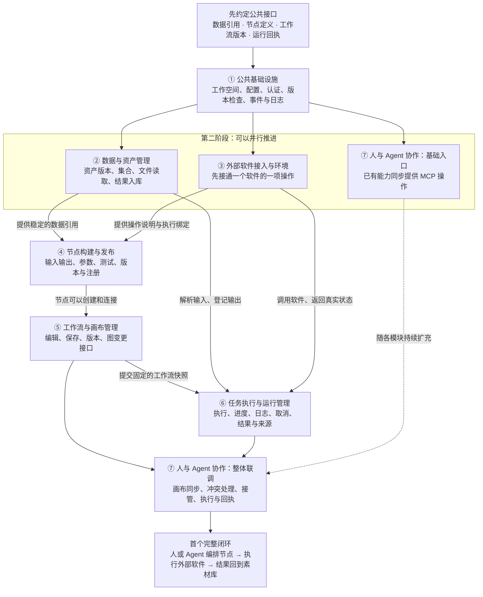

# 七模块目标架构与开发路线

决策日期：2026-10-25。本文记录已确认的产品方向、模块边界和开发流程，是后续任务拆分的依据；目标能力不代表已经实现。

实际实现与当前状态分别见[架构概览](../architecture/overview.md)、[当前开发上下文](current-context.md)；验证证据见[原生网页记录](native-web.md)和各功能验收文档。Agent 长期执行约定见[根目录 AGENTS.md](../../AGENTS.md)。

文件归属现按[七模块源码导航](../architecture/module-map.md)和[文件架构](../architecture/repository-layout.md)固定。已有代码迁入最终模块位置，未实现模块采用文档占位；本路线仍区分已实现、目标和待验证能力。

## 1. 产品定位与实施边界

AstroPhotoFlow 是基于 ComfyUI 源码构建的本地可视化工作流平台，当前交付网页版本。核心目标为：

1. 人与 Agent 都可以控制平台，操作同一份数据与工作流。
2. 提供数据管理和节点制作能力，让用户创建、测试、发布自己需要的节点。
3. 工作流在前端画布可见、可编辑，Agent 的操作与真实执行状态能够被用户检查。
4. 通过 AstroPhotoFlow MCP 对外提供平台能力，支持外部 Agent 使用。
5. 将 PixInsight、Siril 等外部软件的具体操作通过适配器接入，并发布为可由人或 Agent 编排的节点。

设备、Subframe、校准、Master 等属于平台承载的业务资料和处理能力，不据此划分平台一级模块。现有相关实现继续保留。

沿用当前原生 Vue 前端、内部 FastAPI 领域服务、同源业务网关和 ComfyUI 图执行引擎。领域服务保存业务权威；网页、CLI 和 MCP 调用同一套应用能力。节点执行通过适配器衔接外部软件，不另建一套图调度器。

本轮路线实施限定在 `branch/redesign`，不得直接修改或向 `dev`、`main` 合并。保留已有资产身份、固定版本、设备快照、原件和 workspace；数据库或协议变化由对应实施任务单独设计和验证。冻结的 [v1.0 需求原文](../requirements/v1.0/README.md)保持不变，本路线记录当前决策及其与历史方案的差异。

## 2. 七模块职责

公共基础设施计为第 ① 模块，其余六项为功能模块。以下编号按开发依赖排列，不表示七个进程、七个服务、七张表或七个页面。

| 编号 | 模块 | 核心职责 | 与其他模块的边界 |
|---|---|---|---|
| ① | 公共基础设施 | workspace、配置、认证、版本检查、数据库迁移、事件与日志 | 提供共享机制；各模块仍负责自己的业务规则与数据 |
| ② | 数据与资产管理 | 导入、存储、资产版本、集合、元数据、预览、来源和生命周期 | 提供稳定数据引用及输入输出登记；执行状态属于运行管理 |
| ③ | 外部软件接入与环境 | CLI、脚本、API、外部 MCP 的连接、能力描述、依赖与软件版本检测 | 描述如何调用软件；节点模块负责发布画布中的节点定义 |
| ④ | 节点构建与发布 | 输入输出、参数、执行绑定、制作、测试、发布、版本与注册 | 保存可复用的节点定义；画布中的节点实例由工作流管理 |
| ⑤ | 工作流与画布管理 | 节点实例、连线、参数、保存加载、版本、草稿和画布同步 | 保存流程定义与变更；执行时交付固定快照给运行管理 |
| ⑥ | 任务执行与运行管理 | 预检、提交、与引擎调度衔接、进度、日志、取消、失败处理及结果登记 | 负责本次任务的真实状态，通过适配器执行、通过数据模块登记产物 |
| ⑦ | 人与 Agent 协作及 MCP | 能力查询与调用、操作协调、接管、状态回执、对外 MCP | 将客户端操作接入相同应用能力，保持工作流版本与画布状态一致 |

需要分别理解以下对象：

- **适配器**：连接并调用一款外部软件的实现及其操作描述。
- **节点定义**：某项操作的输入、输出、参数、执行方式及版本。
- **节点实例**：画布上具体的某一个节点，拥有自己的参数和连线。
- **工作流**：一组节点实例及其关系，编辑草稿、保存版本和运行快照分别记录。
- **运行记录**：一次实际执行使用的工作流、数据和节点版本，以及真实状态与产物。

节点制作包括软件操作封装、用户脚本和子工作流封装三个方向。共同流程为：创建草稿 → 声明端口与参数 → 配置执行方式 → 试运行 → 发布版本 → 出现在节点库。先用一种采用标准控件的节点验证完整流程，再扩展制作方式。

## 3. 先明确四类接口边界

| 接口类别 | 必须回答的问题 | 主要参与模块 |
|---|---|---|
| 数据引用 | 节点引用哪份资产或集合版本，如何定位可读数据、登记输出和查询来源？ | ②、④、⑥ |
| 节点定义 | 操作有哪些端口和参数，绑定哪个适配器实现，怎样标识与固定版本？ | ③、④、⑤ |
| 工作流版本与变更 | 人与 Agent 基于哪个版本编辑，如何保存、处理冲突并确认画布已显示？ | ⑤、⑦ |
| 运行回执 | 本次执行固定了哪些输入和实现，实际状态、日志、输出与取消结果是什么？ | ②、③、⑥、⑦ |

这些是职责和待细化范围，不是新增 API 契约。具体 HTTP 路径、MCP 工具、数据库结构、节点端口类型和消息格式，在对应实施任务中结合现有契约定稿。本次文档落盘不新增上述实现。

## 4. 依赖关系与开发顺序

采用“底层先建立、低耦合部分并行、高耦合部分尽早联调”。实线表示形成闭环需要的前置接口，虚线表示跨阶段持续扩充。箭头指向的是可联调的最小能力，不要求前置模块全部开发完成。

⑦在图中出现两次，表示同一模块的基础入口与整体联调两个阶段。MCP 从早期接入，随着每项稳定操作同步扩充，不能等其他模块全部完成后才开始。原生画布已有基础也应提前复用，用于验证节点和交互。

| 联调组合 | 耦合程度与原因 | 推进方式 |
|---|---|---|
| ② 数据 ↔ ③ 软件接入 | 相对较低，主要通过稳定数据引用和文件交接连接 | 约定接口后并行推进；并行不等于增加服务或自动分派 Agent |
| ③ 软件接入 ↔ ④ 节点构建 | 高，操作说明决定节点端口、参数和执行方式 | 共同定义协议，以一个真实操作验证 |
| ④ 节点 ↔ ⑤ 工作流 | 高，节点定义影响连线、参数编辑、保存加载和旧图兼容 | 尽早联调新增节点、版本更新与旧图加载 |
| ②＋③＋⑤ ↔ ⑥ 运行管理 | 高，执行同时依赖数据、软件能力和工作流快照 | 优先完成一次真实执行及结果入库 |
| ⑤＋⑥ ↔ ⑦ 人机协作 | 高，Agent 必须准确修改图、读取执行状态并与人同步 | 基础 MCP 提前接入，协作机制逐步补齐 |

## 5. 阶段交付与验收

已有能力先复用和核实，缺失部分按下表补齐。高耦合模块需要在最小接口可用后联调，不按“完整做完一个模块再开始下一个”的方式推进。

| 阶段 | 交付内容 | 进入后续阶段前的验收 |
|---|---|---|
| S0：明确边界 | 梳理四类接口、对应现有契约及本次闭环需补齐的部分 | 数据、节点、工作流、运行各自的身份、职责和回执含义一致；计划与实现状态分开 |
| S1：共享基础 | 复用并补齐①中的 workspace、认证、版本检查、日志和事件基础 | 隔离 workspace 可运行；客户端访问同一领域服务；保留已有启动、停止和数据行为 |
| S2：并行形成基础能力 | ②提供一份可引用的数据；③接通一个软件的一项操作；⑦同步提供相应 MCP 入口 | 数据版本能定位到实际文件；软件可用与不可用状态真实；网页与 MCP 可查询同一份数据 |
| S3：节点与画布联调 | ④制作、测试和发布一种标准节点；⑤复用画布并补齐版本化图变更 | 节点能创建、连接、配置、保存和重新加载；数据引用与节点版本保持；人和 Agent 的修改有明确回执 |
| S4：真实执行与结果入库 | ⑥固定输入及图快照，调用③执行，再通过②登记结果和来源 | 成功结果可读且来源可查；软件失败与输出缺失不报告成功；取消结果按实际能力报告；运行后的编辑不改变本次快照 |
| S5：双入口整体联调 | ⑦完成在线画布同步、编辑冲突、用户接管和执行查询 | 人与 Agent 操作同一工作流；过期版本不覆盖新修改；画布未确认或离线时不报告已显示；结果回到素材库 |

首个完整里程碑是：**一份数据＋一个外部软件操作＋一种节点＋一条工作流＋一次真实运行**，并分别验证人和 Agent 入口。首个软件、具体操作和测试素材在适配器实施计划中锁定；软件名称本身不构成已经接入的承诺。

闭环通过后，再增加节点制作方式、热发布、外部软件和天文业务能力。测试随所改能力补充，验收使用真实回执、日志和产物，不把图上存在节点或接口返回成功等同于实际处理完成。

## 6. 数据与资产管理细化

### 6.1 八项能力

| 能力 | 内容与边界 |
|---|---|
| 资产目录 | 稳定 ID、名称、类型、格式、大小、内容摘要、来源与可用状态 |
| 存储与文件管理 | 托管与外部引用，导入、复制、移动、重定位和导出；各项当前支持情况以实现为准 |
| 元数据管理 | 文件解析、人工补充、字段来源和历史快照；业务资料由对应业务定义 |
| 集合与检索 | 搜索、筛选、排序、批量选择、逻辑分组、固定成员版本和顺序 |
| 查看与预览 | 缩略图、大图、文件信息与受支持内容查看；预览作为可重建缓存管理 |
| 节点数据交接 | 交付固定的资产或集合引用，解析可读输入，检查并登记实际输出 |
| 来源与引用关系 | 导入来源、产生该数据的运行关联、项目和工作流引用；执行参数与日志仍由运行模块保存 |
| 生命周期管理 | 移除、回收站、恢复、清理预览、永久删除和引用保护 |

### 6.2 核心概念与行为

| 概念 | 含义 |
|---|---|
| Asset | 用户管理的数据对象，身份独立于名称与物理路径 |
| AssetVersion | 可被固定引用的数据版本，记录内容及必要元数据 |
| 存储位置 | 某版本实际可读取的位置及其状态；不因此预设必须新增位置表 |
| Dataset | 用户组织和复用的一组资产，不等同于物理文件夹 |
| DatasetVersion | 某次确定的成员版本、顺序与已保存配置 |

保留并完善以下行为：

- 移动和改名不改变资产身份。内容重复的识别与逻辑资产是否合并分开处理，不按内容摘要自动合并不同用途。
- 同一资产可被多个集合或项目引用；组织关系不要求复制原件。集合成员变化发布新版本，历史引用保持固定。
- 名称、备注等资料编辑继续使用 revision；数据内容与固定版本按现有契约管理，不因资料编辑重新复制原件。
- 登记状态、原件可用性、元数据解析和预览就绪分别表达。已登记不等于原件可读，预览失败也不等于原件丢失。
- 人工值、文件观察和导入预设保留来源；继续区分未提供、显式 null 和数值 0。设备是可编辑档案，拍摄资料保留当时快照。
- 浏览筛选用于找到数据，正式运行固定实际成员版本和顺序。需要的 HDU 等数据部分选择随输入引用明确记录。
- 节点保存稳定版本引用，执行时由数据模块解析，再由适配器准备软件所需的文件交接；不以可变绝对路径代替版本身份。
- 输出先暂存，按操作声明检查后登记为结果资产并关联输入和运行。处理不得覆盖科学原件；预览不冒充科学结果。
- 工作流模块保存数据引用，运行模块保存执行事实，数据模块保存资产及其来源关联。需要持久复用和追溯的产物入库，临时数值和参数留在对应工作流或运行上下文。
- 网页与 MCP 使用同一套领域操作、版本检查和状态回执。删除项目引用、移出集合与永久删除原件的含义分别表达；保留已有回收站引用保护。

上述内容是数据模块的目标边界，不能据此宣称移动、重定位、节点输出登记或完整运行来源已经支持。当前素材行为见[素材与存储说明](../architecture/assets.md)。

## 7. 当前基础、待补齐能力与热发布目标

以下现状为本路线记录时的基线，后续以实现和验收证据更新。

| 模块 | 已有基础 | 后续工作 |
|---|---|---|
| ① 公共基础设施 | workspace、配置、认证网关、迁移、请求 ID、revision、启动与停止 | 按新增能力补齐事件与统一回执，保持既有运行隔离 |
| ② 数据与资产管理 | 素材与集合版本、项目引用、导入、元数据、设备快照、预览及回收站 | 节点输入输出正式交接、结果登记与完整来源查询；其他文件操作按实际需求补齐 |
| ③ 外部软件接入与环境 | 现有工作台环境与启动管理可复用 | 软件操作协议、适配器、环境检测和实际调用尚需实施 |
| ④ 节点构建与发布 | ComfyUI 原生节点机制可复用 | 用户节点制作、测试、发布、版本和热发布尚需实施 |
| ⑤ 工作流与画布管理 | 原生画布、节点编辑、工作流保存加载和侧栏切换保留草稿与视口 | 项目工作流版本权威、人／Agent 图变更接口和协作同步尚需实施 |
| ⑥ 任务执行与运行管理 | ComfyUI 原生图执行与队列可复用，导入任务已有生命周期 | 外部软件任务、固定运行快照、来源与结果登记的托管闭环尚需实施 |
| ⑦ 人与 Agent 协作及 MCP | 数据管理 HTTP、CLI 和 58 个 MCP 工具 | 节点发布、工作流编辑、运行操作、画布同步、冲突处理与接管尚需实施 |

热发布按变化范围分别验证：

| 变化 | 目标行为与验证边界 |
|---|---|
| 新增采用标准控件的节点定义 | 目标是不重启整个产品即可更新节点库；后端注册与前端刷新需通过原型验证 |
| 发布脚本或适配器新版本 | 新任务选择新版本，已排队和运行的任务继续使用固定旧版本 |
| 改变端口或参数结构 | 发布新的节点版本；已有工作流保留原定义引用，不静默改变参数和连线含义 |
| 修改平台核心代码或专用前端组件 | 单独评估构建、刷新或重启要求，不承诺任意代码原地热替换 |

当前存在节点定义刷新入口，不等于完成了端到端热发布。原型至少验证：新增节点可见可执行、刷新不丢草稿、旧工作流可加载、运行中新旧版本保持分离。通过后再更新支持范围。

## 8. 文档维护与任务交接

- 本文保存目标架构、模块边界、依赖顺序和阶段验收；[当前开发上下文](current-context.md)保存当前实现与下一步工作，验收文档保存实际证据。
- 架构决策变化时同步本文和 AGENTS 中的摘要；实现完成后再更新现状，保留未实现和未验证的明确标记。
- 新任务说明所属模块、依赖的最小接口、要完成的闭环和验收场景。模块并行开发仍遵循当前分支及工作区约束。
- 文件迁移遵循已确认的长期布局；后续功能在对应模块内实施，不为模块数量增加服务、依赖或通用框架。具体实现遵守最小正确改动原则。
