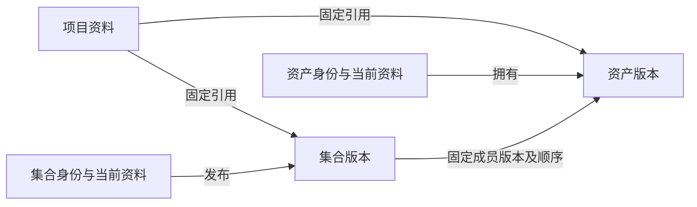

# ② 数据与资产管理概要设计

具体交接见[②接口契约](../../../../docs/api/platform-contracts.md#data)及[文件级详细设计](../../../../docs/api/platform-contracts.md#data-design)：复用现有导入／查询，补科学输入解析、同素材新内容确认、移除影响、所选完整结果保存及后续偏好。确认新内容只显式更新选中引用，固定组与旧运行保持；新增交接不等于现有模型或工具已支持。

M2实施状态：B21复用既有素材、项目、集合、设备、校准、导入、预览与回收站，并按确认方案精简前端设备录入；B22新增固定科学输入解析；B23新增网页可确认的内容观察／接纳HTTP交接；B24复用`AssetTask`完成所选输出检查、预览、登记与查询，并提供内部只读移除范围查询。本轮新增的HTTP端点共两个；其余科学输入和输出交接仍是②公开Python能力，等待⑤真实运行消费。没有新增数据库表或迁移。当前实现位于`feature/database_management`候选分支，未合入dev；跨⑤工作流的影响、排队运行输入保护和网页结果选择仍由B51／B53／B54／B57联调验收。

数据细化入口：[②数据与资产数据结构初稿](../../../../docs/architecture/data-models/02-data.md)。当前为待逐项确认的逻辑草案，区分已有字段、新增建议与派生视图；本概要继续维护能力和行为边界，草案不代表新增实现、接口或迁移已完成。

设计基线：2026-10-26。本文是②的唯一概要设计，依据[现行产品需求](../../../../docs/requirements/README.md)和[总架构](../../../../docs/architecture/overview.md)，维护用户场景、对象归属、内部能力、公开交接及验收条件。DATA 编号仅用于概要追踪，不新增产品需求或可调用接口。当前行为的操作细节继续由素材、导入、设备、校准和预览专题文档维护。

数据对象仍复用现有16个模型及schema0009；当前新增科学输入、内容接纳和结果登记均未新增数据库模型。工作流运行来源、完整比较、文件治理及本地记忆不属于本轮②自身交付。

阅读导航：[场景与覆盖](#scenarios) · [权威与边界](#authority) · [核心对象](#objects) · [能力清单](#capabilities) · [主要流程](#flows) · [跨模块交接](#handoffs) · [前后端分工](#frontend) · [源码与验证](#verification) · [阶段出口](#phases) · [决策与后续设计](#decisions)。

<a id="scenarios"></a>

## 1. 用户场景与需求覆盖

[导入](../../../../docs/requirements/README.md#scenario-import)与[入画布](../../../../docs/requirements/README.md#scenario-canvas)统一维护双入口场景：按钮单个／批量导入继续保留，Agent通过实际可用的清单及资料入口查看构成、组织参数并分批导入，疑义及成功／跳过／失败／未识别清单可查；逻辑整理不隐含移动或改名原件。②提供固定单个／集合引用，④⑤创建画布实例，⑤协调目标，拖入不执行软件。

[行星原始视频场景](../../../../docs/requirements/README.md#scenario-processing)由②登记并交接固定科学输入，③解释工具支持，⑤记录实际范围、产物检查及运行事实，用户选择后交②保存完整结果。当前SER／视频仍仅首帧静态预览；可登记、可预览、可作为科学输入处理分别验收，不新增帧资产模型或自行拆帧规则。

用户通过网页、CLI 或外部 Agent 的 MCP 入口管理同一份资料：导入单图或批量素材，组织跨夜／滤镜集合与项目，保存设备及校准背景，为工作流提供明确输入，检查和保留真实结果，比较历史并在更换客户端后继续工作。科学原件、显示缓存、当前资料、历史事实及运行记录分别表达。

| 需求 | ②负责的交付 | 场景与验收追踪 |
|---|---|---|
| FR-01 项目与连续性 | 项目资料、固定素材／集合引用、所选结果保存、资料导出；通过公开查询组合⑤信息 | 项目切换、移除引用、归档及删除不误改其他项目；DATA-F02／F06／F07，AT-01、AT-20、AT-27 |
| FR-04 素材与业务资料 | 导入、身份版本、分类及检索、集合、设备快照、校准引用、文件治理 | 引用／托管可区分，重复与重试语义准确，历史快照保持；DATA-F01～F03／F07，AT-04、AT-05、AT-26、AT-32 |
| FR-05 查看与比较 | 原件关联的预览、完整查看、显示条件、比较及可核实指标 | 原件不变，版本、ROI、对齐、拉伸及指标来源可辨；DATA-F04／F07，AT-19 |
| FR-10 结果登记与来源 | 固定引用解析、所选完整结果保存；实际处理来源由⑤运行记录提供 | 实际输入、产物与运行对应，已请求保存失败时先核对；DATA-F05／F06，AT-12、AT-14、AT-16、AT-18、AT-20、AT-28 |
| FR-11 历史与治理 | 固定版本、引用保护、回收站、恢复、存储占用与导出 | 清理范围需确认，旧字节不存在时如实说明；DATA-F02／F03／F07，AT-05、AT-20、AT-21、AT-27、AT-32 |
| FR-12 本地上下文 | 工作区偏好、项目背景、工作流经验及主动提交的交接摘要 | 用户表达与候选区分、项目隔离、停用删除、来源失效及客户端接续；DATA-F08，AT-22、AT-30、AT-31 |

FR-07 的能力暴露、FR-08 的受控变更、FR-09 的执行及 FR-14 的文件授权需与⑤①共同验收；②不因此拥有写授权、图版本或运行状态。下表是非功能要求的模块责任，不是本轮实测结果。

| 非功能要求 | ②的机制与验收位置 |
|---|---|
| NFR-01 数据独立 | 程序更新不删除资产、版本、预览配方和记忆；与①验证数据目录及恢复，DATA-F07／F08 |
| NFR-02 大文件与异步 | 沿用后台散列、复制和预览；浏览器／MCP 按需取资料及预览，不默认加载或外发科学原件，DATA-F01／F04／F05 |
| NFR-03 可交互长任务 | 登记、内容、解析与预览分别显示真实状态；未知进度不编造百分比，DATA-F01／F04 |
| NFR-04 异常核对 | 中断、失败、待核对、部分输出和待登记分别表达，DATA-F01／F05／F07 |
| NFR-05 本地与按需读取 | 手动数据功能无云端／生成式模型依赖；记忆按作用域及必要范围交付外部客户端，DATA-F08；工具embedding不默认用于记忆 |
| NFR-06 性能测量 | 记录机器、格式、文件数／大小、HDU、并发、耗时及峰值内存；门槛由后续基准确定，DATA-F01／F04／F07 |
| NFR-07 支持组合 | 解析、预览与科学执行支持分别声明；不支持的格式、选择或旧内容不能静默替换，DATA-F04／F05 |
| NFR-08 可诊断关联 | 请求、导入任务、版本、产物及运行可定位；日志和导出脱敏，DATA-F01／F05／F07 |

<a id="authority"></a>

## 2. 模块职责、权威状态与边界

②保存项目资料、资产及集合版本、业务设备资料、导入来源和接收快照、预览及配方、生命周期和本地上下文。Python 模块依赖 core、contracts；其他模块通过明确公开操作调用，不导入本模块 ORM、私有函数或直接访问 SQLite。

| 合作方 | 保存的权威与②的交接 |
|---|---|
| ① 公共基础设施 | 保存 workspace、认证、迁移及维护控制；②报告真实导入／预览繁忙、排空与受保护资源。①不查询业务私有表或扫描删除业务目录 |
| ③ 软件接入 | 保存软件包及配套节点版本、位置、可用状态和调用观察；消费⑤协调的明确文件／序列交接，不拥有资产登记或整条运行成功判定 |
| ④ 节点构建 | 定义输入输出及参数；测试由⑤记录，④查询最近测试；②提供科学素材及用户选择后的结果保存，节点定义不隐含绑定项目样本 |
| ⑤ 工作流、执行与Agent交互 | 原生当前图及项目关联、当次实际输入／图／参数／实现、运行记录、多次完成预览和当前控制；协调③调用和用户所选结果交②保存，MCP协议适配仍归接入层，不复制素材权威 |

项目资料归②，项目工作流、运行记录及预览统一归⑤。接入及应用装配层组合公开查询；②不反向导入⑤查私有状态。来源中的运行关联与⑤的真实记录一致，本地记忆不能变成另一份可编辑执行事实。

[⑤工作流概要](../workflows/README.md)明确原生当前图自动保存、本地草稿、会话撤销和重要方案另存：②提供固定资产／集合及科学选择，⑤保存选定引用并记录实际输入，恢复保存方案不回滚原件、运行或已登记结果。缺依赖JSON可保留待修复，不替换②引用；跨项目复制不自动将运行文件登记为素材。历史与清理保护需公开联调，不能从现有回收站推断已覆盖工作流；导出由各模块提供真实清单及缺失说明。

<a id="objects"></a>

## 3. 核心对象、身份与版本

| 对象 | 语义及当前边界 |
|---|---|
| workspace 与项目 | workspace 是①管理的平台运行及数据边界；Project 是②的业务组织身份。已有项目资料、归档、回收站及固定引用；完整工作连续性和导出需⑤配合 |
| Asset | 稳定逻辑身份和当前名称、分类、参数、设备快照、备注等资料；资料修改使用 revision。修改显示名称不代表物理文件已改名 |
| AssetVersion | 具体内容身份、存储方式及位置、散列、可用性、接收快照和解析资料。登记后可暂为 unknown，内容完成与解析补齐不等于新内容版本；固定身份不表示文件已可读 |
| revision 与内容版本 | revision 防止资料过期写入；普通资料编辑不创建 AssetVersion。现有结构及查询支持多版本，但独立重新导入创建新资产；通用内容版本发布、重定位与内容恢复仍需设计 |
| Dataset／DatasetVersion | 逻辑集合及固定成员版本、顺序、校准默认／覆盖。名称说明属于当前资料；成员和关联变更发布集合版本，既有成员保持相对顺序，新成员追加；不把集合镜像成文件夹 |
| 项目固定引用 | 指向明确 AssetVersion／DatasetVersion。当前 Asset 资料与固定版本快照可同时返回；固定文件、素材组范围及过去运行不随当前指针、设备库或集合新版本变化；新运行采用修正后的当前资料并记录实际值 |
| 设备、组合、预设与接收快照 | 注册设备和内联设备分别管理；接受任务时冻结组合、预设及设备资料。历史设备外键解除后仍保留接收身份和快照 |
| 导入任务与任务项 | 表达接收、枚举、登记、内容、解析、预览、取消和重试；任务身份与资产身份不同。导入任务留在②，不迁成⑤工作流运行 |
| 预览与比较资料 | 预览由固定版本、HDU、尺寸及算法／配方定位，可重建且不改科学原件；完整查看、ROI、指标及比较说明为待补目标 |
| 结果 | 运行时检查实际产物；用户选择后②保存完整素材，⑤保存执行事实。画布压缩预览不代替完整结果 |
| 生命周期及保护 | 移除引用、归档、移入回收站、恢复、永久清理分别表达。现有清理记录保留有限确认范围及真实进度；未来移除前核对受影响工作流，并遵守实际运行中的输入保护 |
| 本地记忆 | 偏好、背景、经验和摘要是可修订资料，关联真实对象及适用范围；当前无相应业务实现，不由目录存在推断完成 |

下图只说明已有资产、集合和项目引用关系，不是新的表设计：



<a id="capabilities"></a>

## 4. 十二类能力与现状

“已有”依据源码和既有测试位置，不表示本轮重新运行验收；“待实现”是有效需求，“待验证”是尚需跨模块证明的方案。阶段沿用 S0～S6。

| 编号与能力 | 已有基础 | 缺口或待验证 | 阶段 |
|---|---|---|---|
| DATA-01 导入及授权目录 | 单图／批量上传，配置根目录浏览和递归枚举，reference／managed，范围检查 | 完整文件治理与导出；入口范围需准确说明，不能把网页文件夹选择等同于服务端递归索引 | S2 基础，S6 治理 |
| DATA-02 登记及任务恢复 | 分阶段状态、共享有界线程池、取消、中断恢复、选择失败项重试、快照及资产身份复用 | 向①公开真实繁忙／排空及维护准入；大规模基准按实际格式补测 | S2 基础，随①联调 |
| DATA-03 身份、资料与内容版本 | 稳定资产 ID、AssetVersion、revision、散列及资料来源，当前资料和接收快照分开 | 通用新内容版本接纳、外部变化复核、身份保持的移动／改名／重定位及旧内容恢复；不承诺已有持续监控 | S2 引用保证，S6 完整治理 |
| DATA-04 集合及顺序 | 固定成员版本、顺序及校准关联；项目引用不随组变化自动推进 | 向节点交接所选范围，用户明确更新；现有共享集合仅接受共享资产 | S2／S3 |
| DATA-05 项目及结果范围 | 项目资料、固定单图／集合引用及作用域校验；现有导入创建共享资产 | 用户选择完整处理结果后登记素材并命名，默认名及画布预览待实现 | S2 项目资料，S4 结果保存 |
| DATA-06 设备、组合与预设 | 注册／内联组件、稀疏预设、接收时完整快照、历史名称及删除后保留 | 与运行交接实际采用的资料及来源；不恢复旧 CaptureProfile 或设置文件导入 | S2 保持，S4 联调 |
| DATA-07 校准关联 | Bias／Dark／Flat／Dark Flat 默认、继承／null／覆盖，固定校准组或 Master 版本，跨组隔离和历史保护 | 向运行解析有效关联；软件是否执行及如何执行由③⑤负责，现有绑定不等于校准、叠加或自动匹配 | S2 基础，S4 执行交接 |
| DATA-08 分类及检索 | 明确 Header 分类、人工修订、按来源保留资料、搜索筛选排序分页、混合组及匹配数 | 标签与完整检索体验、占用及来源筛选；现有分页不等于已验收任意规模吞吐 | S2 保持，S6 完整检索 |
| DATA-09 科学格式与输入交接 | FITS Header／HDU、当前布局识别及各格式有限解析／预览，版本可用性和导入散列 | 固定引用公开解析、HDU／切片及序列交接、精度／单位／WCS约束；与③⑤验证固定内容和仅引用保证，不能用 JPEG 替代 | S2 最小交接，S4 验证，S6 跨软件 |
| DATA-10 预览、查看及比较 | 100 px缩略图、1080 px大图、固定配方及单图自动拉伸，按需生成、显式重试和所有权保护 | 完整缩放平移、原图／版本比较、同 ROI、对齐与拉伸条件、算法及指标说明；现有大图不等于完整科学查看器 | S2 保留，S6 比较 |
| DATA-11 结果、来源与生命周期 | 导入来源及快照、回收站影响预览、确认清理、部分恢复、共享路径与校准保护 | 用户选择完整结果后的检查保存、失败核对、工作流影响提示、文件治理、占用和导出；运行来源由⑤提供，不预设独立来源或通用保护对象 | S3 引用影响，S4 所选结果保存，S6 完整治理 |
| DATA-12 本地上下文 | 暂无业务模型、公开操作或完整界面；普通备注不是完整记忆治理 | 工作区偏好、项目背景、经验、交接摘要；候选／用户表达、适用性、修订、停用删除和按需检索 | S6，依赖⑤实际记录与公开入口 |

当前格式边界以[素材与存储](../../../../docs/architecture/assets.md)及实现为准：FITS 支持明确的图像布局，XISF 当前处理首幅支持图像，RAW 和常规图像按既有解码器处理，SER／视频只提供首帧静态预览且视频依赖 FFmpeg，NumPy 可登记但没有数组预览。解析、显示和软件科学执行支持分别验收；范围外不猜测布局或静默降精度。

<a id="flows"></a>

## 5. 主要流程与必要异常

### 5.1 文件进入与失败恢复

网页选择单图／批量文件，或选择文件夹当前支持扩展名的第一层文件，先创建上传清单，再传输到暂存位置，全部收到后开始后台导入。未完成上传须重新选择文件创建批次；它不是已经完成上传后的阶段重试。授权根目录入口通过配置范围及相对路径浏览，目录递归枚举并固定路径顺序；不接受任意磁盘路径或越界符号链接。

接收时冻结参数、组合、预设与设备资料 → 枚举并判定重复 → 登记资产／版本及逻辑集合 → 后台散列／托管 → 解析与预览 → 汇总真实状态。登记可先展示，但 availability=unknown、内容 pending 或解析失败不能冒充科学输入就绪；登记主进度结束不表示全部预览完成。

同批重复来源跳过，独立批次重新导入创建新资产，不按相同路径或散列合并逻辑用途。本地 managed 在一次读取中散列并复制至暂存后原子归位；上传原件已经暂存，散列后原子移入 objects，不再次整文件复制。来源在登记与读取前后变化时报告 SOURCE_CHANGED，不发布部分副本。

服务中断恢复沿用原任务；失败／取消项重试建立任务关联，复用已登记资产、版本、接收快照和已完成阶段。归位后提交前中断复用分配路径；取消清除未发布部分复制，已发布 managed 内容不依赖外部来源仍存在。集合发布遇 revision 冲突保留资产和待追加信息，不覆盖并发新版本。细节见[导入流水线](../../../../docs/development/import-pipeline.md)。

### 5.2 资料、集合、项目与校准

编辑当前资料时校验 revision，区分未提供、null 和 0；不生成新资产内容版本，不回写固定接收快照。参数按人工非空值、文件观察、已冻结预设、未知确定，分类显式提供的键覆盖本批对应字段；后台补齐解析不覆盖人工资料。设备改名或删除后，旧素材及已接受任务仍显示自己的快照，不替换成设备库当前名称。

集合成员或校准关联变更校验基础 revision → 固定完整成员版本及顺序 → 发布新集合版本。保留成员不重排，新成员追加；仅修改默认或成员覆盖也发布版本，无变化不制造新版本。项目引用固定所选版本，移除项目引用不删除底层素材。

校准默认与成员覆盖属于具体集合版本；缺失键继承、null 不使用、对象明确覆盖，同一素材在另一组不受影响。当前版本新增校准目标可采用已明确人工纠正的用途，历史版本及沿用关联不被当前标签静默改写；绑定仍不执行处理。混合组保留完整成员和实际匹配数，部分成员匹配时不能从外层批量修改整组。操作细节见[设备与预设](../../../../docs/development/settings-organization.md)和[校准关联](../../../../docs/development/calibration-library.md)。

### 5.3 查看与比较

先按共享或项目固定引用解析目标版本，再分别表达原件、解析、缩略图及大图状态。打开单图时自动配方从原件分析，RGB背景估计白平衡与统一MTF、Mono拉伸均为显示操作；大图和缩略图按既有规则一同发布，不修改科学原件、拍摄参数及其他成员。已保存配方独立于参考照片存活，可用于缓存重建；历史导入错误不代替当前缓存状态。

预览生成持有明确所有权；清理开始后不能新增或迟到发布缓存，中断生成转为可显式重试的失败。关闭对话框释放轮询与图像资源，迟到响应不重新打开。完整比较另补固定版本、相同 ROI、尺寸／配准、相同或独立拉伸条件；指标说明算法、单位、样本及不可用原因，0 不当成缺失。处理方案依据用户目标及多项可核实信息，不以单一背景指标或 Agent 意见判优。现有行为见[预览说明](../../../../docs/development/library-preview.md)。

### 5.4 固定输入、真实产物及来源（目标）

⑤保存固定引用，④描述端口数据语义；⑤在预检中请求②解析资产／集合版本、成员顺序、有效校准及科学选择，核对内容实际可读及运行期间的实际使用范围后交给③。使用的资料解释和参数来源须明确并进入⑤实际快照，不能只记录版本 ID 就声称当时使用内容已确定。

[④节点概要](../nodes/README.md)的可选试运行使用同一交接：⑤记录本次被测内容及输入，④查询最近测试，用户选择后②登记结果。workspace节点库不携带具体测试素材或自动登记产物；S6复合内部步骤及实际产物仍能对应，测试数据不成为节点定义的第二份内容。

[⑤运行概要](../workflows/README.md)已重新确认默认可复现，物化或使用已验证固定内容，显示准备与存储成本；可明确选择仅引用执行，记录较弱保证和前后变化检测，无法证明稳定时标为未验证。已托管不意味着每次再复制，空间不足或准备失败不静默降级，运行模式不改变导入策略。固定输入公开解析及运行期间的使用检查仍待实现。

③在⑤指定的任务范围产生文件并返回观察，⑤核对实际执行及产物；只有用户选择保存时，②登记完整结果并确认成功或失败。运行事实由⑤保存，素材详情不要求完整来源展示；登记失败先核对，不能直接重跑软件。

### 5.5 保存所选结果（目标）

用户可选择任何具体处理结果加入同一 workspace 的素材库，不按中间／最终分类或扩展名限制。保存完整图片，可命名，未命名使用默认名；其他运行文件不自动登记，完整中间文件不作为长期保存内容。多次画布压缩预览由⑤随工作流保存，删除工作流删除其专属预览；素材库预览和用户保存的完整文件分别管理。

现有共享导入及校准约束保持；结果保存和画布预览均待实现。[历史结果组织 ADR](../../../../frontend/docs/adr/WORKBENCH-DATA-0047-project-results-and-shared-library.md)中的中间单帧共享限制已由用户选择替代。

### 5.6 清理、恢复、移动与导出

当前移除、回收站恢复与永久删除分别操作；影响预览列出项目／集合引用、任务、文件和占用，永久删除校验 fingerprint，并在实际文件操作前重新核对。普通项目／集合引用可按当前确认范围解除；活动或中断导入、生成中的预览、历史校准引用及未选对象共享路径有各自阻塞／保留规则，不能概括为“所有引用永远阻止删除”或“确认后可无视引用”。

消费者与校准目标同时选择时保留目标及共享路径，先完成允许的消费者清理，再对剩余记录重新预览重试。部分清理保存真实进度，已不可逆删除的字节不能假报可恢复；外部 reference 原件不被永久清理删除。项目永久删除会解除已有单图／集合引用并保留素材，项目拥有资产会阻塞；未来移除时需查询⑤的工作流使用情况并展示影响。

目标中移除素材前显示受影响工作流；确认后保留节点并提示素材已移除，用户可重新选择。运行中及已有校准保护仍按实际规则处理；不预设通用保护框架。移动、物理改名、重定位和导出保持身份及历史引用，不能只改路径就报告完成；路径变化、字节变化、缺失与仅预览丢失分别表达。

恢复旧科学内容要求旧字节实际存在；数据库记录、原件、显示缓存及完整 workspace 的恢复范围分别说明。导出由②提供所选资产、固定版本、文件及缺失清单，⑤通过公开能力提供工作流／运行资料；列明外部引用、工具依赖及分发限制，排除凭据。占用和清理按原件、版本、结果、预览及所属模块资源分类，不随①诊断日志轮转删除业务内容。现有规则见[设置记录管理](../../../../docs/development/settings-management.md)和校准专题。

### 5.7 本地上下文与客户端接续（目标）

保存个人偏好、项目背景和主动提交的交接摘要。用户对结果表示满意后，外部 Agent 可总结偏好并通过 MCP 自动保存，标明 Agent 分析及来源项目，跨项目参考；用户可查看、修改、停用和删除。项目明确约定按项目使用并优先于工作区偏好，用户明确表达优先于Agent分析。个人偏好保留旧正文及必要修改、来源信息，可查看并恢复为当前偏好；恢复不改过去运行，读取使用当前启用内容，不一并注入全部历史。不预设通用修订框架或物理表，也不据此要求其他记忆类别统一保存可恢复历史。

用户表达、Agent 分析和执行事实分别标记，分析不当作科学结论。按项目、任务及适用范围查询必要内容和来源，不每次注入全部历史；支持修订、停用和删除，停用或删除立即停止检索。适用性仅按来源能否定位、记录的软件版本差异及用户标注提供事实提醒，不自动判断偏好或经验是否有效；冲突以真实工作流／运行记录为准。

删除个人偏好包括其当前和历史正文，不删除实际业务记录；未来索引、可控副本及备份需如实说明正文清除边界，审计不继续保留要求清除的正文。平台不读取完整聊天、不保存模型私有状态、不内置模型提炼；外部客户端读取资料后可能发送给模型，MCP 按必要范围交付且原始科学文件不默认外发。

[③软件概要](../software/README.md)确定的工具按需发现由⑤协调：②提供自身公开工具描述，③提供外部工具目录，①提供固定本地embedding公共资源机制，每次最多10个候选，模型不可用明确关键词降级。该索引只用于工具发现，不默认索引②的记忆、项目资料或原件；不扩大资料读取范围，也不由③代替②登记结果或决定保留／共享。

[⑤协作概要](../workflows/README.md)补齐整夜目录及从叠加结果继续两条旅程：②负责夜间目标汇总、历史候选、背景／偏好和明确固定集合，④⑤建立科学素材引用节点。当前OBJECT解析与项目target_name查询不等于完整夜间归并、别名匹配或拖入闭环已实现；疑义不自动合并，只处理今晚不自动加入历史目标帧，校准关联仍按既有固定规则表达。

固定Skill／workflow已知能力直接调用，需发现时才检索；未来精简MCP整体迁移58工具及Skill，不留旧入口，本轮数据行为不变。首版人或外部通用Agent提出参数，②提供真实结果及比较条件、⑤留痕；未来Judge只预留候选图／比较来源及排序采用的概念，训练另属项目，不默认向外提供原始字节。

<a id="handoffs"></a>

## 6. 跨模块概念操作与交接

本表规定生产消费和必要保证，不是函数、路由、工具名或新公共模型。当前 [public.py](public.py) 仅导出 DisplayPreviews、backfill_missing_previews、import_workers、mark_interrupted_tasks；[routes.py](routes.py) 装配已有 HTTP 数据操作。后续公开能力由真实实现补齐，业务模块不反向依赖接入层。

| 概念能力与生产者 → 消费者 | 保证与失败含义 | 联调与验证入口 |
|---|---|---|
| 资料／版本查询，② → 网页／CLI／MCP、⑤ | 明确当前资料、固定版本、项目范围、内容与预览状态；错误项目或版本拒绝，缺失不替换为当前版本 | DATA-F02／F04／F06；现有项目及预览测试，未来范围查询补测 |
| 端口语义与输入交接，④声明、②解析 → ⑤协调 → ③消费 | 固定身份、顺序、科学选择、可读内容及保证级别；解析失败、变化、不支持不能静默降级 | DATA-F05；②③验证一份真实输入，S4 与⑤验证实际使用内容 |
| 素材使用影响，⑤提供 → ②移除／清理调用方 | 移除前展示受影响工作流，确认后保留缺失节点；实际运行、校准及活动任务保护不能绕过，不建立通用保护登记 | DATA-F03／F05／F07；现有数据清理为基础，未来跨模块联调新增 |
| 输出，③观察 → ⑤检查 → 用户选择后②登记 | 本次产物与执行事实可核对；用户选择后保存完整文件，失败先核对 | DATA-F05；需新增真实软件产物与保存验证 |
| 用户选择结果保存，用户经⑤／接入提出 → ②提交 | 保存所选完整文件与名称并反馈结果；不自动登记其他工作文件 | DATA-F06；新增双入口结果保存验证 |
| 预览／比较及指标，② → 网页或MCP，必要处理由③⑤提供事实 | 显示转换不改原件；比较条件、算法、单位及缺失原因可查，不伪装未配准逐像素比较 | DATA-F04／F07；既有预览测试及未来比较验证 |
| 忙碌、排空及资源维护，② → 应用装配／① | 报告真实导入、预览任务和受保护资源；无法确认时不能报告空闲或可删，维护准入由①协调 | DATA-F01／F04／F07；既有线程池排空测试及未来维护联调 |
| 记忆及项目汇总，用户／外部Agent主动提交 → ②，⑤提供事实 → 应用组合 → 网页／MCP | 限定项目、来源、候选及启用范围；失效可见，停用删除后不检索，不以摘要覆盖事实 | DATA-F08；首次实现补模块、界面及真实MCP接续测试 |

<a id="frontend"></a>

## 7. Python、前端与原生桥接分工

Python 保存业务权威，执行认证范围内的资料与版本校验、文件处理、引用保护及结果登记；大文件操作与预览沿用服务共享有界线程池，短事务发布状态，不新建通用调度器。导入及预览工作线程由 HTTP 应用通过公开入口装配和排空。

私有 UI 的 [data 模块](../../../../frontend/packages/astrophotoflow-ui/src/modules/data)消费 HTTP／Zod 契约，维护筛选、分页、选择、表单草稿、未保存保护及真实任务状态；包外通过 Workspace 公开导出使用。所选结果保存、完整比较和记忆治理是后续界面目标，浏览器不能代替服务端权限、revision、原件检查和登记。

[原生桥接](../../../../frontend/src/platform/astrophotoflow)负责侧栏挂载与宿主协调，画布始终保留；自研 UI 不导入原生 Store 或画布单例。导入／预览目前使用轮询；领域状态桥接按①验证，画布确认归⑤，不以一次通知或列表刷新宣称运行完成。前端只保存未提交草稿和展示状态，不保存第二套资产／运行权威。

<a id="source-map"></a>
<a id="verification"></a>

## 8. 实际源码与验证入口

| 范围 | 实际源码 | 现有验证位置及限制 |
|---|---|---|
| 数据对象及HTTP装配 | [models.py](models.py)、[routes.py](routes.py)、[public.py](public.py)、[应用装配](../../interfaces/http/app.py) | [test_service.py](../../../../tests/modules/data/test_service.py)、[导入边界](../../../../tests/architecture/test_import_boundaries.py)；不覆盖未来节点／运行公开契约 |
| 导入与任务 | [imports.py](imports.py)、[files.py](files.py)、[ingestion.py](ingestion.py) | [test_ingestion.py](../../../../tests/modules/data/test_ingestion.py)、[test_import_pipeline.py](../../../../tests/modules/data/test_import_pipeline.py)、[预设集成](../../../../tests/integration/test_import_presets.py) |
| 资产、集合、项目 | [library.py](library.py)、[datasets.py](datasets.py)、[projects.py](projects.py)、[common.py](common.py) | test_ingestion 的固定引用、独立重复、组资料原子编辑；[test_library_sort.py](../../../../tests/modules/data/test_library_sort.py)及test_service作用域；不能当作通用内容版本发布已实现 |
| 设备与接收快照 | [equipment.py](equipment.py)、[setups.py](setups.py)、[presets.py](presets.py) | [test_setups.py](../../../../tests/modules/data/test_setups.py)、[test_equipment_snapshots.py](../../../../tests/modules/data/test_equipment_snapshots.py)、[test_domain_foundation.py](../../../../tests/modules/data/test_domain_foundation.py) |
| 校准与回收站 | [calibration.py](calibration.py)、[trash.py](trash.py)、[management_trash.py](management_trash.py) | [test_calibration.py](../../../../tests/modules/data/test_calibration.py)、test_service 的确认引用、部分清理、恢复和新依赖检查；未来⑤保护需另补 |
| 预览及科学解析 | [previews.py](previews.py)、[fits_preview.py](fits_preview.py)、[auto_stretch.py](auto_stretch.py)、[video_preview.py](video_preview.py) | [test_display_previews.py](../../../../tests/modules/data/test_display_previews.py)、[test_auto_stretch.py](../../../../tests/modules/data/test_auto_stretch.py)、[test_fits_preview.py](../../../../tests/modules/data/test_fits_preview.py)、[test_video_preview.py](../../../../tests/modules/data/test_video_preview.py) |
| 公共契约及客户端 | [contracts](../../contracts)、[HTTP客户端](../../interfaces/client)、[CLI](../../interfaces/cli)、[MCP](../../interfaces/mcp) | [test_client_operations.py](../../../../tests/integration/test_client_operations.py)、[test_cli_mcp_protocol.py](../../../../tests/integration/test_cli_mcp_protocol.py)、[OpenAPI快照](../../../../docs/api/openapi.json)；58工具是已有数据范围，不能替代目标能力验收 |
| 数据界面及宿主 | [UI API](../../../../frontend/packages/astrophotoflow-ui/src/modules/data/api)、[workspace](../../../../frontend/packages/astrophotoflow-ui/src/modules/data/workspace)、[UI公开入口](../../../../frontend/packages/astrophotoflow-ui/src/index.ts)、[LibrarySidebarTab](../../../../frontend/src/platform/astrophotoflow/LibrarySidebarTab.vue) | [UI数据测试](../../../../frontend/packages/astrophotoflow-ui/tests/modules/data)、[现有隔离浏览器](../../../../tests/browser/native-web.mjs)；模拟fixture不是整批真实素材业务验收 |

现有回归命令从仓库根执行，**本轮文档任务不运行这些业务检查**：

```powershell
uv run --locked --no-sync pytest tests/modules/data tests/integration/test_import_presets.py -q
uv run --locked --no-sync pytest tests/integration/test_client_operations.py tests/integration/test_cli_mcp_protocol.py tests/architecture -q
pnpm test
```

根 `pnpm test` 委托私有UI包，当前测试均在数据模块。节点输入解析、所选结果保存及运行关联、比较、文件治理和记忆目前没有完整对应测试；首次实现时在实际模块／契约／UI及真实集成中新增，不能把未来路径和命令写成已经存在。真实软件、浏览器与MCP业务验收使用隔离workspace及合成素材，正常dev不用于写入验收。历史结果以[验证矩阵](../../../../docs/development/test-matrix.md)为准。

<a id="phases"></a>

## 9. 阶段交付与验收出口

| 阶段 | ②的输入及交付物 | 可进入后续阶段的条件 |
|---|---|---|
| S0 概要后准备 | 五模块概要、现行需求、实际实现及下节设计清单 | 全局数据与具体接口共同对齐；本概要成文不表示S0整体完成 |
| S2 固定数据交接 | ①最小认证／目录／配置基础，③明确首个操作格式；复用导入、项目及快照，补最小公开解析 | 一份固定引用实际可读，范围、顺序、科学选择及未就绪原因明确，网页／MCP查询同资料；不等待完整记忆和比较 |
| S3 工作流引用 | ④端口语义、⑤当前图保存及固定素材引用规则 | 保存重载不换输入，移除前工作流影响提示和运行使用检查经公开交接成立，旧集合与校准保持 |
| S4 结果保存 | ⑤运行事实及实际产物 | 用户选择后保存完整素材，可命名或默认名；失败可核对，不盲目重跑 |
| S5 双入口一致性 | ⑤活动目标、当前控制与实际记录 | 网页与MCP读取同一版本及结果；旧写不覆盖，接管和断连不破坏资料及运行引用 |
| S6 完整产品 | S4／S5闭环及剩余有效需求 | 完整查看比较、标签／检索、历史恢复／导出、存储治理及本地记忆分别验收 |

以下八条为责任及未来业务验收清单，本轮只核对文档覆盖，不执行这些场景：

| 链路 | 必须观察的结果 | 基础与新增验证 |
|---|---|---|
| DATA-F01 上传、目录、重复与恢复 | 上传范围及传输与后台分开；同批跳过／独立新身份／重试复用准确；取消和中断不制造完整假副本；按钮及Agent分批入口遵循同一规则，构成疑义及分项结果可查，不隐含移动原件 | 既有导入与快照回归；新增①维护准入及实际繁忙联调 |
| DATA-F02 资料、设备、集合与项目 | 当前修改不回写接收快照；旧项目保留固定成员／设备；组资料原子修改不创建资产内容版本 | 既有项目、设备、集合回归；未来⑤固定引用联调 |
| DATA-F03 校准、历史与删除 | 继承／null／覆盖和跨组隔离保持；新校准版本不替换历史；真实依赖变化使旧预览失效 | 既有校准及回收站回归；新增⑤保护联调 |
| DATA-F04 预览、配方与所有权 | 固定版本可定位，缺失缓存与缺失原件分开；重建及失败不改原件；生成与清理不能相互穿越 | 既有大图／拉伸／项目预览及UI回归；完整查看另验 |
| DATA-F05 输入、执行与登记 | 固定实际内容及科学选择；⑤检查实际产物并记录来源，用户选择后②保存完整结果；断连、部分文件、提交中断和所选结果重复登记先核对；视频登记／首帧预览／科学处理分开，固定视频及实际输入范围交接，不把静态预览当原件 | 当前仅导入基础；②③④⑤新增真实软件及恢复验证 |
| DATA-F06 所选结果保存 | 用户选择任何结果保存完整文件，可命名或使用默认名；未选文件不自动登记 | 当前未实现；新增结果保存及双入口验证 |
| DATA-F07 比较、占用、治理及恢复 | 比较条件与指标来源明确；清理确认范围和真实进度一致；旧字节缺失不假报恢复，导出清单及缺失准确 | 既有文件保护基础；新增比较、文件治理和⑤恢复联调 |
| DATA-F08 记忆与客户端接续 | 项目隔离、用户表达／候选可辨；个人偏好历史可查看并恢复为当前，删除包括历史正文；修订、停用删除及来源事实提醒有效，旧运行不改；新客户端按摘要和事实接续 | 暂无完整实现；首次补②治理、UI及真实MCP会话验收 |

<a id="decisions"></a>

## 10. 已确认决策与后续设计事项

已确认：沿用现有共享导入；用户选择的完整结果才登记为素材，不按中间／最终分类限制；完整中间文件不作为长期保存内容。结果保存和多次画布预览仍待实现。

五模块概要完成后，统一进入全局数据、具体接口及近期任务，依次处理：

- 资料 revision、固定接收事实、内容版本及实际执行资料快照的关系；通用内容版本发布、外部变化复核和重定位的明确操作。
- 用户选择结果保存、文件变化确认和工作流引用提示的实际交接；不预设独立结果组或通用保护框架。
- ②③⑤文件／序列／HDU交接、默认可复现及显式仅引用的验证方式和空间成本、保护及续跑固定结果关系；默认选择已由⑤概要重新确认，具体协议仍待共同设计。
- 产物检查、登记防重、文件归位与事务提交的恢复核对；以实际故障与契约验证决定实现，不预建通用事件或恢复框架。
- ⑤提供素材使用情况及实际运行占用，移除前展示工作流影响；导出汇总及实际保留范围；②保持无反向业务依赖，①维护准入消费真实繁忙。
- 比较／指标、记忆作用域及修订／清除关系、按需查询与可控索引；不提前选择向量库、模型提炼或持久事件通道。

本轮报告进入 `.artifacts/data-design`，只验证需求覆盖、源码与测试位置、链接／锚点及差异。未运行功能回归、构建、迁移、启停或业务数据操作，不提交或推送。新增能力均需后续实际证据；其余模块发现的新公共需求继续回写①，架构边界变化同步总架构。
